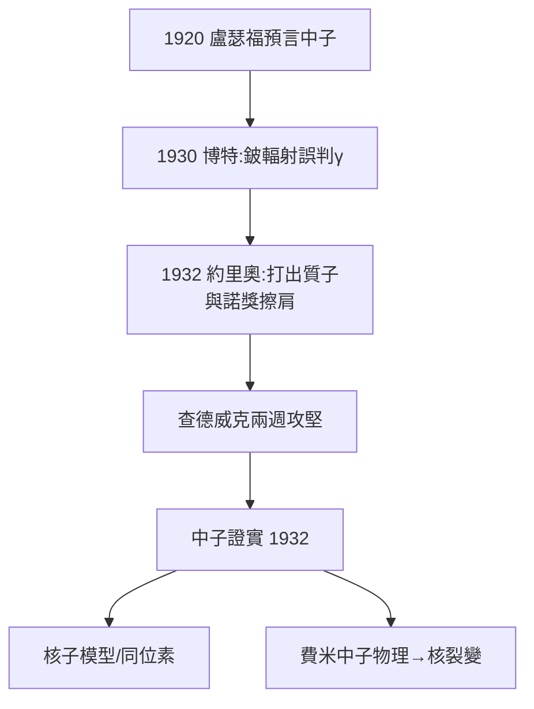

# 3.2 中子的發現：查德威克補上失蹤的一角（1932）

## 一個懸置十二年的難題

1920 年盧瑟福提出假設：質子與電子可能緊密結合成一個電中性的粒子——「中子」。十二年間，實驗室多次搜尋都告失敗。

線索其實早已出現：

- 1930 年，德國博特（Bothe）用 $\alpha$ 粒子轟擊鈹，得到一種穿透力極強的「輻射」，誤判為 $\gamma$ 射線；
- 1932 年初，約里奧-居里夫婦（Joliot-Curies）證明這種輻射能把石蠟中的質子打出來——如果它是 $\gamma$ 射線，能量大得違反常理。他們與諾貝爾獎擦肩而過。

## 查德威克的兩週攻堅

詹姆斯・查德威克（James Chadwick）是盧瑟福的老部下（曼徹斯特時代就一起工作），讀到約里奧的論文後，立刻意識到這就是老師預言的中子。在兩週多的密集實驗中，他用雲霧室與各種靶核系統量測反沖質子與反沖氮核的能量，證明這種輻射不是光子，而是質量接近質子的**中性粒子**：

$${}^{9}\mathrm{Be} + \alpha \rightarrow {}^{12}\mathrm{C} + n$$

1932 年 2 月，論文發表於《自然》。查德威克獲 1935 年諾貝爾物理學獎。

## 中子改寫了什麼

1. **原子核的組成**：核 = 質子 + 中子（海森堡隨即建立核子模型）；
2. **同位素的解釋**：質子數同、中子數異；
3. **新的炮彈**：中子不帶電、不受核電場排斥，費米隨即用它轟擊元素，開啟中子物理——通向核裂變與原子時代的鑰匙。

**因果**：博特與約里奧的「誤讀」為查德威克提供了子彈，盧瑟福十二年的假設提供了獵槍。而卡文迪許「相信直覺＋立刻動手」的文化，讓查德威克在別人猶豫時搶先補上了週期表之上最後一塊拼圖。
