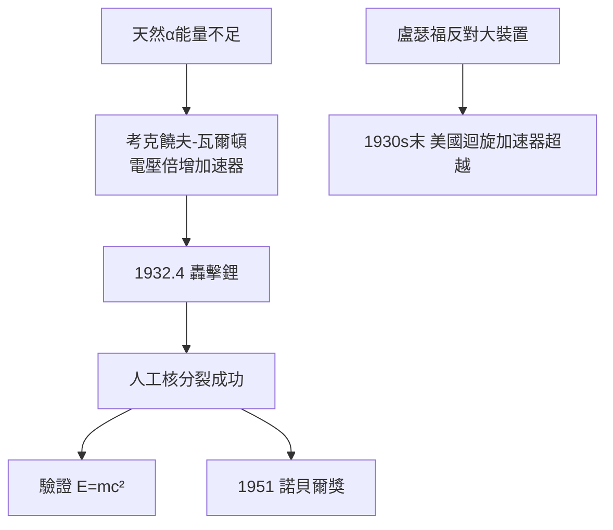

# 3.3 劈開原子核：考克饒夫—瓦爾頓的加速器（1932）

## 為什麼需要「大炮」

$\alpha$ 粒子（天然放射源）能量有限，只能打到輕元素。要系統地轟擊各種原子核，必須有**人工加速器**。但當時美國的勞倫斯正發展迴旋加速器，歐洲的電壓倍增技術也被視為工程難題。

## 兩個工程師型的物理學家

約翰・考克饒夫（John Cockcroft）是電機工程師出身，Ernest Walton（歐內斯特・瓦爾頓）則是愛爾蘭理論學者。盧瑟福讓他們放手去造「質子炮」：

- 考克饒夫—瓦爾頓**電壓倍增電路**：用電容與整流器把幾百 kV 疊加到約 700 kV；
- 目標最初定為氫（質子），1932 年 4 月改打鋰。

1932 年 4 月 14 日，瓦爾頓在閃爍屏上看到熟悉的閃爍：質子轟入鋰靶，打出**兩個 $\alpha$ 粒子**：

$${}^{7}\mathrm{Li} + p \rightarrow 2\,{}^{4}\mathrm{He}$$

$Q$ 值約 17.3 MeV，與愛因斯坦質能關係 $E=mc^2$ 的預言精確吻合——**第一次用人工加速粒子驗證了質能等價**。

## 諾貝爾獎與先機的得失

考克饒夫與瓦爾頓獲 1951 年諾貝爾物理學獎。但歷史對卡文迪許也提出了批評：

- 盧瑟福對「大科學」持保留態度，不願投資更大加速器；
- 1930 年代末，美國勞倫斯的迴旋加速器後來居上；
- 1930 年代末，核物理的中心開始向美國轉移。

**因果**：查德威克的中子（1932 年 2 月）與考克饒夫—瓦爾頓的質子炮（1932 年 4 月）先後問世，卡文迪許在一年之內完成了原子核物理的兩大奠基。然而盧瑟福的「小科學」品味埋下了隱患——戰後，實驗室必須用別的方式找回優勢。
