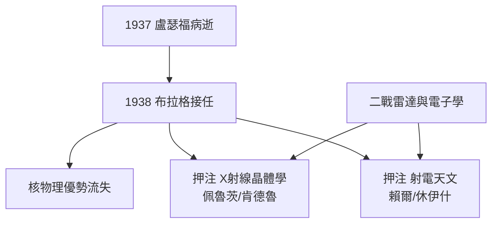

# 4.1 布拉格接任：盧瑟福之後的轉向（1938–1953）

## 群雄爭奪的椅子

1937 年 10 月盧瑟福病逝。候選人中包括勞倫斯、湯姆生（J. J. 之子 G. P. 湯姆生，電子繞射發現者）、以及 **W. L. 布拉格**（William Lawrence Bragg，X 射線結晶學開創者，1915 年諾貝爾物理獎最年輕得主）。1938 年，布拉格勝出。

## 一次「換血」式的人事

布拉格面臨的現實：核物理的頂尖人力已被戰爭與美國吸走，實驗室設備也遠不如戰後的美國加速器中心。與其硬拼核物理，布拉格做出兩項人事佈局：

1. **支持 J. D. 貝爾納與馬克士威·佩魯茨的 X 射線晶體學小組**（後發展為 MRC 分子生物學單元）；
2. **支持馬丁·賴爾（Martin Ryle）把戰時雷達技術轉向射電天文**。

「把蘋果樹嫁接在別的砧木上」——布拉格後來這樣形容自己的策略：不砍掉核物理，而是開闢兩片新的果園。

## 戰爭的饋贈

第二次世界大戰給了這兩項轉向意外的嫁接枝條：

- **雷達** → 微波技術、天線陣列 → 射電望遠鏡；
- **電子學與計算** → 自動化數據處理 → 蛋白質晶體學的傅立葉分析；
- **同位素追蹤與抗生素** → 生物化學的需求高漲。

**因果**：如果布拉格沿用盧瑟福的「全室核物理」路線，卡文迪許將在戰後加速器競賽中被美國碾壓。正因為他敢於把賭注押在兩個「非主流」方向上，才有了 1953 年的 DNA 雙螺旋與 1967 年的脈衝星——實驗室的第二、第三次黃金時代。
