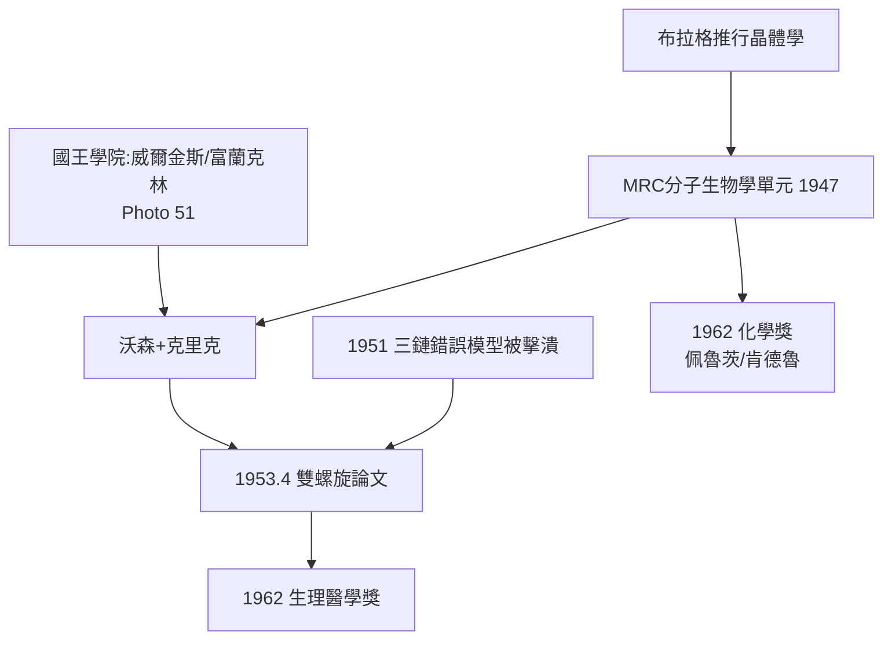

# 4.2 分子生物學的誕生：DNA 雙螺旋（1953）

## 從晶體學到生命

布拉格與父親 W. H. 布拉格早在 1912–15 年就用 X 射線解析了食鹽與金剛石結構。到卡文迪許後，他把這門「看見原子」的技術推向最難的目標——**蛋白質與核酸**。

1947 年，醫學研究委員會（MRC）在卡文迪許內設立「分子生物學研究單元」，由佩魯茨（Max Perutz）主持，肯德魯（John Kendrew）副之。1951 年，23 歲的美國青年沃森（James Watson）以博士後身分加入；同期，劍橋的克里克（Francis Crick）是單元內的博士生。

## 兩條賽道的競爭

- **倫敦國王學院**：威爾金斯（Maurice Wilkins）與羅莎琳・富蘭克林（Rosalind Franklin）拍攝高質量 DNA 的 X 射線繞射照片；
- **卡文迪許**：沃森與克里克以模型建造法推測結構。

1953 年 2 月，沃森看到富蘭克林的 **Photo 51**（B 型 DNA 繞射圖），掌握螺距、直徑與鹼基朝向的關鍵數據；克里克則憑晶體學知識（與考克倫的螺旋變換理論）算出雙鏈反向平行。1953 年 4 月 25 日《自然》發表三人論文：**DNA 是雙螺旋**。

## 「著名的錯誤模型」文化

1951 年底，沃森與克里克曾提出一個三鏈錯誤模型，被同行（包括訪問的鮑林觀點反推與富蘭克林數據）當場擊潰。卡文迪許的文化是：**錯誤模型公開受審，推倒重來不丟臉**。沒有這次失敗，就沒有次年正確模型的躍遷。

## 結局的獎賞與遺憾

1962 年，沃森、克里克、威爾金斯共享諾貝爾生理學或醫學獎。富蘭克林 1958 年死於癌症，年僅 37 歲，與諾獎無緣。佩魯茨與肯德魯則因肌紅蛋白與血紅蛋白結構獲 1962 年化學獎——同一棟樓同一年出了兩個獎。

**因果**：布拉格的轉向（4.1）→ 晶體學單元落戶 → 錯誤模型的公開批評文化 → 與國王學院的數據共享（競爭中合作）→ 1953 年雙螺旋。這是物理學直接孕育分子生物學革命的時刻，也是卡文迪許第一次「跨界稱王」。
