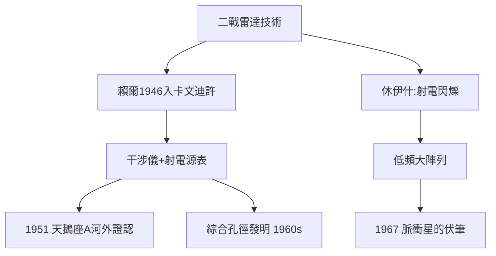

# 4.3 射電天文學的萌芽：賴爾與休伊什（1946–1957）

## 雷達工程師的轉行

馬丁・賴爾（Martin Ryle）戰時在英國電信研究所（TRE）從事雷達干擾與天線設計。1946 年他來到卡文迪許，帶著一個念頭：既然雷達能探測飛機，為什麼不能用同樣的天線技術「看」宇宙？

卡文迪許當時窮得連一台像樣的雷達天線都要自己焊。賴爾的團隊用報廢的德國雷達天線、防空炮的轉向裝置與借來的電子管，在劍橋郊外堆出了第一批射電望遠鏡。

## 演化學：從干涉儀到綜合孔徑

賴爾的核心問題：射電源是什麼？分布在哪裡？

1. **1940s 末**：發現太陽射電爆發（與海伊等人競爭）；
2. **1950s**：與休伊什（Antony Hewish）發展**干涉儀**，編製劍橋射電源表（1C、2C、3C……）；
3. **關鍵爭論（1951）**：3C 源是銀河系內還是河外？哈勃學派的巴德與明科夫斯基用 200 吋望遠鏡證認天鵝座 A 是**河外星系**——射電天文從此連接上宇宙學；
4. **1959–1962**：賴爾發明**綜合孔徑**（aperture synthesis）——用移動的天線陣列「合成」一面巨鏡，徹底解決解析度問題。

## 另一條線：閃爍

休伊什注意到射電源的「閃爍」（scintillation），起源於太陽風對無線電波的擾動。他推測：**角徑極小的源**閃爍最強。為搜尋這種「點源」，他設計了大面積低頻陣列，讓博士生喬絲琳・貝爾（Jocelyn Bell）負責觀測——1967 年，這台望遠鏡將撞見脈衝星（見 5.1）。

**因果**：戰爭把微波與天線技術「送」給了和平年代，布拉格（4.1）給了這群工程師出身的學者一個家。賴爾的源表為宇宙學提供新樣本，休伊什的閃爍研究則在無意間為脈衝星布下陷阱——射電天文將成為實驗室下一波諾獎的主產區。
