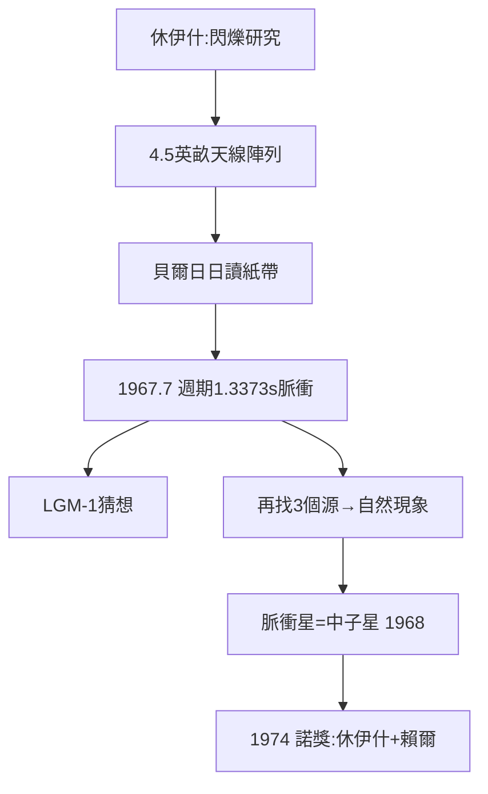

# 5.1 脈衝星的發現：貝爾與休伊什（1967）

## 一台「閃爍望遠鏡」

為偵測類星體等小角徑射電源的閃爍，休伊什設計了一台工作在 81.5 MHz 的偶極天線陣列——**面積 4.5 英畝、2048 根偶極子、每 100 毫秒記錄一次全天空流量**。建造與操作落在博士生喬絲琳・貝爾（Jocelyn Bell）肩上：拉電纜、釘木樁、日復一日分析一米高的紙帶記錄。

## 「小綠人」

1967 年 7 月底，貝爾在紙帶上注意到一小段「背景雜訊」：一串嚴格週期 1.3373 秒的脈衝。排除地球干擾、排除衛星、確認恆星時跟蹤後，她得到結論——信號來自固定天區，且精確得像一台宇宙時鐘。

實驗室的內部反應極具卡文迪許特色：

- 有人半開玩笑稱之為 **LGM-1（Little Green Men，小綠人）**——若是外星文明的信號呢？
- 休伊什的第一反應是懷疑儀器，第二反應是「那就找出更多」；
- 貝爾很快又找到 3 個類似源——宇宙尺度的自然現象，不是 LGM。

1968 年 2 月《自然》發表，命名為**脈衝星**（pulsar）。理論隨即跟上：這是快速自轉、帶極強磁場的**中子星**——巴德與茲威基 1934 年的預言成真，也是超新星爆發的殘骸。

## 諾貝爾獎與它的爭議

1974 年，休伊什與賴爾（表彰綜合孔徑）共享諾貝爾物理學獎；貝爾（時已婚，名 Joceyn Bell Burnell）未列名。這成為科學史上關於「誰發現」最著名的爭議之一。貝爾的回應寬和：她說若當時是研究生不獲獎是常態，並持續呼籲重視青年研究者的貢獻。

**因果**：沒有賴爾的射電線路與休伊什的閃爍理論（4.3），就沒有這台望遠鏡；沒有貝爾近乎苦行式的讀帶與「不放過異常」的訓練，脈衝星至少要晚幾年才會出現。而脈衝星反過來為廣義相對論檢驗與引力波間接探測（雙脈衝星）提供了天體實驗室。
