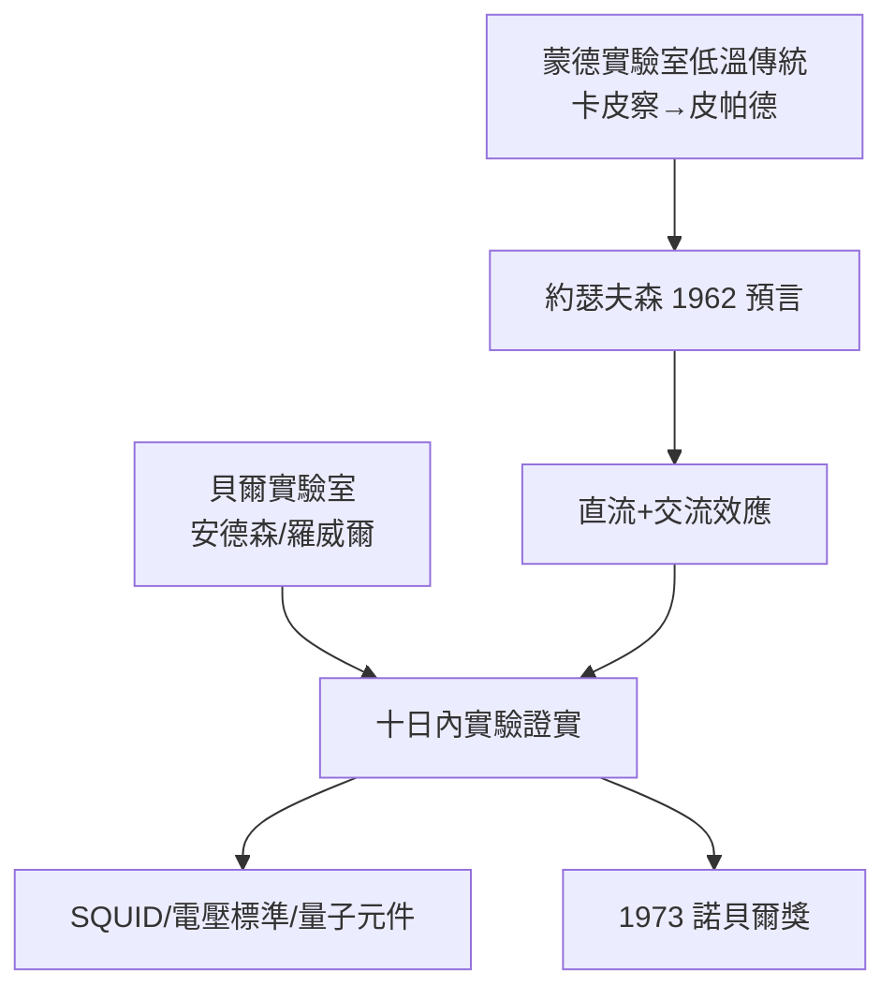

# 5.2 約瑟夫森效應與超導的新世界（1962）

## 一個 22 歲研究生的「荒謬」預言

布萊恩・約瑟夫森（Brian Josephson）1930 年代出生的劍橋人（生於 1940 年威爾斯），1960 年代初在卡文迪許攻讀博士，師從蒙德實驗室低溫學派的皮帕德（Brian Pippard）。

1962 年，22 歲的約瑟夫森在計算兩塊超導體夾一層薄絕緣層（約瑟夫森結）的電流時，得出兩個違背直覺的結論：

1. **直流約瑟夫森效應**：不加電壓，也有超導電流穿透絕緣層；
   $$I = I_c \sin\varphi$$
2. **交流約瑟夫森效應**：加直流電壓 $V$ ，結會輻射頻率為
   $$f = \frac{2eV}{h}$$
   的電磁波。

## 貝爾實驗室的十日證實

理論發表後，貝爾實驗室的安德森（P. W. Anderson，當時在劍橋訪問，與約瑟夫森有過討論）與羅威爾（John Rowell）很快在實驗中看到電流階梯——十天內證實。兩派人馬（劍橋的理論 + 美國的實驗）共同完成了這次發現。

## 一個效應，多個產業

- **SQUID（超導量子干涉儀）**：磁場測量靈敏到 $10^{-15}$ 特斯拉，用於腦磁圖、大地探測；
- **電壓量子標準**：以 $2e/h$ 定義伏特，接回馬克士威時代的「度量衡」傳統；
- **約瑟夫森結電子學**：超快低功耗邏輯、後來超導量子位元的候選元件。

約瑟夫森獲 **1973 年諾貝爾物理學獎**。

**因果**：1930 年代盧瑟福為卡皮察建的蒙德實驗室（3.1）意外留下一條低溫物理的血脈，三十年後結出約瑟夫森效應——「制度性遺產」有時以最曲折的方式兌現。同時，約瑟夫森效應把電壓測量交還給基本常數，讓卡文迪許回到馬克士威「電學標準」的起點，整整繞了一圈。
