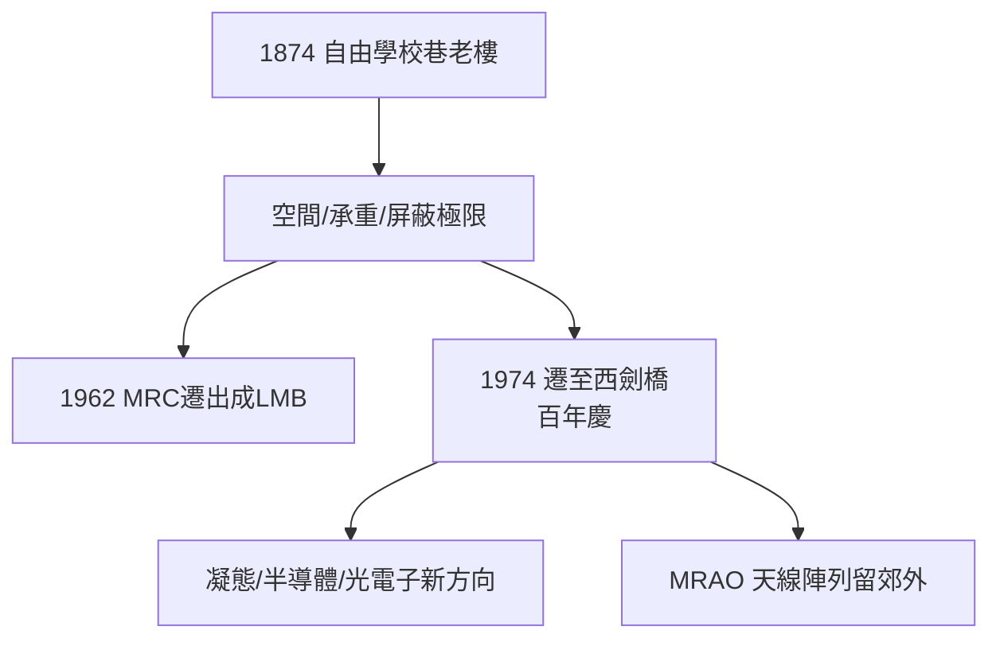

# 5.3 百年遷址：自由學校巷到馬丁・賴爾路（1974）

## 老樓的極限

自由學校巷（Free School Lane）的老卡文迪許，是 1874 年蓋的維多利亞式建築：走廊狹窄、樓板承重有限、沒有屏蔽與恆溫車間。到 1960 年代，它同時塞著射電天文、分子生物學（MRC 單元）、低溫物理、電子顯微鏡組……早已不勝負荷。

結構性的推力來自三個方向：

1. **大科學化**：綜合孔徑望遠鏡與晶體學數據處理需要大型設施與機械車間；
2. **跨界擴張**：MRC 分子生物學單元 1962 年遷往新建的醫學研究委員會大樓（成為獨立的 LMB），騰出空間也標誌著「分家」；
3. **安全與環境**：強磁場、放射源、低溫液氦都讓百年老樓捉襟見肘。

## 新家：西劍橋

1974 年，適逢實驗室**百年慶**，卡文迪許遷入西劍橋馬丁・賴爾路（Madingley Road 旁，後命名 J. J. Thomson Avenue）的新址：

- 多層實驗樓 + 附屬機械與電子車間；
- 射電天文台保留穆拉德射電天文台（Mullard Radio Astronomy Observatory, MRAO）在郊外的天線陣列；
- 半導體物理、超導、光電子等新方向進駐。

## 百年的接力棒

遷址恰似一次家族聚會：湯姆生、盧瑟福、布拉格、莫特（Nevill Mott，第 7 任教授，1977 諾獎）等人代表的五個時代同堂。老樓交給劍橋大學博物館與行政部門，新樓則迎接即將到來的半導體與凝態物理時代。

**因果**：分子生物學的出走（LMB）與新樓的落成，意味著卡文迪許從「包辦一切」轉為「聚焦物理」。此後它不再獨佔頭條，卻以更常態化的方式持續輸出諾獎級成果——莫特（1977）、卡皮察（1978，表彰其 1930 年代在蒙德實驗室的發現）相繼登場。
