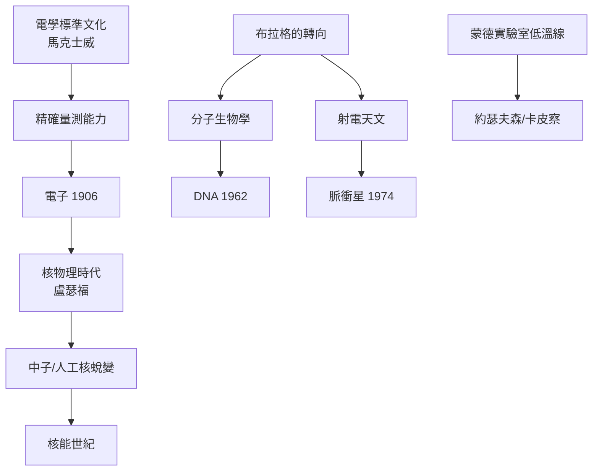

# 6.1 諾貝爾獎的譜系：三十餘座獎章的源流

## 一張家譜

以實驗室為單位統計，卡文迪許相關的諾貝爾獎得主超過 30 人。挑出主幹：

| 年份 | 得主 | 領域 | 任內主任 |
|---|---|---|---|
| 1904 | 瑞利 | 氬的發現 | 瑞利 |
| 1906 | J. J. 湯姆生 | 電子 | 湯姆生 |
| 1908 | 盧瑟福（化學） | 放射性蛻變 | 湯姆生（學生） |
| 1915 | W. L. 布拉格 | X 射線結構 | （後來的第 5 任） |
| 1922 | 阿斯頓 | 質譜與同位素 | 盧瑟福 |
| 1927 | 威爾遜 | 雲霧室 | 湯姆生（學生） |
| 1935 | 查德威克 | 中子 | 盧瑟福 |
| 1948 | 布萊克特 | 核反應雲霧室 | 盧瑟福（學生） |
| 1951 | 考克饒夫、瓦爾頓 | 人工核蛻變 | 盧瑟福 |
| 1962 | 佩魯茨、肯德魯（化學）；沃森、克里克、威爾金斯（生理醫學） | 蛋白質/DNA | 布拉格 |
| 1973 | 約瑟夫森 | 約瑟夫森效應 | 莫特 |
| 1974 | 賴爾、休伊什 | 射電天文/脈衝星 | 布拉格（部屬） |
| 1977 | 莫特 | 非晶態物理 | 莫特 |
| 1978 | 卡皮察 | 低溫物理 | 盧瑟福（部屬） |

## 獎章背後的「驅動鏈」

## 三種「獎章生產模式」

1. **直系成果**：主任任內的直接發現（電子、中子、雙螺旋）；
2. **學生與部屬**：盧瑟福的學生、布拉格的部屬各自得獎——培養者的功勞；
3. **遲到的兌現**：卡皮察 1930 年代的工作要到 1978 年才獲獎；莫特的非晶態理論也屬「存量兌現」。

**因果總結**：諾獎不是目標，而是制度文化的副產品。精確量測 → 新工具 → 新現象 → 新學科，這條鏈條在卡文迪許轉了一百多年。
