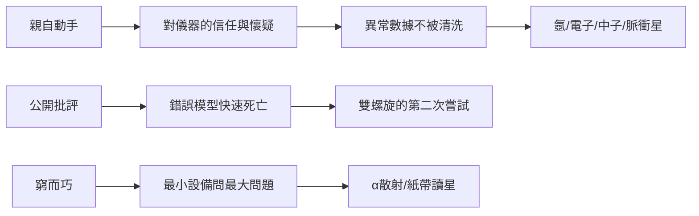

# 6.2 實驗哲學：「手腦並用」的制度文化

## 一句口號的源頭

卡文迪許的靈魂不是某項發現，而是創立時定下的方法論。馬克士威把它寫成樸素的三句話：**自己動手、自由討論、精確至上**。歷任主任以不同方式演繹：

| 主任 | 對文化的加工 |
|---|---|
| 馬克士威 | 立家規；「繩子、蠟與封印」的窮實驗精神 |
| 瑞利 | 制度化教學與誤差不放過 |
| J. J. 湯姆生 | 識人善任；世界學生計畫 |
| 盧瑟福 | 中心課題聚焦；家長式激勵 |
| 布拉格 | 跨界播種；為人才建樓 |
| 莫特 | 凝態物理；理論與實驗並肩 |

## 文化如何「驅動」科學

四個案例足以說明：

1. **氬（1894）**：千分之 0.5 的密度差，凡「誤差文化」薄弱處早被抹平；
2. **中子（1932）**：查德威克讀到約里奧論文當週就開工——「馬上動手」是肌肉記憶；
3. **雙螺旋（1953）**：1951 年的錯誤三鏈模型被茶會辯論擊垮，「丟臉」不是問題，「錯而不改」才是；
4. **脈衝星（1967）**：貝爾在紙帶堆裡不放過 1.3373 秒的異常，靠的是瑞利式「異常即線索」的訓練。

## 與其他學派的對照

- **德國（如柏林）**：儀器精良、教授權威強，學生分工細；
- **美國（戰後）**：資本密集、大設備競賽；
- **卡文迪許**：以最小的設備、最大的自由，賭「人」而不是賭「機器」。

**因果**：文化先於成果——每一次黃金時代，都是先有一代主任把文化加固，才有隨後的獎章潮。制度比天才長壽，這是實驗室百年最深的教訓。
