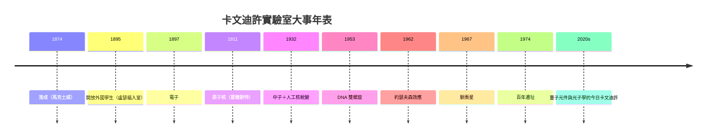

# 6.3 對後世的啟示：實驗室的百年之後

## 從一棟樓到一種模式

1874 年落成時，卡文迪許只是英國大學裡寥寥數座教學實驗室之一；到 20 世紀末，它已成為「研究型實驗室」的世界範本。其模式被全球複製：

- **教學與研究合一**：學生在真問題中成長（德國模式的英國化）；
- **主任即播種者**：馬克士威→湯姆生→盧瑟福→布拉格，每一任都為下一任埋下種子；
- **小實驗室、大問題**：證明「敢問大問題」比「擁有大設備」更根本。

## 給後世的四條教訓

1. **制度先行**：入學開放（1895）招來盧瑟福，MRC 單元（1947）帶來雙螺旋。改變一條規則，常比改變一個人更有效；
2. **擁抱轉向**：布拉格在核物理低谷時押注晶體學與射電天文，說明「轉行」不是失敗而是續命；
3. **善待異常**：氬、中子、脈衝星都藏在「不該存在的訊號」裡；
4. **接受遺憾**：富蘭克林的早逝、貝爾未獲諾獎、卡皮察的二十年遲來表彰——科學共同體的記憶會修正，但代價由個人承擔。

## 餘韻

如果要用一句話總結這棟樓的故事：**它把「實驗」從工匠之藝升格為科學的憲法**。馬克士威在 1874 年種下的三條家規，被瑞利量成標準、被湯姆生散播世界、被盧瑟福錘鍊成鋼、被布拉格嫁接出兩個新學科、被莫特與後繼者帶進量子時代。諾貝爾獎的搖籃，搖的是制度，不是獎章。

**因果閉環**：本書從「劍橋重數學輕實驗」的困境開始，以「實驗成為科學憲法」結束——最初的那個問題（實驗算不算科學？），由實驗室自己的一生給出了答案。
