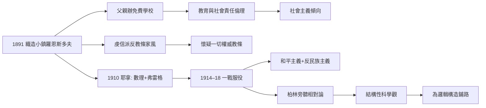
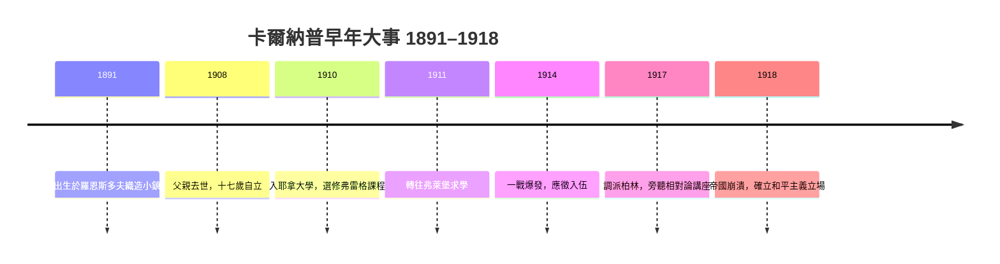

# 1.1 羅恩斯多夫與一戰（1891–1918）

1891 年 5 月 18 日，魯道夫·卡爾納普（Rudolf Carnap）出生於德國西北部伍帕塔爾地區的織造小鎮羅恩斯多夫（Ronsdorf）。這不是一個學術世家，而是一個虔信派（Pietismus）氣息濃厚的織造業家庭——日後成為「邏輯實證主義建築師」的人，起點是紡織機旁的敬虔傳統。

## 織工鎮上的虔信派家庭

- 羅恩斯多夫屬於巴門—埃爾伯費爾德工業帶（今伍帕塔爾），十九世紀末已是德國織造業中心：機器、計量、標準化的氣氛浸透日常生活；
- 虔信派是德國新教內部的改革運動，主張內在的信仰體驗高於教會儀式，強調讀經、自省與社群互助——這是一種「反教條的宗教性」；
- 父親約翰內斯·卡爾納普經營織帶工廠，同時為貧苦兒童創辦免費學校，把「教育是義務」當作家訓；
- 母親安娜·多蘿西亞出身教師世家，親自教導幼年魯道夫，家中藏書以哲學與宗教為主；
- 1908 年父親去世，十七歲的卡爾納普提前學會了自立，也把家族「以工作服務社群」的倫理內化為終身的社會主義傾向。

## 戰前的求學之路

- 卡爾納普先後在巴門文理中學與耶拿的 Gymnasium 就讀，古典語言、數學與物理成績並優；
- 1910 年起進入耶拿大學，主修數學、物理與哲學；
- 同年選修了弗雷格（Gottlob Frege）的課——當時幾乎無人重視這位隱居的邏輯學家，卡爾納普卻被《概念文字》的符號世界擊中（→ 詳見《弗雷格傳記》；本書 1.2）；
- 1911–1914 年間往返耶拿與弗萊堡，在弗萊堡接觸新康德學派的價值哲學，埋下日後「科學 vs 形上學」問題意識的種子；
- 戰前德國的數學物理正是黃金期：希爾伯特的公理化綱領、愛因斯坦 1905 年後的相對論浪潮，都在訓練這一代學生用「結構」而非「實體」思考世界（→ 詳見《希爾伯特傳記》；《愛因斯坦傳記》）。

## 一戰：從士兵到和平主義者

- 1914 年一戰爆發，卡爾納普應徵入伍，此後近四年身在軍旅；
- 戰壞生活讓他親眼目睹帝國動員機器如何吞噬同輩——這是他後來一切和平主義立場的經驗底盤；
- 1917–1918 年間被調派柏林，一邊服役一邊旁聽物理課程，據其自述曾接觸愛因斯坦的相對論講座；
- 正是在相對論中，他確認了一個終身命題：物理學用的是**結構性的數學描述**，而不是關於「物質本質」的圖像——廣義相對論以度規張量 $g_{\mu\nu}$ 描述時空，完全不需要「時空的內在性質」這類形上圖像；
- 這個結論的哲學含義極大：如果連時空都可以純形式化地處理，那麼哲學中關於「世界本質」的爭論，還剩下多少實質內容？
- 1918 年帝國崩潰、戰爭結束，他由愛國青年轉為堅定的和平主義者與社會主義同路人——他一生拒絕任何形態的民族主義，包括 1930 年代的納粹主義（本書 2.3）。

## 性格的底色

- 戰前戰中的經歷塑造了一種罕見的組合：**激進的結論，溫和的作風**；
- 他敢於宣布整個形上學傳統「無認知意義」（本書 2.1），卻從不參與人身論戰；同事回憶他「安靜、整潔、極有耐心，像實驗室裡的技師」；
- 他終身保持工程師式的習慣：精確的時間表、分類完備的通信檔案、對自己著作不斷的修訂——這些習慣日後體現在《構造》的改版、《邏輯句法》的英文增訂、以及歸納邏輯幾十年不斷的參數重估（本書 4.2）；
- 虔信派的內省傳統則留下了另一面：他持續寫私人日記（今天保存在匹茲堡大學檔案館），記錄夢境與情感生活——形式主義者的內心，遠比他的公開著作豐富。

**因果**：虔信派的「反教條」與父親的「教育救濟」是卡爾納普哲學性格的兩塊基石——前者讓他敢於宣布形上學命題「無認知意義」，後者讓他始終相信清晰的語言是公共福祉。而一戰則做了兩件事：政治上把他推向和平主義，思想上把他推向「只有數理結構才可靠」的相對論世界觀。沒有戰爭的幻滅，就沒有後來維也納學派那種近乎道德性的「反形上學」激情（本書 2.1）。

## 關鍵事件年表

| 年份 | 事件 | 後續影響 |
|------|------|----------|
| 1891 | 5 月 18 日生於羅恩斯多夫 | 虔信派家庭背景 |
| 1908 | 父親去世 | 提前自立、社會責任感成形 |
| 1910 | 入耶拿大學，選修弗雷格課程 | 邏輯轉向的起點 |
| 1911–1914 | 往返耶拿與弗萊堡求學 | 新康德派 vs 數理物理的張力 |
| 1914 | 一戰爆發，應徵入伍 | 政治立場轉向和平主義 |
| 1917–1918 | 柏林服役並旁聽物理 | 接受相對論的結構性世界觀 |
| 1918 | 德意志帝國崩潰 | 戰後學術重建的世代登場 |

## 小結

卡爾納普的早年可以概括為「敬虔傳統 × 數理科學 × 戰爭創傷」的三重變奏。虔信派教會他反對外加權威，父親的學校教會他教育理想，弗雷格與愛因斯坦則給了他工具；一戰把三者熔鑄成一種信念：哲學若要對人類有益，必須像科學一樣清晰、像邏輯一樣嚴密。帶著這份信念，他在戰後回到課堂——下一節，是弗雷格與胡塞爾的兩間教室。
