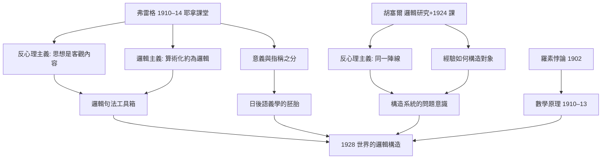
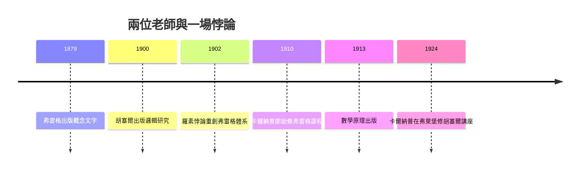

# 1.2 弗雷格與胡塞爾的課堂（1910–1914）

1910 年，十九歲的卡爾納普在耶拿大學走進了一間幾乎空著的教室：講台上是弗雷格（Gottlob Frege）。同時代的哲學生追逐生命哲學與新康德主義，卻沒有人知道，這間冷清教室裡傳授的符號邏輯，將在三十年後統治整個英語世界分析哲學。

## 弗雷格：一間空教室裡的革命

- 1910–1914 年間，卡爾納普修習了弗雷格開設的六門課程，包括「概念文字」（Begriffsschrift）、「邏輯中的方法」等；
- 當時聽課者寥寥數人，據卡爾納普回憶有時僅三四人——哲學系學生嫌它太數學，數學系學生嫌它不夠實用；
- 弗雷格 1879 年的《概念文字》已發明現代量詞記法，把亞里斯多德以來的邏輯改造成一套完整的演算；課堂上他系統陳述了後來《算術基本法則》的核心思想：把算術化約為邏輯的**邏輯主義綱領**；
- 卡爾納普自述從弗雷格那裡得到三件終身武器：
  1. **區分心理與邏輯**——思想不是頭腦裡的事件，而是客觀的、可分析的內容；
  2. **區分對象的指稱與意義**——「晨星」與「昏星」指同一行星但意義不同，這是日後語義學的胚胎（本書 3.3）；
  3. **對「概念」而非「語詞」的敏感**——先弄清概念結構，再談哲學爭論；
- 弗雷格的邏輯主義直接指向羅素：羅素 1902 年的信指出「所有不包含自身的類的類」造成悖論，重創弗雷格的第五公理；《數學原理》（1910–1913）正是對這場危機的回應（→ 詳見《羅素傳記》第 2 章、第 3 章；《弗雷格傳記》）；
- 卡爾納普在課堂上看到的，是一個偉大體系**正在崩塌中的施工現場**——這種「以定理修正信念」的示範，成為他一生的科學人格。

## 胡塞爾：另一條「嚴格科學」的路

- 胡塞爾 1900 年《邏輯研究》是《概念文字》之後對心理主義最著名的批判，兩人共享「反心理主義」陣線：邏輯規律不是關於人腦如何思考的經驗概括，而是關於理想內容的規範；
- 卡爾納普在學生時代即研讀胡塞爾，並在 1924–1925 年於弗萊堡正式修習胡塞爾的講座課——這是《世界的邏輯構造》寫作期間的直接滋養（本書 1.3）；
- 兩人同樣追求「嚴格科學的哲學」，分歧卻是根本的：
  - 胡塞爾往**意向性與現象學還原**走，訴諸第一人稱經驗的描述，最終走向超驗現象學；
  - 卡爾納普往**邏輯構造與句法分析**走，訴諸可符號化的語言規則，最終走向邏輯經驗主義；
- 《邏輯研究》第六研究的「充實」與認識論問題，被卡爾納普用「構造系統」翻譯成另一種語言——這種「吸收骨架、丟棄圖像」的手法，是他一生的方法論簽名；
- 值得注意的是，胡塞爾本人早年也是數學出身、師從布倫塔諾路線的邏輯學家——兩人分裂之處不在起點而在終點：同一個「嚴格性」理想，一個化為描述，一個化為形式系統。

## 戰前德國思想版圖中的位置

- 耶拿當時的哲學主流是新康德主義與費希特傳統（耶拿是德國觀念論的歷史名城），弗雷格只是編制外的數學講師；
- 弗萊堡則由李凱爾特代表西南學派，強調「價值」與「理解」高於自然科學的因果說明——文德爾班「規範科學 vs 規律科學」的二分是當時人文學科的旗幟；
- 卡爾納普恰好橫跨兩個世界：數理物理的「規律科學」訓練，與新康德派的「規範科學」熏陶——日後他對人文學科的態度（同情其價值、懷疑其認知主張）正來自這種雙重浸泡；
- 同時代的維根斯坦在劍橋隨羅素研究，兩條邏輯血脈——耶拿的弗雷格線與劍橋的羅素線——將在維也納匯合（→ 詳見《維根斯坦傳記》第 1 章；本書 2.1）。

**因果**：兩位老師各自「單兵作戰」式地反對心理主義，卡爾納普把他們焊接成一條生產線。弗雷格的課堂在當時幾乎無人問津，卻因卡爾納普這一個學生而間接改寫了二十世紀哲學——沒有弗雷格的耶拿，就沒有維也納學派的邏輯工具箱；沒有胡塞爾的《邏輯研究》，就沒有《構造》一書「從經驗出發」的雄心。而弗雷格↔羅素↔維根斯坦這條邏輯血脈（→ 詳見《維根斯坦傳記》第 1 章），將在維也納的星期四聚會上匯流（本書 2.1）。

## 關鍵事件年表

| 年份 | 事件 | 後續影響 |
|------|------|----------|
| 1879 | 弗雷格出版《概念文字》 | 現代量詞邏輯誕生 |
| 1900 | 胡塞爾出版《邏輯研究》 | 反心理主義綱領確立 |
| 1902 | 羅素致信弗雷格提出悖論 | 邏輯主義危機開場 |
| 1910 | 卡爾納普開始修弗雷格課程 | 邏輯主義洗禮 |
| 1910–1913 | 羅素、懷特海出版《數學原理》 | 邏輯主義綱領的高峰 |
| 1910–1914 | 修畢弗雷格六門課 | 掌握概念文字與邏輯分析 |
| 1924–1925 | 弗萊堡修胡塞爾講座 | 直接滋養《構造》寫作 |

## 小結

1910–1914 的兩間教室，是卡爾納普哲學的「雙親」：弗雷格給形式，胡塞爾給地基。弗雷格本人的體系因羅素悖論而搖搖欲墜，卻在卡爾納普手中以「邏輯句法」的形式轉世（本書 2.2）；胡塞爾的現象學被他抽掉意向性圖像後，化為構造系統的認識論骨架。戰爭打斷了這段求學（本書 1.1），但工具已經到手——戰後他將用它們建造二十世紀最雄心勃勃的哲學工程。
