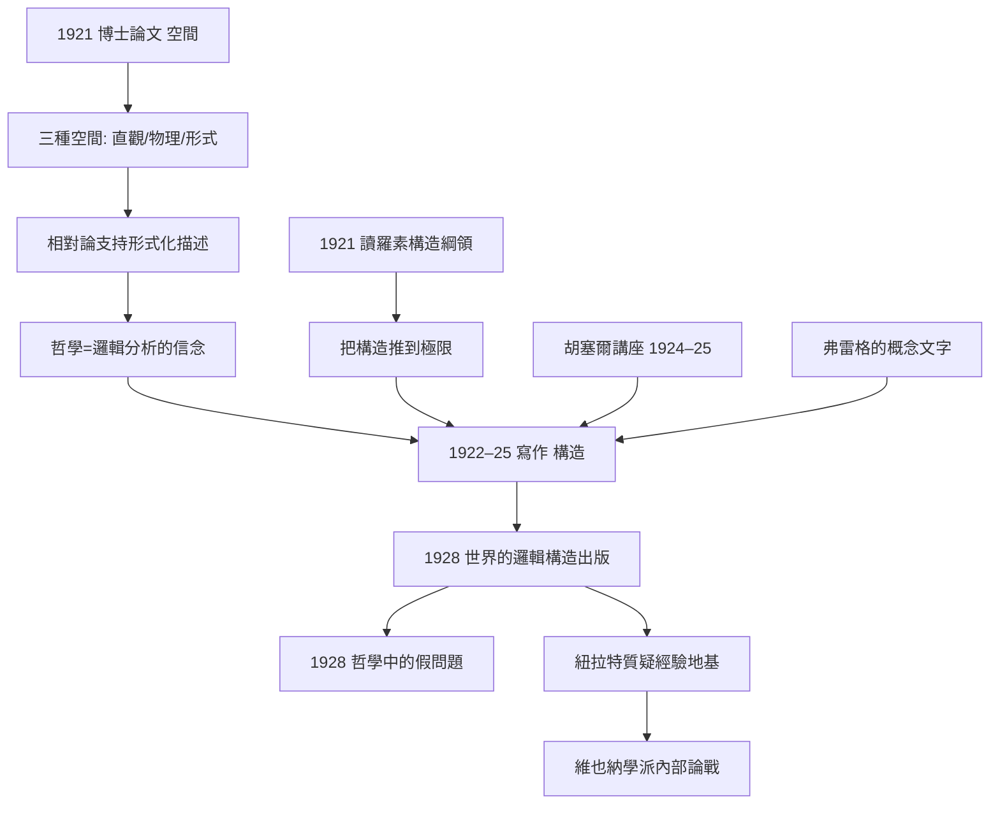
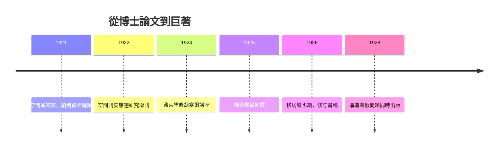

# 1.3 博士論文與邏輯構造（1921–1928）

一戰結束後，卡爾納普回到校園。1921 年他在耶拿以《空間》（Der Raum）取得博士學位，隨後用五年時間寫出二十世紀哲學最雄心勃勃的著作之一：《世界的邏輯構造》（Der logische Aufbau der Welt，1928）。這六年，把弗雷格的工具與胡塞爾的問題，焊成了一部「認識論的機器」。

## 《空間》：三種空間的博士論文

- 1921 年博士論文《空間》，指導教授為新康德學派的布魯諾·鮑赫，1922 年作為《康德研究》增刊出版；
- 核心區分了三種空間，各屬不同的認識論地位：

$$\text{直觀空間（現象的）} \;\neq\; \text{物理空間（經驗的）} \;\neq\; \text{形式空間（數學的）}$$

- 直觀空間屬於現象學描述的層面（胡塞爾的路），物理空間屬於經驗科學，形式空間則是純粹公理系統——例如非歐幾何中平行公理成立與否，與直觀無關；
- 這篇論文的方法論結論是：**康德式的先驗直觀對物理空間已無必要**，愛因斯坦 1915 年的廣義相對論以黎曼幾何 $g_{\mu\nu}$ 描述時空，正是「形式空間與物理空間脫鉤」的勝利（→ 詳見《愛因斯坦傳記》）；
- 對康德主義者而言這是釜底抽薪：康德把歐氏幾何當作先驗綜合判斷的範例，而相對論證明了經驗物理學可以在非歐幾何中運行無礙；
- 指導教授鮑赫是民族主義者，卡爾納普卻在學術上越走越「去德意志化」——師生歧路在 1933 年變成政治對立（本書 2.3）。

## 轉折：讀到羅素的「對外在世界的證明」

- 卡爾納普自述，1921 年前後讀到羅素《哲學問題》中外在世界邏輯構造的綱領，如同雷擊：「哲學也可以這樣做！」（→ 詳見《羅素傳記》第 2 章）；
- 羅素 1914 年《我們關於外在世界的知識》提出：用邏輯構造（logical construction）代替因果推理，把對象定義為經驗的邏輯函項；
- 卡爾納普把這個綱領推到極限：不只構造外在世界，而是**從第一人稱經驗出發，構造出自我、他人、物理世界與整個知識系統**；
- 技術工具是「準分析」（Quasianalyse）與「相似圈」（Ähnlichkeitskreis）：在只有相似關係、尚無精確性質的經驗流中，用疊代分組構造出最初的可辨識單位——類似於在只給定等價關係 $\sim$ 時重構商集：

$$a \sim b \;\Rightarrow\; [a]_{\sim} \text{ 為構造出的「性質類」}$$

- 為什麼構造必須從「相似」而不是「相同」開始？因為原初經驗中沒有嚴格的同一性，只有重疊的質感——這正是現象學描述層面的實情，卡爾納普把它轉譯成了關係邏輯的課題。

## 《世界的邏輯構造》（1928）

- 1922–1925 年在耶拿近郊寫作，1926 年隨遷居維也納修訂，1928 年出版；
- 基底選擇「自心理學的」經驗流（基本要素：原初經驗；基本關係：部分相似記憶），再把他人心理、物理世界逐層構造出來——這是方法論的**單子論時刻**，靈感可上溯萊布尼茨與胡塞爾；
- 為何選「我的經驗」而非「物理對象」？因為構造必須有最小、最直接給定的起點——這一選擇後來引發紐拉特的著名反對：「我們像水手在大海上修船，沒有中性的經驗地基」（本書 2.1）；
- 《構造》與同年出版的《哲學中的假問題》（Scheinprobleme in der Philosophie）互為表裡：後者宣布「實在論 vs 觀念論」之類爭論是**偽問題**——因為一旦構造完成，兩種立場對一切可檢驗命題給出相同結果；
- 「整個世界」不是被描寫，而是被**邏輯地構造**——哲學從此從「世界觀之爭」變成「構造方法的技術選擇」；
- 此書一出版即成為維也納學派的技術旗幟：費格爾回憶，年輕一代終於看到「哲學可以像科學一樣有進度」。

## 構造綱領的兩面性

- **批判面**：它證明傳統認識論（自我 vs 世界、內部 vs 外部）大多是構造方式的錯覺——同樣的語句網絡可以「現象主義式」也可以「物理主義式」地翻譯，二者並無實質衝突；
- **建設面**：它給出可操作的規則——任何哲學主張若無法在構造系統中定位，就應視為待清理的殘渣；
- 這兩面在維也納學派中分別被繼承：批判面走向反形上學宣言（本書 2.1），建設面走向統一科學的語言計畫；
- 而單子論式的起點（我的經驗）與社會主義的公開立場之間的張力，也在紐拉特那裡被挑明：認識論的起點是不是太「資產階級個人主義」了？這場爭論將推動卡爾納普走向語言主義（本書 2.2）。

**因果**：《空間》證明「物理世界可用純形式描述」，《構造》則反過來問「經驗能構造出多麼豐富的對象世界」。一退一進之間，卡爾納普完成了從康德式問題到邏輯式問題的置換：哲學不再問「認識如何可能」，而問「給定語言與基本關係，對象如何被定義」。前一半成功地把科學哲學形式化；後一半則立刻在維也納遭到紐拉特與維根斯坦兩種方向的夾擊——這場夾擊正是下一章的引擎。

## 關鍵事件年表

| 年份 | 事件 | 後續影響 |
|------|------|----------|
| 1921 | 博士論文《空間》完成，獲耶拿博士學位 | 三種空間的認識論區分 |
| 1921 | 讀羅素構造綱領 | 《構造》的動機來源 |
| 1922 | 《空間》刊於《康德研究》增刊 | 進入學術界視野 |
| 1922–1925 | 寫作《世界的邏輯構造》 | 邏輯構造工程的成形 |
| 1924–1925 | 弗萊堡修胡塞爾講座 | 現象學骨架的直接滋養 |
| 1926 | 移居維也納，修訂書稿 | 進入石里克小組（本書 2.1） |
| 1928 | 《構造》與《假問題》出版 | 邏輯實證主義的奠基文本 |

## 小結

1921–1928 年，卡爾納普完成了兩件事：用一篇博士論文把「空間」從康德先驗論解放為形式科學；用一部巨著把羅素的構造綱領推成完整的認識論系統。《構造》是整個邏輯實證主義的建築藍圖——但它剛落成，就在維也納被兩種力量挑戰：維根斯坦的神秘主義與紐拉特的整體主義。建築師因此被迫改建地基，而這次改建，產出了 1934 年《語言的邏輯句法》（本書 2.2）。
