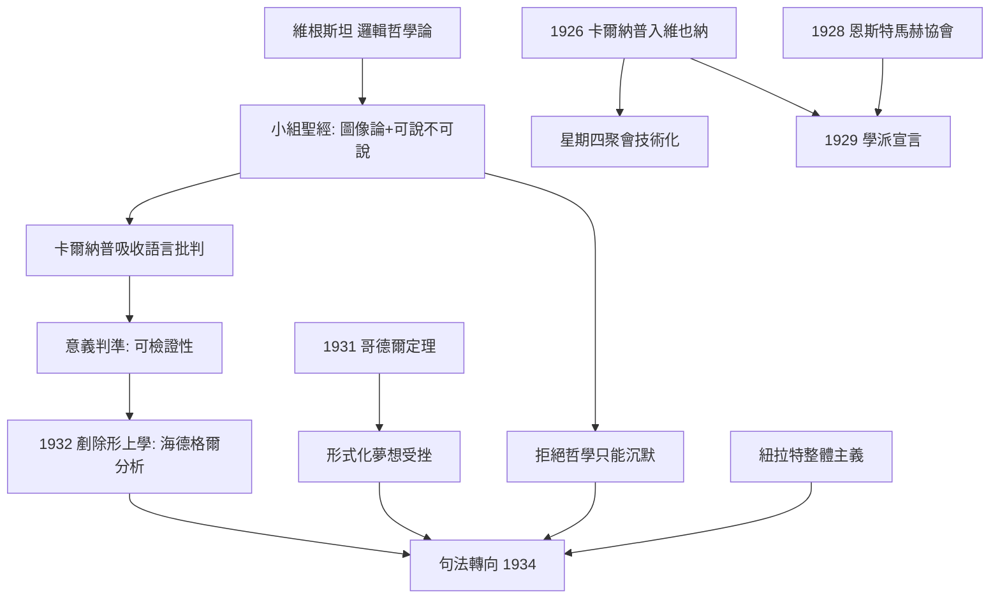
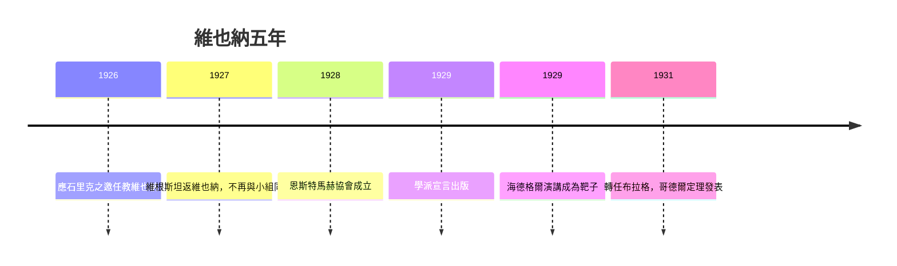

# 2.1 石里克小組的靈魂（1926–1929）

1926 年秋，摩里茨·石里克（Moritz Schlick）把卡爾納普請到維也納大學任教。此後五年，卡爾納普成為「石里克小組」——後世所稱**維也納學派**——的技術靈魂。小組的星期四聚會、1929 年的宣言、以及與維根斯坦的糾葛，都與這位沉默而多產的德國人密不可分。

## 星期四之夜：一個小組的運轉

- 石里克自 1924 年起主持週四晚上的討論會，卡爾納普 1926 年加入後，小組的焦點從「科學基礎」轉向「邏輯與語言」；
- 核心成員各據一方：石里克（主席、物理哲學）、漢恩（Hahn，數學）、紐拉特（Neurath，社會科學）、費格爾（Feigl）、魏斯曼（Waismann）、門格爾（Menger）、以及總是在角落傾聽的哥德爾（→ 詳見《希爾伯特傳記》關於哥德爾的段落）；
- 聚會的慣例是逐段精讀一本書：維根斯坦《邏輯哲學論》、彭加勒《科學與假設》、休謨《人性論》——讀書會的形式決定了學派「以文本而非以宗師為中心」的民主氣質；
- 小組的聖經是維根斯坦 1921 年的《邏輯哲學論》：命題是事實的圖像、可說與不可說之分、邏輯是命題的框架（→ 詳見《維根斯坦傳記》第 2 章）；
- 但卡爾納普與維根斯坦個性與哲學全面相剋：維根斯坦要求討論止於倫理與神秘，卡爾納普則想**把不可說者也形式化地說出來**。維根斯坦 1927 年前後只願意與魏斯曼、石里克單獨見面，拒絕再與小組同席；
- 卡爾納普在自傳中承認：從維根斯坦那裡吸收了「哲學問題源於語言誤用」的洞見，卻拒絕「哲學只能沉默」的結論——這場拒絕產出了他的句法轉向（本書 2.2）。

## 反形上學：海德格爾事件

- 1929 年，海德格爾發表演講《什麼是形上學？》，宣告「無」本身在作祟、「無無著」（Das Nichts nichtet）；
- 1932 年卡爾納普發表《透過語言的邏輯分析剷除形上學》，把這句話送進邏輯解剖室：德語允許把動詞「無」實詞化，於是產生了**合乎語法卻毫無認知意義**的句子；
- 判準是可檢證性（Verifiability）：一個命題要有認知意義，原則上必須能描述什麼觀察會證實或否證它——「無無著」對任何觀察都無所說；
- 這篇攻擊不是私人恩怨，而是小組綱領的極端化：既然意義=證實方法，那麼神學、倫理學、海德格爾與傳統形上學同屬一個「被排除的俱樂部」；
- 諷刺的是，羅素與摩爾在劍橋對黑格爾的反叛用了三十年（→ 詳見《羅素傳記》第 1 章），維也納學派用一篇論文完成了同樣的清場；
- 也必須記錄其代價：可檢證性判準在 1930 年代被證明自身面臨「全稱定律無法被有限觀察證實」的困難，小組內部遂有韓培爾等人的逐步弱化——教條從未凝固，這正是這個學派比其漫畫形象更可取之處。

## 1929：學派的誕生與告別

- 1928 年小組成立「恩斯特·馬赫協會」，以實證主義傳統為正統；
- 1929 年 9 月，趁石里克獲聘重返維也納之機，小組出版《維也納學派：科學的世界觀》宣言，署名為卡爾納普、漢恩、紐拉特；
- 宣言把血統上溯到馬赫、彭加勒、弗雷格、羅素、愛因斯坦，並公開宣布立場：**經驗主義 + 邏輯分析**，反形上學、反先驗綜合；
- 同年，維根斯坦回歸哲學並公開與《邏輯哲學論》的舊立場決裂，小組的「聖經」開始鬆動——而 1931 年哥德爾不完全性定理更重創了小組「把數學化約為可判斷形式系統」的夢想；
- 1931 年，卡爾納普接受布拉格德意志大學自然哲學教席離開維也納——不是逃離學派，而是把學派的方法帶往下一站。

## 小組內部的三條裂縫

- **維根斯坦的沉默主義**：倫理、美、生命的意義「不可說」——卡爾納普認為這些領域應交給藝術與生活，哲學對其閉嘴沒有錯，但把「不可說」當成哲學成就則是誤導；
- **紐拉特的整體主義**：沒有中性的經驗法庭，只有語句網絡的相互調整——這直接威脅《構造》的單子論起點；
- **哥德爾的定理**：任何足夠豐富的一致形式系統都有不可判定命題——「用一種完美邏輯終結哲學」的夢想數學上不可能；
- 卡爾納普對三條裂縫的回應構成他 1930 年代的全部工作：面對第一條，把「可說」的疆域擴大到元語言（本書 2.2）；面對第二條，承認語言選擇的相對性並把它變成原則（容受原則，本書 2.2）；面對第三條，把邏輯多元主義制度化。

**因果**：維也納五年，是《構造》與《邏輯哲學論》的正面相撞。維根斯坦說邏輯是語言的邊界，牆外是倫理與神秘；卡爾納普則認為牆外的部分多半是**語法幻覺**，牆內的部分應交給科學。這場相撞逼出了兩件大事：對形上學的語法解剖（1932），與對「哲學=句法」的系統化（1934，本書 2.2）。而宣言把小組命名為「學派」的那一刻，也把這場奧地利思想實驗推向了世界——儘管十年內，政治將把整個學派連根拔起（本書 2.3）。

## 關鍵事件年表

| 年份 | 事件 | 後續影響 |
|------|------|----------|
| 1926 | 應石里克之邀任教維也納 | 進入小組核心 |
| 1926–1929 | 週四聚會的技術化時期 | 學派方法定型 |
| 1927 | 維根斯坦返維也納，與小組若即若離 | 聖經權威鬆動 |
| 1928 | 恩斯特·馬赫協會成立 | 學派組織化 |
| 1929 | 《維也納學派》宣言（卡爾納普、漢恩、紐拉特） | 學派正式命名 |
| 1929 | 海德格爾《什麼是形上學？》 | 反形上學的靶子 |
| 1931 | 卡爾納普轉任布拉格；哥德爾定理發表 | 句法計畫接棒 |

## 小結

1926–1929 年，卡爾納普從外來者變成學派的技術心臟：他提供可檢證性判準的邏輯骨架、宣言的理論框架，以及對維根斯坦「忠實而全面的背叛」。小組內部的三條裂縫——維根斯坦的沉默主義、紐拉特的整體主義、哥德爾的定理——沒有擊垮他，反而把他推向更精確的問題：**如果哲學不是學說，而是一種對語言的處理，那麼它需要什麼樣的理論？**答案寫在 1934 年。
