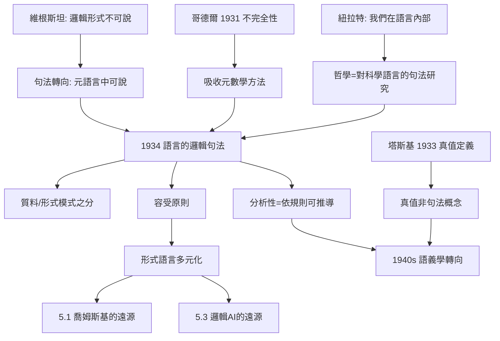
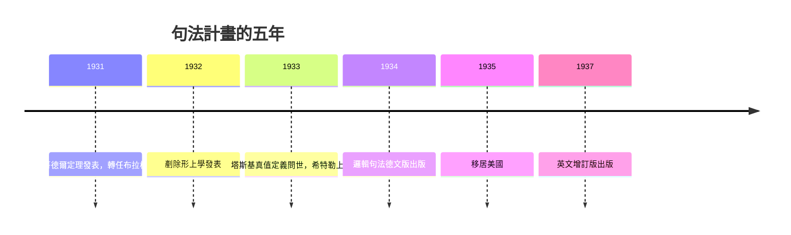

# 2.2 語言的邏輯句法（1934）

1934 年，卡爾納普在布拉格出版《語言的邏輯句法》（Logische Syntax der Sprache）。這是他被引用最多的單一著作，也是「哲學作為句法」宣言的完成。它誕生於學派危機（維根斯坦的沉默、哥德爾的定理、納粹的陰影），卻意外成為日後形式語言理論、生成語法乃至計算機科學的概念母體之一（本書第 5 章）。

## 背景：三重危機逼出句法轉向

- **維根斯坦之牆**：《邏輯哲學論》說語言的邏輯形式「不可說」，只能顯示——卡爾納普反其道而行：如果我們有一門關於語言的科學，邏輯形式就**可以說**（本書 2.1）；
- **哥德爾之雷**：1931 年不完全性定理證明，足夠豐富的形式系統中存在不可判定命題。小組「邏輯一勞永逸」的夢想破產，但哥德爾的方法——**算術化、元數學、形式系統的自我指涉**——被卡爾納普全盤吸收（→ 詳見《希爾伯特傳記》關於哥德爾的段落）；
- **紐拉特之疑**：紐拉特拒絕《構造》的中性經驗地基，主張語句之間只有句法關係、「我們永遠在語言內部」——卡爾納普把這個哲學立場翻譯成技術綱領；
- 三重壓力的交集指向同一結論：**哲學的對象不是世界，而是科學語言的結構**。

## 核心概念

- **形式化語言 $\mathcal{L}$**：由形成規則（什麼是合式公式）與變形規則（什麼是有效推理）定義的符號系統，例如：

$$\varphi \text{ 合式},\; \varphi \to \psi \text{ 為公理} \;\Rightarrow\; \vdash_{\mathcal{L}} \psi$$

- **對象語言與元語言**：談論 $\mathcal{L}$ 的語句屬於元語言 $\mathcal{M}$。維根斯坦說不可說的「邏輯形式」，在 $\mathcal{M}$ 中是可以陳述的定理——這是把《邏輯哲學論》的「顯示」改寫成「在更高階語言中言說」；
- **質料模式與形式模式**（material vs formal mode）：說「數是類的類」是質料模式（貌似談世界）；說「『數』一詞可歸結於『類』一詞」是形式模式（只談語言）。哲學混亂多半源於該用形式模式時誤用質料模式；
- **句法定義的邏輯詞**：邏輯與數學不是關於世界的真理，而是語言規則的定理——「分析性」首次被定義為**依規則可推導**；
- **容受原則**（Prinzip der Toleranz）：「在邏輯中沒有道德。人人可以自由建造自己的邏輯，即自己的語言形式。」——不同的形式語言不必互相裁判，只需檢驗各自的效用；
- 容受原則的深意：它把哲學爭論的裁決權從「真理」轉到「語言設計的工程效益」——這在 1930 年代是石破天驚的，卻成為今日「多元邏輯」「非經典邏輯」研究的常規前提。

## 一場即時的辯論：與塔斯基和哥德爾

- 塔斯基 1933 年《形式化語言中的真值概念》指出：在足夠豐富的語言中，真值謂詞無法在**對象語言自身**內一致地定義，必須訴諸語義學的元語言（→ 詳見《希爾伯特傳記》）；
- 卡爾納普最初的句法綱領企圖把一切都收進句法（包括真理），塔斯基的結果顯示：**真值不是句法概念**——這直接催生了卡爾納普 1940 年代的語義學轉向（本書 3.3）；
- 哥德爾則私下提醒他：句法規則若要窮盡數學，將撞上不完全性。卡爾納普的回應不是退縮，而是把「邏輯」重新定義為**多元形式語言的家族**——容受原則因此不只是寬容，更是不完全性之後的理智生存策略；
- 這段三角關係（維也納—布拉格—華沙）決定了二十世紀邏輯哲學的版圖：塔斯基的語義學、哥德爾的元數學、卡爾納普的句法學，三者互相刺激而各成體系。

## 書的寫作與傳播

- 書稿主要寫於布拉格任內（1931–1934），用德語出版，1937 年擴充為英文版《語言的邏輯句法》；
- 英文版的時機驚人地重要：它與卡爾納普的移民同年段，使這套概念在英語世界「先有書、後有人」地傳播（本書 2.3）；
- 書中對「一門語言=一個規則系統」的表述，連同波斯特的產生系統，成為形式語言理論的兩大源頭（本書 5.1）；
- 語言哲學之外的讀者也在場：馮紐曼一系的數學家、後來的計算機先驅，都把「規則系統可以完全機械地執行」視為理所當然——這個「理所當然」正是《邏輯句法》的功績（本書 3.2、5.3）。

**因果**：《邏輯句法》是三次危機的合金：維根斯坦的牆逼出了元語言，哥德爾的雷逼出了多元語言，紐拉特的疑逼出了「哲學=句法」的定位。而塔斯基 1933 年的真值定義，則像一顆延時炸彈，在 1940 年代把卡爾納普從句法推向語義學（本書 3.3）。更長的影響在書外：**形成規則+變形規則**的語言觀、元語言/對象語言之分，將在二十五年後以「生成語法」的名義重現於語言學（本書 5.1），並經由邏輯 AI 成為知識表示的直系祖先（本書 5.3）。

## 關鍵事件年表

| 年份 | 事件 | 後續影響 |
|------|------|----------|
| 1931 | 哥德爾不完全性定理 | 卡爾納普吸收元數學方法 |
| 1931 | 轉任布拉格德意志大學教授 | 寫作環境確立 |
| 1932 | 《剷除形上學》發表 | 反形上學綱領的極端化 |
| 1933 | 塔斯基真值定義論文（波蘭文） | 顯示真值非句法概念 |
| 1934 | 《語言的邏輯句法》出版 | 哲學作為句法的完成 |
| 1937 | 英文增訂版出版 | 進入英語世界 |
| 1935 | 移居美國 | 句法思想隨移民擴散（本書 2.3） |

## 小結

《語言的邏輯句法》把哲學從「談世界」改造為「談科學語言」，以容受原則為多元形式語言時代立法。它是維根斯坦「不可說」的技術性反叛，是哥德爾定理後的理智重建，也是紐拉特整體主義的形式化翻譯。但寫作此書時，卡爾納普的書桌已能聽到歷史的腳步聲——1933 年希特勒上台，學派的猶太成員紛紛流亡，句法藍圖將在另一片大陸上施工（本書 2.3）。
