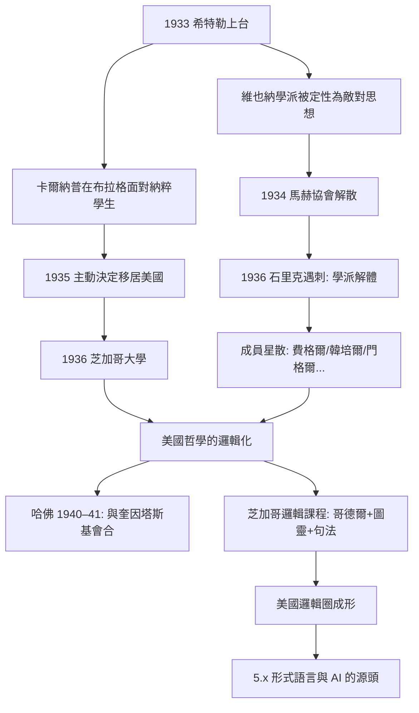
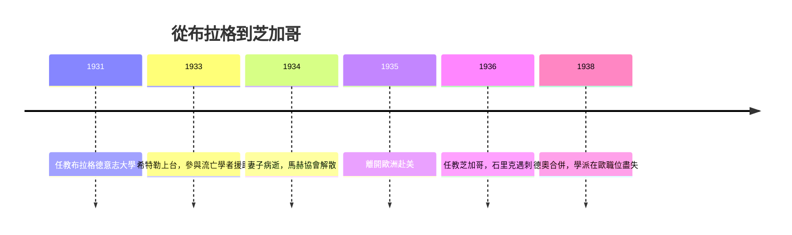

# 2.3 納粹崛起與移民（1933–1935）

1933 年 1 月，希特勒上台。維也納學派這個以馬赫、愛因斯坦為守護神、以反形上學為志業的團體，在納粹眼中正是「猶太式」世界觀的堡壘。學派在五年內被政治連根拔起，成員星散英美——這場流亡，意外地把歐陸邏輯實證主義移植到了美國的邏輯學與哲學系（本書第 3 章、第 5 章）。

## 學派如何被政治擊碎

- 納粹意識形態把相對論斥為「猶太物理」，把邏輯實證主義視為「無根的世界布爾喬亞」思想——宣言中的反形上學被讀成反德意志；
- 1933 年德國高校的「重編制法」（Gesetz zur Wiederherstellung des Berufsbeamtentums）清洗猶太與政治不可靠的教授，德語學術圈一夜塌方：愛因斯坦、弗雷格門下的後繼者、哥廷根的整個數學學派皆受波及（→ 詳見《希爾伯特傳記》）；
- 1934 年，維也納的恩斯特·馬赫協會在奧地利法西斯化氛圍中解散；1936 年石里克在維也納大學樓梯間被一名精神失常的前學生槍殺，學派失去靈魂人物；
- 1938 年德奧合併後，凡是與「學派」沾邊的學術職位皆遭清洗；
- 成員的去向構成二十世紀思想地理的大遷徙：卡爾納普→芝加哥、費格爾→明尼蘇達、韓培爾→普林斯頓與匹茲堡、伯格曼→艾奧瓦、門格爾→聖母大學、弗蘭克→哈佛——實證主義從此成為**美國哲學系的常規課程**。

## 卡爾納普的個人抉擇

- 1931–1935 年，卡爾納普任教於布拉格德意志大學；該校德裔學生中的納粹運動日趨狂熱，他自述在課堂上面對的是「希特勒的青年」；
- 1933 年後他參與協助流亡學者的委員會，為失業的猶太與左翼學者奔走——這使他同時被德國與奧地利的官方輿論敵視；
- 他的和平主義與社會主義立場（本書 1.1）使他早在 1930 年代初就判定：德語文化圈已無法容納理性主義的工作；
- 1934 年，妻子伊麗莎白（Liesbeth）病逝，家庭與政治雙重危機疊加；
- 1935 年，他決定離開歐洲赴美訪問；1936 年起定居美國。與許多 1938 年後倉皇逃亡的同行相比，這是一次**早有預判的主動撤離**；
- 政治選擇與哲學選擇在此重合：容受原則的多元主義者，無法接受一個宣布「誰的思想配存在」的政權。

## 移民的連鎖效應

- 卡爾納普抵美後在哈佛大學結識奎因、塔斯基（訪問）、古德曼等人，1940–1941 年的哈佛年把維也納—華沙—劍橋三條線路熔於一爐（本書 3.3）；
- 1936 年起他執教芝加哥大學，把邏輯句法、塔斯基語義學、哥德爾定理與圖靈的可算度性編入哲學研究生課程（本書 3.1、3.2）——美國哲學的「邏輯化」很大程度上是這批流亡者的作品；
- 同一時期，普林斯頓的丘奇學派（丘奇、後來的圖靈）與 IAS 的哥德爾、馮紐曼構成另一個邏輯中心；流亡哲學家與本土邏輯學家的網絡，將在 1950 年代匯成美國形式科學的黃金期（本書 5.2）；
- 他留在歐洲的家族付出代價：親屬身陷戰時德國，戰後他長期資助歐洲的重建與同行；
- 歷史的弔詭：納粹想消滅的「猶太式邏輯」，因為這場流亡而成為美國哲學、語言學與日後計算機科學的基礎設施（本書 5.1–5.3）。

## 移民作為思想史的變數

- 這場流亡的規模空前：僅 1933–1941 年，約十萬德語區學者與專業人士抵美；
- 對哲學而言，效果是「反轉潮向」：戰前美國哲學以實用主義與唯心主義為主流，戰後分析哲學逐漸成為英語世界的正統——移民者是關鍵傳送帶；
- 對卡爾納普個人，移民還意味著從「歐洲論戰者」轉型為「美國教授」：他學會了美國學術體制的運作（基金、出版社、系務），成為後來移民學者的導師與中間人；
- 他終身保有德語寫作能力與歐洲口味，卻以英語完成了大部分晚年著作——雙語本身成了「語言工具主義」的生活註腳：語言是工具，換語言如換工具，沒有哪一種「本質上」更高貴。

**因果**：納粹崛起沒有摧毀卡爾納普的思想，反而替它完成了史上最有效率的國際推廣。極權主義摧毀了德語學術圈，卻把其中最形式化的頭腦快遞到美國；卡爾納普以「早兩年」的預判完成了個人撤離，又在芝加哥把撤離變成擴張。下一章將看到：美國土壤如何讓句法綱領長出語義學（3.3）、可算度性（3.2）與歸納邏輯（4.2）三根新枝。

## 關鍵事件年表

| 年份 | 事件 | 後續影響 |
|------|------|----------|
| 1933 | 希特勒上台；納粹學生運動席捲布拉格德大 | 決定撤離的背景 |
| 1933 | 卡爾納普參與流亡學者援助工作 | 與官方輿論決裂 |
| 1934 | 妻子伊麗莎白病逝 | 個人危機疊加 |
| 1934 | 維也納恩斯特·馬赫協會解散 | 學派組織瓦解 |
| 1935 | 離開歐洲赴美 | 主動撤離而非倉皇逃亡 |
| 1936 | 石里克遇刺；卡爾納普任教芝加哥 | 學派重心西移 |
| 1938 | 德奧合併，學派成員在歐職位盡失 | 移民潮完成 |

## 小結

1933–1935 年，政治與哲學在卡爾納普身上重合為一個決定：離開。這個決定的收益遠超個人安全——維也納學派的思想經由流亡者網絡成為美國學院的正統之一，而卡爾納普本人則在芝加哥開啟了第二個創造期。歷史殘酷地驗證了他的診斷：一個消滅「敵對思維方式」的政權，恰恰證明了容受原則為何必要。
