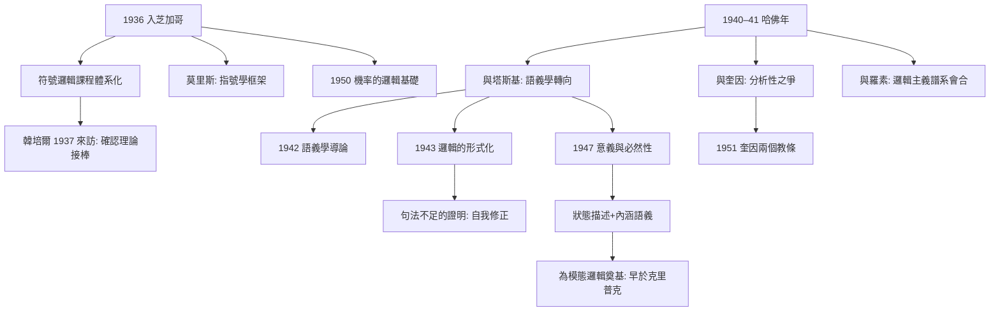
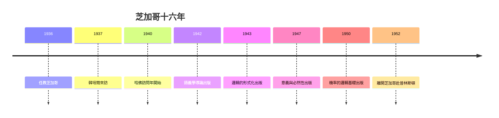

# 3.1 芝加哥大學（1936–1952）

1936 年，卡爾納普應莫里斯（Charles Morris）之邀加入芝加哥大學哲學系，直到 1952 年。十六年的芝加哥歲月，是他產量最高的時期：《語義學導論》（1942）、《邏輯的形式化》（1943）、《意義與必然性》（1947）三大書接連問世，邏輯實證主義在美國完成建制化。

## 一個流亡學派的本土化

- 芝加哥時期的卡爾納普從「維也納學派成員」轉型為「美國哲學系的邏輯教授」：他開設的符號邏輯課程覆蓋從一階邏輯到哥德爾定理、遞迴函數乃至圖靈機的完整譜系（本書 3.2）；
- 同事莫里斯以「指號學」（semiotic：句法學、語義學、語用學三分）聞名，正是他堅持邀請卡爾納普，並說服校方：一個哲學系必須有第一流的邏輯；
- 1937 年韓培爾（Hempel）來訪合作，日後成為科學哲學「確認悖論」（烏鴉悖論）的著名提出者——確認理論的發展鏈條由此接通（本書 4.2）；
- 布拉德利、劉易斯式的美國本土哲學與實證主義在芝加哥正面相遇：卡爾納普不參與罵戰，而是不斷拿出更精確的技術文本，用著作而非論戰完成了說服；
- 他在芝加哥的研討班成為流亡者與本土青年之間的旋轉門：戰時的美國學生第一次在哲學系課堂上系統接觸哥德爾定理與塔斯基的真值概念。

## 哈佛年（1940–1941）

- 1940–1941 學年，卡爾納普以訪問學者身份在哈佛，同在校園的還有訪問的塔斯基、訪問的羅素，以及本地教授奎因；
- 這被後人稱為邏輯哲學的「全明星賽季」：華沙語義學（塔斯基）、劍橋邏輯（羅素）、維也納句法（卡爾納普）與哈佛整體論（奎因）同場競技；
- 卡爾納普與塔斯基密集討論真值與語義概念，直接推動他從「句法主義」走向語義學計畫（本書 3.3）；
- 他與奎因的友誼與分歧同時加深：奎因不接受「分析/綜合」二分，1951 年《經驗主義的兩個教條》把這場私人辯論變成分析哲學史的轉折點——卡爾納普以《經驗主義、語義學與本體論》（1950）回應，堅持分析性是**語言框架內部**的有效概念；
- 兩人框架之爭的實質：奎因要拆掉語言與世界之間的牆，卡爾納普要牆，只是把牆設計成可以更換的模組（容受原則的延續，本書 2.2）；
- 羅素此時也在哈佛訪問（→ 詳見《羅素傳記》第 4 章），這位卡爾納普 1921 年的「精神導師」與其弟子輩同堂——邏輯主義百年譜系在此完成了一次難得的實體聚會。

## 三大書：從句法到語義的完工

- 《語義學導論》（1942）：以**描述語義學**處理歷史語言、以**純語義學**構造形式系統，將塔斯基的真值定義改造為哲學工具；
- 《邏輯的形式化》（1943）：證明若僅有句法規則，標準一階邏輯的語義會**嚴重不確定**——必須補充語義規則，這是對句法主義的自我修正；
- 《意義與必然性》（1947）：提出外延/內涵（extension/intension）對偶與「狀態描述」（state description）語義，給模態概念 $\Box\varphi$（必然）一個精確的語義學處理——比克里普克可能世界語義學（1959–1963）早十餘年（本書 3.3、5.2）；
- 1942 年他與英娜（Ina Stöger）再婚；二戰期間他支持反法西斯陣營的工作，和平主義立場未變（本書 1.1）；
- 1950 年《機率的邏輯基礎》出版，開啟歸納邏輯的宏大計畫——芝加哥末期的他已同時經營語義學與歸納邏輯兩條戰線（本書 4.2）。

## 芝加哥的日常與風格

- 他以嚴格聞名又以謙和聞名：研討班的規則是「任何斷言都必須可以化為形式問題」，但辯論的氣氛從不尖刻；
- 學生回憶他把哥德爾定理講得「像手工藝示範」：一步一步算給你看，而不是宣布結論；
- 他堅持哲學問題沒有等級：為研究生解釋一個量詞的語義，與寫《意義與必要性》同等認真；
- 這種「教學即傳教」的作風，使芝加哥成為美國邏輯實證主義的人才培養所——1950 年代美國科學哲學的中堅，多半直接或間接受過他的訓練。

**因果**：芝加哥十六年是一部「輸入—加工—輸出」的機器：輸入是流亡帶來的維也納句法與塔斯基語義學，加工場所是哈佛年的四強會談，輸出是三大書構成的語義學體系。句法不足的證明（1943）尤其關鍵——建築師親手宣布第一版藍圖不夠用，這種自我修正能力正是分析哲學「進步」形象的來源。而與奎因的爭論，則把卡爾納普變成二十世紀後半分析哲學繞不開的「被批判的座標原點」。

## 關鍵事件年表

| 年份 | 事件 | 後續影響 |
|------|------|----------|
| 1936 | 任教芝加哥大學 | 實證主義在美建制化 |
| 1937 | 韓培爾來訪合作 | 確認理論傳承 |
| 1940–1941 | 哈佛訪問年：塔斯基、羅素、奎因 | 語義學轉向與框架之爭 |
| 1942 | 《語義學導論》 | 描述/純語義學之分 |
| 1943 | 《邏輯的形式化》 | 證明句法規則不足以定語義 |
| 1947 | 《意義與必然性》 | 外延/內涵、狀態描述語義 |
| 1950 | 《機率的邏輯基礎》；回應奎因 | 歸納邏輯開工、框架主義確立 |

## 小結

芝加哥時期的卡爾納普，完成了三項工程：把維也納的遺產編成美國的研究生課程；在哈佛年與塔斯基合作把句法綱領升級為語義學綱領；用三大書為模態邏輯與分析性提供技術基礎。1950 年代將證明這些投資的報酬率：克里普克的可能世界語義學、蒙太古語法、乃至麥卡錫的邏輯 AI，都能在《意義與必然性》裡找到地基（本書 5.2、5.3）。
