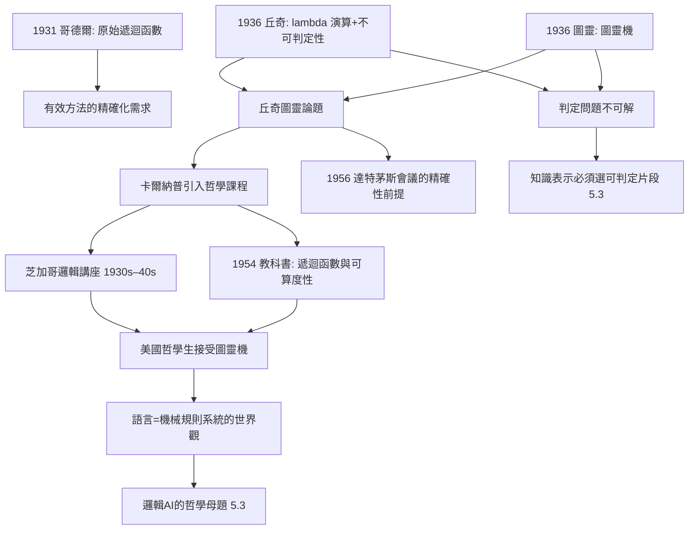
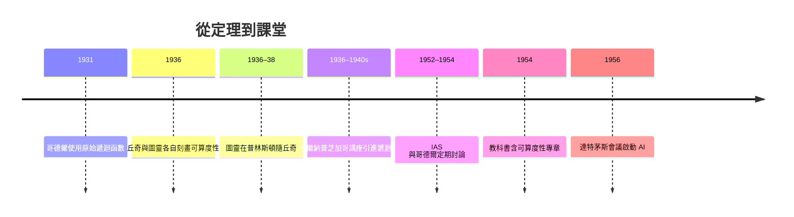

# 3.2 可算度性與圖靈機的引進（1936）

1936 年，圖靈在倫敦《倫敦數學學會學報》發表《論可計算數》（→ 詳見《圖靈傳記》第 2 章）。同一年，卡爾納普正在芝加哥把丘奇（1936）與圖靈（1936）的可算度性成果引入哲學課程——他是最早把「圖靈機」當作哲學基礎設施來講授的哲學家之一。這一節追蹤可算度性如何從數理邏輯的專利變成哲學與 AI 的通用語言（→ 詳見《丘奇傳記》第 2 章）。

## 1936：可算度性的三重奏

- 同年出現的三個結果彼此獨立又等價，構成可算度性理論的誕生年：
  1. **丘奇**：$\lambda$-可定義函數刻畫有效可計算性，並證明一階邏輯的判定問題不可解（→ 詳見《丘奇傳記》第 2 章）；
  2. **圖靈**：以「圖靈機」這個機械模型刻畫計算，證明停機問題不可解；
  3. **波斯特**：以產生系統給出等價刻畫；
- 哥德爾 1931 年的不完全性定理已經用到「原始遞迴函數」，但「什麼是可計算」的**外延確定**要到 1936 年才完成——丘奇—圖靈論題（Church–Turing thesis）由此得名：

$$\text{有效可計算} \;\equiv\; \text{圖靈機可計算} \;\equiv\; \lambda\text{-可定義} \;\equiv\; \text{遞迴}$$

- 這個論題的哲學分量在於：它把一個模糊的日常概念（「按規則一步步做」）精確化為一個數學謂詞，而且**多條完全不同的路徑收斂到同一個外延**——這種收斂本身就是「我們抓到了正確概念」的最強證據；
- 卡爾納普立刻看到哲學含義：如果「機械程序」「有效方法」這些哲學爭論的核心概念有了**數學上精確的替身**，那麼關於機械論、規則、心靈的討論就有了一個可嚴格化的起點。

## 卡爾納普的引介工作

- 1930 年代中後期，卡爾納普在芝加哥的邏輯講座系統講授哥德爾定理與遞迴函數；據學生回憶，他把丘奇與圖靈 1936 年的論文列為必讀；
- 他與在普林斯頓的丘奇、以及在高等研究院（IAS）的哥德爾保持通信與互訪；IAS 期間（1952–1954，本書 4.1、5.2）他與哥德爾每週交談，話題常涉可算度性與語義學；
- 1954 年的教科書《符號邏輯導論及其應用》（Introduction to Symbolic Logic and its Applications）設專章講遞迴函數與可算度性——這是哲學學生最早能接觸到圖靈機形式的教科書之一；
- 在卡爾納普的「科學語言」框架裡，可算度性提供了一個哲學判準的雛形：一個理論要成為「經驗的」，其檢驗程序必須是有效方法；一個語言的規則要可用，其應用必須可機械執行——**這正是後來邏輯 AI 中「知識表示必須配推理程序」的哲學母題**（本書 5.3）；
- 他的學生與聽眾把這條線帶向各處：韓培爾帶到普林斯頓與匹茲堡的科學哲學，蒙太古、克雷格等帶進形式語言研究（本書 4.1、5.2）。

## 從可算度性到「語言作為機器」

- 卡爾納普《邏輯句法》中的語言定義——形成規則+變形規則——本質上就是一個符號操作系統；1936 年之後，這種「語言=機械可執行的規則系統」觀念獲得了數學基礎；
- 圖靈機把「機械程序」落實為讀寫頭在帶上移動；卡爾納普把「哲學分析」落實為對這類規則系統的句法描述。兩者共享同一世界觀：**思考的內容或許有爭議，但規則的執行沒有**；
- 這條線在 1950 年代的因果鏈是：卡爾納普/丘奇的邏輯課程 → 香農與麥卡錫在普林斯頓的接觸 → 1956 年達特茅斯會議上麥卡錫提議把「智能」形式化（→ 詳見《麥卡錫傳記》第 1 章；本書 5.3）；
- 換言之：沒有「可算度性=有效方法」這一精確化，麥卡錫 1955 年的提案「智能可以如此被精確描述，以致機器可以模擬它」在字面上無從寫起；
- 另一條支線同樣重要：判定問題的不可解（丘奇 1936、圖靈 1936）為「形式化有其極限」提供了定理級證明——這與哥德爾定理一起，構成後來計算複雜性與可判定性研究的出發點，也成為知識表示語言「必須選擇可判定片段」的理論依據（本書 5.3）。

## 哲學意涵的初步結算

- **對機械論爭論**：「心靈是否可被機械模擬」從思辨問題變成「圖靈機能否模擬 $\mathcal{X}$」的可定義問題；
- **對數學基礎**：直觀主義、形式主義、邏輯主義的百年之爭，獲得了一個中立工具（遞迴論）來精確陳述各自的承諾；
- **對哲學方法**：「無矛盾」「可判定」「可計算」成為檢驗哲學構造物的最低工程標準——這是維也納學派「清晰性」理想的數學化完成；
- 當然，1936 年的圖靈本人正在普林斯頓隨丘奇讀博士（1936–1938）——可算度性革命的美國傳播，正好經過卡爾納普課堂所在的這張網絡（→ 詳見《圖靈傳記》第 2 章；《丘奇傳記》第 2 章）。

**因果**：1936 年的可算度性革命提供「什麼是機械程序」的答案；卡爾納普的獨特貢獻，是把它翻譯進哲學的語法——使「規則」「方法」「語言」成為可形式討論的對象。這條因果鏈的遠端，直指計算機科學的誕生：圖靈 1936 年的抽象機（→ 詳見《圖靈傳記》第 2 章）經由丘奇—普林斯頓學派與卡爾納普式的哲學課程，變成了馮紐曼結構的理論前奏，也變成了 AI 的概念預算（本書 5.3）。

## 關鍵事件年表

| 年份 | 事件 | 後續影響 |
|------|------|----------|
| 1931 | 哥德爾使用原始遞迴函數 | 可算度性理論的起點 |
| 1935 | 卡爾納普移居美國 | 進入美國邏輯傳播網 |
| 1936 | 丘奇、圖靈、波斯特各自刻畫可算度性 | 丘奇—圖靈論題成形 |
| 1936–1938 | 圖靈在普林斯頓隨丘奇讀博士 | 可算度性與邏輯圈的匯流 |
| 1936–1940s | 芝加哥講座引進遞迴函數與圖靈機 | 哲學界的可算度性教育 |
| 1952–1954 | IAS 與哥德爾定期討論 | 可算度性×語義學的交流 |
| 1954 | 《符號邏輯導論及其應用》含可算度性章節 | 教科書層面的制度化 |
| 1956 | 達特茅斯會議 | 可算度性成為 AI 的地基（本書 5.3） |

## 小結

1936 年，兩篇論文（丘奇的、圖靈的）與一間芝加哥教室，共同完成了一次概念轉移：可算度性從數理邏輯的內部問題，變成哲學可以依託的基礎設施。卡爾納普不是這場革命的作者，卻是它最重要的轉譯者之一——他讓美國哲學在 AI 誕生前二十年，就先學會了「程序」與「規則」的嚴格用法。這份遺產在 5.3 節兌現。
