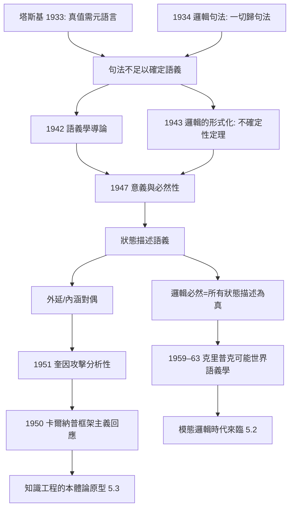
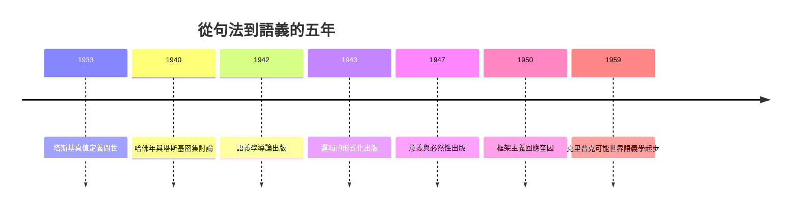

# 3.3 語義學與模態邏輯（1942–1947）

1942–1947 年，卡爾納普連續出版《語義學導論》（1942）、《邏輯的形式化》（1943）、《意義與必然性》（1947）。這三部曲是他職業生涯最大的一次自我修正：從《邏輯句法》（1934）的「一切都是句法」，轉向承認**語義學是不可繞開的獨立層面**，並為模態邏輯提供了第一套系統語義學。

## 塔斯基的衝擊：真值不是句法概念

- 塔斯基 1933 年證明：在足夠豐富的語言中，「真」無法僅憑句法規則定義，必須以元語言中的語義謂詞 $Tr$ 滿足塔斯基等價式：

$$Tr(\ulcorner \varphi \urcorner) \leftrightarrow \varphi$$

- 卡爾納普最初的計畫是把真理也句法化；塔斯基的結果（以及他 1943 年自己對一階邏輯的完備性分析）顯示：**同一套句法規則可以對應多種語義**，句法不足以確定意義；
- 這直接產生《邏輯的形式化》（1943）的核心定理式結論：若只給形成規則與變形規則，標準一階邏輯的量詞解釋處於嚴重不確定中——必須補充語義規則；
- 哲學後果：1930 年代「哲學=句法」的口號必須修正為「哲學=句法+語義學+（最終）語用學」。卡爾納普以建築師的作風接受了圖紙的改版；
- 值得強調的是：這次修正不是失敗，而是計畫的正常演化——早在 1934 年他就區分了句法與語義的不同任務，只是當時認為語義可化約為句法；塔斯基的定理證明化約不可能，於是語義學獨立成科。

## 《意義與必然性》：狀態描述與內涵

- 語義系統 $S$ 由**狀態描述**（state descriptions）給出：對語言中每個原子語句指定真假的一個完全賦值，類似今日的可能世界；
- 外延定義為：
  - 句子的外延 = 其真值；謂詞的外延 = 其滿足的個體類；
  - 內涵則由所有狀態描述上的取值決定：句子的內涵 = 使其為真的狀態描述類，謂詞的內涵 = 對應的性質；
- 兩個表達式**邏輯等值**（在所有狀態描述中同真值）當且僅當內涵相同——這給「共指稱而不換義」提供了精確工具，直接回應弗雷格的晨星/昏星難題（→ 詳見《弗雷格傳記》）；
- 在此基礎上定義模態：

$$\Box\varphi \;=\; \varphi \text{ 在所有狀態描述中為真（邏輯必然）}$$

- 《意義與必然性》因此是**第一個系統的模態邏輯語義學**：把 $\Box$ 解釋為在所有賦值下為真——正是克里普克 1959–1963 年可能世界語義學的先聲，儘管卡爾納普的「必然」僅限邏輯必然，未處理跨世界同一性（→ 詳見《丘奇傳記》第 3 章關於模態邏輯的段落）；
- 丘奇在《符號邏輯評》上的長篇評論（1950–51）肯定了技術成就，同時指出「內涵的個體化依賴於語言的等價關係」——這批評催生了更精細的內涵邏輯（本書 5.2）。

## 分析性與綜合性：框架的防線

- 《意義與必然性》以語義規則定義**分析句**：在所有狀態描述中為真，即 $L$-真；
- 1950 年奎因《經驗主義的兩個教條》攻擊分析/綜合區分循環不定義；卡爾納普在《經驗主義、語義學與本體論》（1950）回應：分析性是**相對於給定語義系統**的內部概念，如同「遊戲中合法的棋步」——你不會因為「合法步」的定義依賴遊戲規則就宣布下棋不可能；
- 這場辯論的長期效果：模態邏輯、內涵語義學在英語世界的生存空間，某種程度上是靠卡爾納普的技術成果守住的；
- 《意義與必然性》的規範性語言（框架、內部/外部問題）更成為後設本體論（neo-Carnapian metaontology）的源頭，影響直達當代（本書 5.3）；
- 外部問題（要不要採用某種語言）是實用問題，內部問題（某框架內有沒有 $\mathcal{X}$）是邏輯問題——這個二分日後成為知識工程中「本體選擇」的哲學原型。

## 三部曲的內在邏輯

- 《語義學導論》建立詞彙：指稱、外延、真值、語義系統；
- 《邏輯的形式化》證明句法的極限：給出「僅憑規則不足以確定語義」的技術論證；
- 《意義與必然性》完成建設：狀態描述、內涵、模態、分析性；
- 三書合觀，是一次完整的「破—證—立」：破的是 1934 年的自己，證的是句法不足定理，立的是語義學體系；
- 這種「以定理改正口號」的紀律，在哲學史上極為罕見——大多數哲學家終其一生在捍衛一個口號，卡爾納普則先後修正自己的三個口號（構造、句法、語義），每次修正都由嚴格論證驅動。

**因果**：這個五年期的邏輯是一條嚴格的推理鏈：塔斯基證明真值需要語義學 → 卡爾納普證明句法規則不能唯一確定語義 → 於是構造語義系統（狀態描述）→ 在語義系統上定義內涵與必然 → 為模態邏輯與克里普克時代鋪路。每一次邁進都由前一個技術結果驅動，而每一次邁進都同時是對 1934 年自我的修正。哲學史上少有這種「以定理改正口號」的紀律——這正是卡爾納普作為「建築師」的原型。

## 關鍵事件年表

| 年份 | 事件 | 後續影響 |
|------|------|----------|
| 1933 | 塔斯基真值定義論文 | 語義學獨立性的證明 |
| 1940–1941 | 哈佛年與塔斯基密集討論 | 轉向的直接觸媒 |
| 1942 | 《語義學導論》 | 描述/純語義學之分 |
| 1943 | 《邏輯的形式化》 | 句法規則不足以定語義 |
| 1947 | 《意義與必然性》 | 狀態描述、內涵、邏輯必然 |
| 1950 | 《經驗主義、語義學與本體論》 | 框架主義回應奎因 |
| 1950–1951 | 丘奇長篇評論《意義與必然性》 | 內涵邏輯的精細化 |
| 1951 | 奎因《兩個教條》 | 分析性大辯論開場 |
| 1959–1963 | 克里普克可能世界語義學 | 卡爾納普語義學的直系後代 |

## 小結

1942–1947 年，卡爾納普親手拆掉了自己 1934 年的「句法萬能論」，用狀態描述語義重建了意義、真理與必然的基礎。這次自我修正的紅利在兩個方向兌現：理論上，克里普克可能世界語義學與當代模態形上學由此起步（本書 5.2）；實踐上，外延/內涵與「語言框架」概念成為日後知識表示與邏輯 AI 的標準詞彙（本書 5.3）。1952 年之後，他將帶著這套語義學工具走向普林斯頓與加州（本書第 4 章）。
