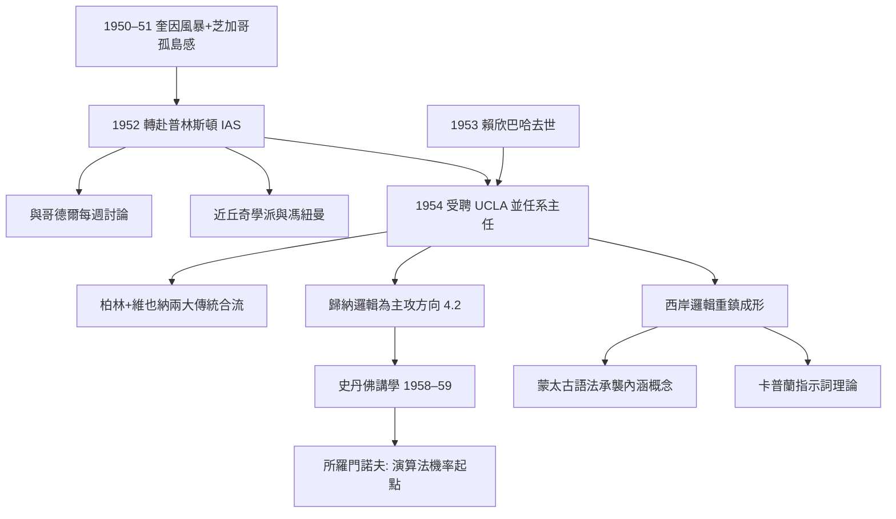
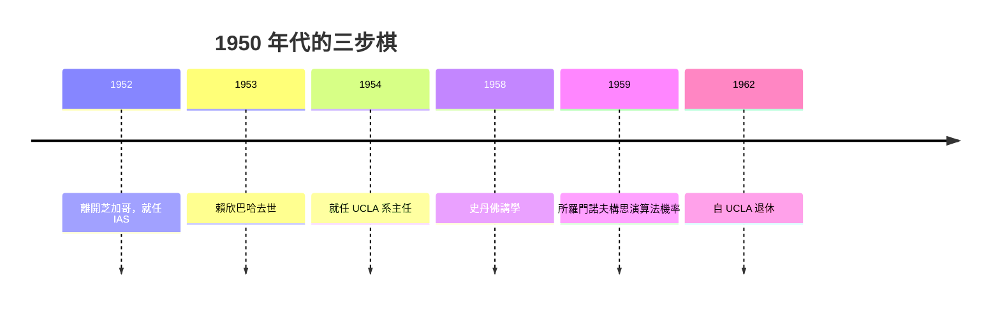

# 4.1 轉往加州大學洛杉磯分校（1954）

1952 年，卡爾納普離開芝加哥，赴普林斯頓高等研究院（IAS）任職兩年；1954 年，他轉任加州大學洛杉磯分校（UCLA），接替去世的賴欣巴哈（Hans Reichenbach）出任哲學系主任。這次西遷看似人事調動，實則完成了美國科學哲學地理版圖的最後一塊拼圖。

## 離開芝加哥的原因

- 1950 年代的芝加哥大學哲學系氣氛保守，對形式邏輯的投入有限；卡爾納普自述在校內「如孤島」，想找一個能發展邏輯與科學哲學群體的地方；
- 1950–1951 年奎因的《兩個教條》風暴固然是學術論戰，但現實層面，東岸（哈佛、普林斯頓）已聚集了大批分析哲學與邏輯人才，中西部相形失色；
- 1952–1954 年的 IAS 歲月是理想的過渡：與哥德爾為鄰，每週交談，馮紐曼仍在世，普林斯頓大學的丘奇學派近在咫尺（本書 5.2）；
- 1953 年，UCLA 的賴欣巴哈——柏林學派領袖、科學哲學大家——病逝，留下職位與一個正在上升的系；
- 兩個因素疊加，使西遷成為理性選擇：IAS 無長期職位，而 UCLA 給的是正教授兼系主任，且加州的邏輯人才（塔斯基在伯克利）正在集結。

## UCLA：接棒賴欣巴哈

- 賴欣巴哈的柏林學派與卡爾納普的維也納學派本是雙子星：一個以機率與歸納見長，一個以邏輯與語義見長。卡爾納普接任，等於把兩大傳統合併於一系；
- 兩人早年即互相批評又互相尊重：賴欣巴哈主張機率的頻率說，卡爾納普主張邏輯機率——這場辯論在 UCLA 由卡爾納普單方面續寫（本書 4.2）；
- 他把研究方向集中在**歸納邏輯與機率**（本書 4.2）——正好是賴欣巴哈的舊領域，接棒而勝於守成；
- UCLA 因他而成為美國西岸的邏輯重鎮：理查德·蒙太古（Richard Montague）在伯克利受教於塔斯基，其「蒙太古語法」明言承襲卡爾納普《意義與必然性》的內涵概念（本書 5.2）；大衛·卡普蘭（David Kaplan）在 UCLA 受教於卡爾納普，博士論文發展指示詞（demonstratives）理論，日後成為當代語言哲學經典；
- 威廉·克雷格（William Craig）的「克雷格定理」（1953，可將遞迴可枚舉的公理集改寫為遞迴的隱定義公理集）也在這一時期與卡爾納普的歸納邏輯計畫互相討論；
- 1958–1959 年，他應邀至史丹佛講學；聆聽者中有年輕的所羅門諾夫（Ray Solomonoff）——卡爾納普對先驗機率的討論，成為所羅門諾夫歸納推論（algorithmic probability）的觸媒之一（本書 4.2、5.3）。

## 加州的生活與工作方式

- 卡爾納普鍾愛加州：氣候適合他常年堅持的遠足與游泳，住宅裡健身房與書房並列；
- 他以嚴格的時間表工作：上午純研究（歸納邏輯），下午行政與通信——與維也納時期的「夜間寫作」相比，這是體系的維護期而非擴張期；
- 他保持國際通信網：與哥德爾、塔斯基、丘奇、奎因、日本與以色列的學者持續通信，成為形式語言研究的全球樞紐（本書 5.2）；
- 系務上他推動了 UCLA 的邏輯課程改革，使哲學、數學、語言學的學生共享邏輯訓練——這種跨系課表在當時的美國相當前衛；
- 1962 年自 UCLA 退休後仍指導研究與出版，直到 1970 年去世（本書 4.3）。

## 西遷的歷史意義

- 對哲學地理：美國科學哲學自此形成雙極——東岸（哈佛—普林斯頓）以奎因、古德曼為軸，西岸（UCLA—伯克利—史丹佛）以卡爾納普、塔斯基為軸；
- 對語言學與邏輯的合流：蒙太古語法（1970 年代）將自然語言的片段做完全形式化的語義學處理，其技術底盤正是卡爾納普—塔斯基—丘奇一脈；西岸因此成為形式語言學的重鎮（本書 5.1）；
- 對 AI：西岸的邏輯—機率傳統經由所羅門諾夫、後來的知識表示研究，直接進入計算機科學（本書 5.3）；
- 一位六十二歲教授的搬家，牽動三個學科——這是「樞紐」角色的最好註腳。

**因果**：西遷的因果鏈是「學術孤島感 → IAS 緩衝 → 賴欣巴哈去世騰出位置 → UCLA 合併柏林/維也納傳統」。洛杉磯因此從哲學地圖的邊緣變成節點：向東看，蒙太古與卡普蘭把卡爾納普語義學推進形式語言學與當代形上學；向南看，所羅門諾夫從歸納邏輯的先驗機率走出演算法機率，成為日後機器學習理論的一支源頭（本書 5.3）。一次人事調動，串起了三個學科。

## 關鍵事件年表

| 年份 | 事件 | 後續影響 |
|------|------|----------|
| 1950–1951 | 芝加哥系內孤立感加深；奎因論戰 | 離開的推力 |
| 1952 | 就任普林斯頓高等研究院 | 與哥德爾、丘奇學派為鄰 |
| 1953 | 賴欣巴哈去世 | UCLA 職位出現 |
| 1954 | 受聘 UCLA，任哲學系主任 | 柏林+維也納傳統合流 |
| 1955–1959 | 主攻歸納邏輯；發展 $\lambda$-連續統 | 確認理論黃金期（4.2） |
| 1958–1959 | 史丹佛講學 | 所羅門諾夫受啟發（5.3） |
| 1962 | 自 UCLA 退休 | 轉入晚年整理期（4.3） |

## 小結

1954 年的西遷，把卡爾納普從中西部搬到太平洋，也把維也納學派的最後一塊版圖拼進了美國西岸。在 UCLA，他接的不只是賴欣巴哈的職位，而是兩個學派合一的使命；他付出的不只教學，而是以通信與門生把語義學、歸納邏輯播撒給蒙太古、卡普蘭與所羅門諾夫。老年建築師的最後一項工程，因此不在自己的圖紙上，而在別人的圖紙裡——下一節看他工程量最大的歸納邏輯。
