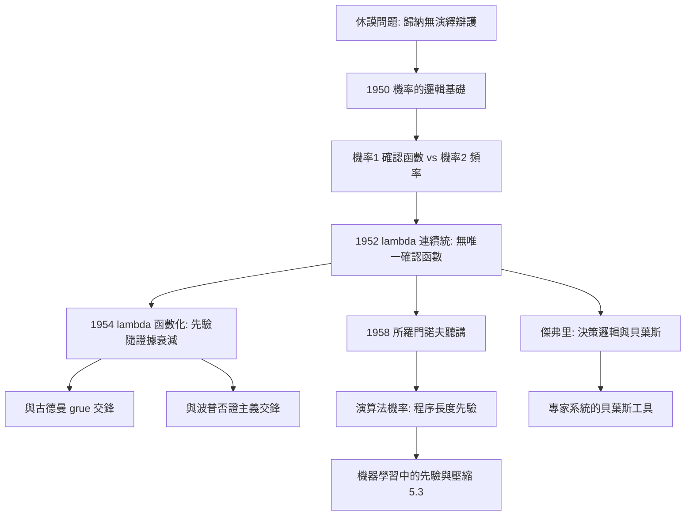

# 4.2 歸納邏輯與機率（1950–1970）

從《機率的邏輯基礎》（Logical Foundations of Probability, 1950）到 1970 年去世前的《歸納邏輯與科學的邏輯》，卡爾納普生命最後二十年幾乎全部投入歸納邏輯：把「證據 $e$ 在多大程度上確認假說 $h$」變成一個可計算的函數。這是他的未竟之業，也是他影響 AI 機率推理最直接的一條線（本書 5.3）。

## 問題：休謨的幽靈

- 休謨問題：從「迄今所有烏鴉皆黑」推不出「下一隻烏鴉是黑的」——歸納沒有演繹式的辯護；
- 卡爾納普的回答是實用主義式 + 形式主義式的：不必「證明歸納正確」，只需給出一個**邏輯機率函數** $c(h \mid e)$，測量證據對假說的確認度，並證明它在適當公理下唯一確定；
- 區分兩種機率概念：
  1. **機率$_1$**：邏輯機率，語句間的確認關係 $c(h,e)$，屬於語義學；
  2. **機率$_2$**：統計機率，世界中的相對頻率，屬於經驗科學；
- 哲學史上的爭執（頻率派 vs 主觀派）被他重鑄為**兩個不同概念**——這一區分日後成為貝葉斯哲學的標準工具箱。

## 技術核心：$\lambda$-連續統

- 將可能的世界狀態編碼為「結構描述」與「同構描述」，在有限語言上計算每一狀態的先驗權重；
- 引入參數 $\lambda$ 控制「樣本證據」與「邏輯結構」在預測中的相對權重：

$$c^{\lambda}\big(\mathrm{Q}_j \mid s\big) \;=\; \frac{n_j + w \cdot \lambda / \kappa}{n + \lambda}$$

其中 $n_j$ 是屬性 $\mathrm{Q}_j$ 的已觀察次數，$w$ 為滿足的 $\mathrm{Q}$-謂詞數，$\kappa$ 為謂詞總數，$s$ 為樣本；
- $\lambda$ 的兩個極端：
  - $\lambda = \infty$：純歸納（歸納傳統主義，即拉普拉斯式均勻先驗，$c^{\dagger}$）；
  - $\lambda = 0$：純經驗（直接以頻率為確認度，$c^{*}$ 曾是他最屬意的「最佳」函數）；
- 1952 年《歸納方法的連續統》承認：$\lambda$ 原則上可取任意實數——**沒有唯一「正確」的確認函數**，這是容受原則（本書 2.2）在歸納邏輯中的重演；
- 1954 年《連續統中的歸納方法》進一步把 $\lambda$ 函數化，讓它可以隨樣本增大而減小——證據越多，先驗結構的影響越小，理論逐漸「忘記」先驗。

## 兩場著名的交鋒

- **古德曼的 grue 悖論**（1955）：為何綠色是「可投射的」謂詞，而「綠-然後-藍」不是？卡爾納普的回應：確認函數的 $\lambda$ 參數對語言的**描述詞彙**保持中立，可投射性問題屬於語言選擇（框架）問題，不屬於確認計算的內部——批評者認為這是推卸，支持者認為這是劃界；
- **波普的可否證主義**：波普否認有歸納邏輯。卡爾納普反駁：科學實踐中「接受哪個假說」「給多大信心」必須有定量依據，純否證主義無法解釋統計假說檢驗的實際用法；
- 兩場交鋒的共同結構：對手質疑「邏輯機率」的客觀性，卡爾納普以「相對於語言框架」的半約定地位回應——與他對奎因分析性攻擊的回應同構（本書 3.3）。

## 遺產：通往 AI 的機率之路

- **所羅門諾夫**：1958–59 年在史丹佛聽卡爾納普講學後，構思演算法機率：用最短程序長度 $2^{-|p|}$ 加權先驗，取代卡爾納普的句法均勻先驗——卡爾納普問「如何給所有假說分先驗機率」，所羅門諾夫給出了可計算的答案（本書 5.3）；
- **傑弗里**（Richard Jeffrey）：發展徹底主觀貝葉斯的《決策邏輯》，並與卡爾納普合編《歸納邏輯研究》，把確認理論帶進決策論；
- **貝葉斯統計與專家系統**：$c(h \mid e)$ 的「證據加權更新」結構，正是貝氏網路與主觀貝葉斯方法的哲學前身；麥卡錫一系邏輯 AI 之外的機率 AI（→ 詳見《麥卡錫傳記》第 3 章），同樣受益於這套概念工具；
- 1970 年代起，明確的卡爾納普式「歸納邏輯綱領」在哲學界式微——但其中的核心構件（先驗機率、證據更新、語言依賴性）在機器學習中全面復活，被稱為「卡爾納普的復仇」（本書 5.3）。

**因果**：歸納邏輯的內部邏輯是「休謨問題 → 形式化確認度 → 發現 $\lambda$ 無法唯一確定 → 把 $\lambda$ 本身函數化」。每一次讓步都更接近真理：先承認沒有唯一函數，再承認 $\lambda$ 應隨證據變動。而外部效應同樣深遠：所羅門諾夫把「先驗的分配問題」變成「程序的壓縮問題」，這一步從卡爾納普的教室直通今日的最小描述長度與柯爾莫哥洛夫複雜度（本書 5.3）。

## 關鍵事件年表

| 年份 | 事件 | 後續影響 |
|------|------|----------|
| 1950 | 《機率的邏輯基礎》 | 邏輯機率綱領建立 |
| 1952 | 《歸納方法的連續統》 | 承認確認函數的家族性 |
| 1954 | 《連續統中的歸納方法》 | $\lambda$ 函數化 |
| 1955 | 與古德曼 grue 悖論交鋒 | 可投射性問題入史 |
| 1958–1959 | 史丹佛講學，所羅門諾夫聽講 | 演算法機率的遠源 |
| 1960s | 與傑弗里合作《歸納邏輯研究》 | 決策論化轉向 |
| 1970 | 去世，綱領未竟 | AI 機率推理接棒（5.3） |

## 小結

歸納邏輯是卡爾納普的「聖母院」：設計宏偉，施工至死未完工，卻為後人提供了可遷入的骨架。他把休謨問題從哲學羞辱變成技術日程，用 $\lambda$-連續統示範「如何在多元方法中做出理性選擇」。二十一世紀回望，機器學習的先驗、貝葉斯更新與壓縮觀點，無一不是這張圖紙的施工——建築師沒能看到封頂，但樓已蓋到了 AI（本書 5.3）。
