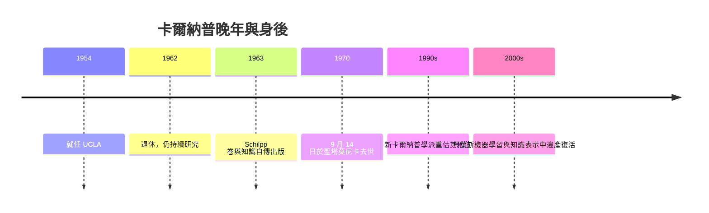

# 4.3 晚年與去世（1970）

1970 年 9 月 14 日，卡爾納普在聖塔莫尼卡因心臟病突發去世，享年七十九歲。晚年他是 UCLA 榮休教授，仍在書桌前整理《歸納邏輯與科學的邏輯》書稿。他的離去標誌著一個時代——維也納學派最後一位體系性的締造者謝幕——但他的概念網絡才剛開始在語言學、邏輯與 AI 中發揮結構性作用（本書第 5 章）。

## 最後二十年的節奏

- 1962 年自 UCLA 退休，保留辦公室與研究生指導；期間多次訪問歐洲，重回維也納、布拉格與德國講學，與曾經的故土和解於學術而非政治；
- 1963 年，《哲學中的魯道夫·卡爾納普》（Schilpp 卷）出版，收錄他親筆撰寫的《知識自傳》——這部自傳是研究其思想演化（弗雷格、維根斯坦、塔斯基、奎因）的第一手文獻；
- 1970 年前後，他與傑弗里（Richard Jeffrey）合編《歸納邏輯研究》，並持續發展確認函數的公理化，直到去世前仍在修改稿紙；
- 生活層面，加州的遠足、游泳與音樂會是他形容的「繼續工作的能源」；他保留了一貫的低調：不寫回憶錄式的軼聞，只寫思想的結算表。

## 去世：一個時代的結束

- 1970 年 9 月 14 日心臟病去世於聖塔莫尼卡家中；
- 同輩核心人物已多先走：石里克（1936 遇刺）、漢恩（1934）、紐拉特（1945）、賴欣巴哈（1953）、愛因斯坦（1955）、馮紐曼（1957）；
- 幸而哥德爾（至 1978）、奎因（至 2000）、圖靈所開啟的計算時代（→ 詳見《圖靈傳記》）、麥卡錫的邏輯 AI（→ 詳見《麥卡錫傳記》）都還在進行時——卡爾納普生前的學生與讀者，正是這些事業的執行者；
- 訃聞中反覆出現的判詞是：二十世紀分析哲學若僅能保留一個「工程師」的名字，那會是卡爾納普——他不如維根斯坦魅力、不如奎因犀利，但他建造了別人賴以論戰的地板。

## 評價的鐘擺

- 1960–70 年代：歷史主義（庫恩、費耶阿本德）與奎因主義高漲，卡爾納普被貼上「過時的邏輯實證主義」標籤，影響力跌入谷底；
- 1990 年代起：「新卡爾納普學派」興起——後設本體論（框架問題）、模態語義學史、歸納機率與形式認識論全面重估，他被重新認定為**當代分析哲學的建築師**而非遺跡；
- 2000 年後：機器學習中的貝葉斯先驗、最小描述長度、形式知識表示，使他成為「哲學家中對 AI 影響最結構性的一位」（本書 5.3）；
- 鐘擺的機制耐人尋味：他一生追求「可檢驗、可構造、可修正」——包括對自己的體系。正因為他不留下不可動搖的教條，他的遺產不會被一次批判摧毀，只會被一次次升級。

**因果**：卡爾納普之死是一個句點，但他的方法論是一個開放集合——容受原則本身就是「邀請後人另起語言」的許可證。庫恩與費耶阿本德的批判、奎因的拆解、AI 工程師的借用，都可視為這張許可證的兌現。他生前最後的工作（歸納邏輯的形式化）與身後最大的影響（機率化的知識表示）剛好在同一條延長線上（本書 5.3）——這是思想史少見的「死亡即交接」。

## 關鍵事件年表

| 年份 | 事件 | 後續影響 |
|------|------|----------|
| 1962 | 自 UCLA 退休 | 轉入整理與通信期 |
| 1963 | Schilpp 卷《知識自傳》 | 思想演化的第一手文獻 |
| 1960s | 與傑弗里合編歸納邏輯系列 | 綱領的制度化 |
| 1970 | 9 月 14 日於聖塔莫尼卡去世 | 維也納學派時代落幕 |
| 1970s | 歷史主義批判使其影響看似式微 | 鐘擺低谷 |
| 1990s | 新卡爾納普學派興起 | 後設本體論承認其框架論 |
| 2000s | 貝葉斯 AI 中遺產復活 | 「卡爾納普的復仇」（5.3） |

## 小結

晚年卡爾納普沒有革命性的新宣言，只有對歸納邏輯近乎修士般的打磨與一份冷靜的自傳。1970 年他去世時，報章稱其為「邏輯實證主義的領袖」；半世紀後回望，更準確的頭銜是**形式語言時代的樞紐**：向前連著弗雷格與羅素，向後通著喬姆斯基、丘奇學派與邏輯 AI。下一章把這條樞紐線完整鋪開——從 1934 年的《邏輯句法》到 2026 年的知識表示戰場。
