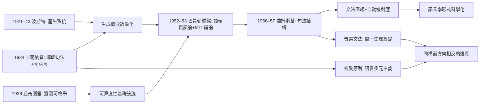

# 5.1 對喬姆斯基生成語法的影響（1956–1957）

1957 年，喬姆斯基（Noam Chomsky）出版《句法結構》（Syntactic Structures），掀起語言學的認知革命。這場革命的形式骨架——生成規則、形式語言的層級、對象語言與元語言之分——可以一路回溯到卡爾納普 1934 年的《語言的邏輯句法》與波斯特、丘奇的遞迴論（→ 詳見《丘奇傳記》第 2 章）。本節追蹤這條「邏輯→語言學」的因果鏈。

## 形式語言觀念的譜系

- **波斯特**（1921，發表於 1943）：產生系統（production system）——用有限條改寫規則從字串生成字串，這是「生成」概念的數學起點；
- **卡爾納普**（1934）：把一門語言定義為形成規則+變形規則的封閉系統，並提出語言的分層與元語言；他明言，自然語言也應能用這種方式逐步形式化（本書 2.2）；
- **丘奇—圖靈**（1936）：遞迴可枚舉的精確化，為「什麼是機械生成的語言」給出外延（本書 3.2）；
- **喬姆斯基**（1956–1957）：把上述工具對準自然語言，提出文法類型層級（後稱喬姆斯基譜系）：

$$\text{正則文法} \subset \text{上下文無關} \subset \text{上下文有關} \subset \text{遞迴可枚舉}$$

- 譜系的每個層級都對應一台自動機（有限狀態機、下推自動機、線性有界自動機、圖靈機）——語言學就此坐上可算度性的基礎設施（本書 3.2）。

## 卡爾納普與喬姆斯基之間的橋：巴希勒

- 巴希勒（Yehoshua Bar-Hillel）是卡爾納普最密切的後期合作者：兩人 1952 年合著《語義資訊論大綱》，把香農資訊量改造成語義內容量 $cont(p) = 1 - p$；
- 1953 年巴希勒到麻省理工學院訪問，與年輕的喬姆斯基展開長期辯論：巴希勒主張從卡爾納普式句法學出發做「代數語言學」，喬姆斯基則要徹底重建——辯論的技術交集正是**改寫規則與生成系統**；
- 巴希勒與吉爾赫希貝格 1958 年共同編纂《現代邏輯與語言學基礎》（ Foundations of Modern Logic and Linguistics? 實為 Aspects 上溯的諸源頭之一），系統地把卡爾納普、塔斯基、丘奇的邏輯文獻餵給語言學界；
- 喬姆斯基本人多次承認：《句法結構》的「生成」概念與形式語言層級，直接受益於邏輯學傳統（波斯特、卡爾納普、丘奇），儘管他的語言學目標（解釋語言能力）與卡爾納普的句法學目標（清理哲學問題）不同。

## 同與不同：一次受控制的顛覆

- **相同之處**：語言是規則系統；能力問題先於使用問題；「合式性」由規則判定，類似卡爾納普的形成規則；變形規則（transformation rules）之名直接取自邏輯句法傳統；
- **不同之處**：
  1. 卡爾納普的形式語言是**人工建構的**（哲學清理工具），喬姆斯基要**描述既有的**自然語言（經驗科學對象）；
  2. 卡爾納普持容受原則、語言多元；喬姆斯基主張普遍文法的單一生物基礎；
  3. 卡爾納普的句法學刻意排除意義，喬姆斯基後期（Aspects, 1965）把語義解釋重新納入文法；
- 儘管有分歧，歷史效果一致：**語言學從人文描寫學科變成了形式科學**——而這一步的階梯，每級都印著邏輯學的字樣。

**因果**：這條因果鏈的關鍵節點是巴希勒——沒有他，卡爾納普的句法學與喬姆斯基的生成語法可能只是形似。卡爾納普提供了「語言=規則系統」的世界觀與元語言技術，丘奇—圖靈提供了可算度性底盤，喬姆斯基則把引擎裝上自然語言的車身。方向雖相反（人工語言 vs 天賦文法），動力機制卻同一：**用有限規則生成無限句集**。這句話正是卡爾納普《邏輯句法》的定義，也是《句法結構》的宣言。

## 關鍵事件年表

| 年份 | 事件 | 後續影響 |
|------|------|----------|
| 1934 | 卡爾納普《語言的邏輯句法》 | 形成規則+變形規則的語言觀 |
| 1936 | 丘奇、圖靈刻畫遞迴可枚舉性 | 形式語言層級的外延基礎 |
| 1952 | 巴希勒—卡爾納普語義資訊論 | 邏輯進入語言學議程 |
| 1953 | 巴希勒在 MIT 與喬姆斯基辯論 | 技術概念的傳遞 |
| 1956 | 喬姆斯基「三種語言模型」論文 | 文法層級問世 |
| 1957 | 《句法結構》出版 | 認知語言學革命 |
| 1965 | 喬姆斯基《句法理論面面觀》 | 語義重新入場，與句法學分道 |

## 小結

卡爾納普寫《邏輯句法》時想解決的是哲學問題，不經意間寫出了語言學的形式憲法。二十三年後，喬姆斯基用同一部憲法改組了語言學——「生成」一詞從遞迴函數論走進了心理學與認知科學。對照本書 5.2（普林斯頓邏輯圈）與 5.3（邏輯 AI），可見卡爾納普遺產的三大流向：語言學、數理邏輯、人工智慧——同一座樞紐，三條鐵軌。
