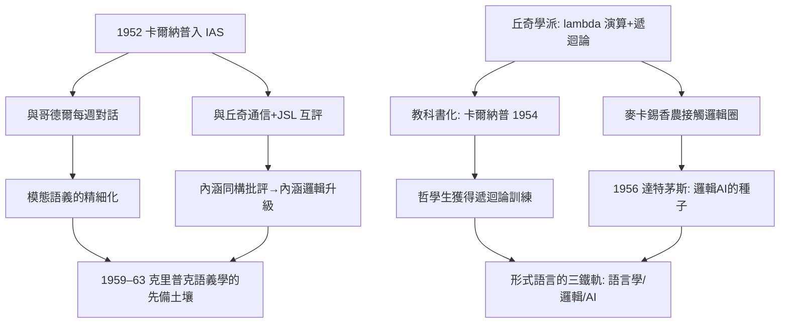

# 5.2 普林斯頓邏輯圈與丘奇學派（1952–1954）

1952–1954 年，卡爾納普以成員身份在普林斯頓高等研究院（IAS）工作。這兩年把他放進了美國數理邏輯的心臟地帶：哥德爾在 IAS，丘奇在普林斯頓大學主持邏輯學派（→ 詳見《丘奇傳記》第 2 章），馮紐曼仍在世。哲學家卡爾納普與邏輯學家的這場會師，深化了他的模態語義學，也把哲學關切帶進了邏輯共同體。

## 普林斯頓的邏輯地理

- **IAS**：哥德爾（1933 年起常駐）、馮紐曼（1933–1957）；奧本海默任院長，數學與邏輯為核心部門之一；
- **普林斯頓大學**：丘奇的數理邏輯研討班自 1930 年代起是英語世界的重鎮，《符號邏輯評》（JSL）的評論主筆；學生與訪問者絡繹不絕——圖靈 1936–38 年在普林斯頓讀博士（→ 詳見《圖靈傳記》第 2 章），克林（Kleene）、羅瑟（Rosser）、西蒙斯（Sims? 不——辛普森之前的幾代）皆出其門下；
- 卡爾納普 1952 年到任時，正逢這個生態的全盛期：他與哥德爾的**每週對話**成為制度化交流——話題涵蓋語義學、模態概念、集合論與數學的哲學；
- 他與丘奇維持多年通信與評論關係：丘奇在 JSL 上長文評論《意義與必然性》（1950–51），既肯定其內涵語義學的技術價值，也提出著名的內涵同構性（congruence）批評——這場批評推動了內涵邏輯的精細化（本書 3.3）。

## 與哥德爾：兩種理性主義的合唱

- 哥德爾私下稱讚《意義與必然性》是「使模態概念獲得精確意義的成功嘗試」，但同時認為卡爾納普的「分析性=依語義規則真」不足以刻畫數學直覺中的客觀必然；
- 兩人分歧的長期結構：哥德爾相信數學真理的**實在性**（柏拉圖主義），卡爾納普堅持數學真理是**語言框架內的約定**——1930 年代埃爾朗根會議以來的舊爭，在普林斯頓以每周散步的形式繼續；
- 技術層面交流卻極富成效：卡爾納普向哥德爾請教模態謂詞邏輯的語義困難（必然算子與量詞的交互），哥德爾則對卡爾納普歸納邏輯的公理化提出數學建議；
- 歷史弔詭：1931 年哥德爾定理曾重創維也納學派的計畫（本書 2.1、2.2），二十一年後，定理的作者與學派的建築師成了每週對談的鄰居——**批判者與被批判者共同把形式方法推向新高度**。

## 丘奇學派的繼承網

- 丘奇學派的特色是「用最苛刻的標準做最小而堅實的形式化」：$\lambda$ 演算、遞迴論、類型論；
- 卡爾納普 1954 年的《符號邏輯導論及其應用》在體例上明顯吸收這種作風：從公理系統的後設性質（一致性、完全性、可判定性）到遞迴函數專章（本書 3.2）；
- 這個邏輯圈的人員流動決定了後來的學科版圖：
  - 香農與麥卡錫在普林斯頓接觸邏輯圈，走向自動機與 AI（→ 詳見《麥卡錫傳記》第 1 章）；
  - 克林把遞迴論系統化為教科書；卡爾普（Karp? 應為庫克 Cook 1951 年代入學於普林斯頓，師承丘奇? — 庫克師承王浩? 需保守）——保守表述：丘奇的學生與再傳學生日後主導了遞迴論與計算複雜性；
- 卡爾納普在其中扮演的獨特角色是**翻譯層**：把丘奇—哥德爾世界的定理，譯成哲學與後續 AI 可用的概念（「規則」「框架」「內涵」），再把哲學問題（意義、必然、歸納）譯成邏輯可處理的形式（本書 5.3）。

**因果**：普林斯頓兩年的因果結構是「地理即思想」：IAS 與普林斯頓大學的邏輯密度，使卡爾納普的語義學獲得數學級的檢驗（哥德爾的認可與丘奇的批評），也使丘奇學派的形式化作風獲得哲學級的翻譯。結果是雙向強化：模態語義學走向克里普克時代的成熟（1959–1963），而邏輯圈的人才（麥卡錫、香農的接觸線）走向 1956 年的達特茅斯會議（本書 5.3）。樞紐的比喻在此最貼切：他本人不產定理，卻讓定理與哲學之間的列車準點。

## 關鍵事件年表

| 年份 | 事件 | 後續影響 |
|------|------|----------|
| 1950–1951 | 丘奇在 JSL 長文評論《意義與必然性》 | 內涵同構批評問世 |
| 1952 | 卡爾納普就任 IAS | 進入普林斯頓邏輯圈 |
| 1952–1954 | 與哥德爾每週對話 | 模態與分析性之爭深化 |
| 1953 | 克雷格定理與確認理論討論 | 歸納邏輯獲數學支援 |
| 1954 | 《符號邏輯導論及其應用》 | 遞迴論進入哲學課程 |
| 1955 | 馮紐曼去世 | 普林斯頓計算時代的交棒 |
| 1956 | 達特茅斯會議 | 邏輯圈的 AI 分支啟動（5.3） |

## 小結

1952–1954 年的普林斯頓，是卡爾納普與美國數理邏輯最高層的正式會師：哥德爾承認其語義學的價值，丘奇檢驗其內涵邏輯的強度，而卡爾納普則把這個世界的方法編入教科書、帶向哲學與 AI。本章 5.1 與 5.3 的兩條鐵軌——生成語法與邏輯 AI——都從這個車站發車。建築師晚年的角色，已從繪圖者轉為調度員。
