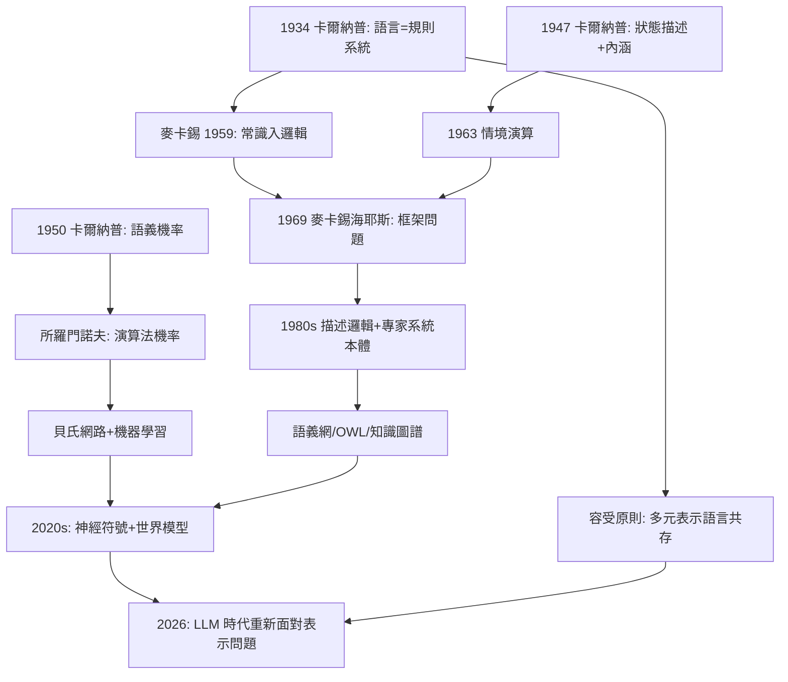

# 5.3 邏輯 AI 與知識表示的路線源頭（1959–2026）

麥卡錫（John McCarthy）1959 年發表《有常識的程式》（Programs with Common Sense），提出「常識必須以邏輯形式表示，推理必須成為計算」——這就是**邏輯 AI 與知識表示**路線的開國文獻（→ 詳見《麥卡錫傳記》第 2 章）。這條路線的概念祖譜上，卡爾納普的名字無處不在：形式語言、內涵語義、確認函數、框架問題的命名史。本節把 1959–2026 年這條線完整鋪開。

## 源頭一：形式語言作為知識的容器

- 邏輯 AI 的第一步是宣稱：**常識知識可以被寫進一門形式語言**。這個宣稱的哲學前提正是卡爾納普的語言觀：一門語言由形成規則與變形規則完全確定（本書 2.2）；
- 麥卡錫 1959 年的提案——「讓程式接受語句形式的通知，並用演繹從中推出行為」——在句法層面就是卡爾納普式的：知識庫=理論 $\mathcal{T}$，行動=從 $\mathcal{T}$ 的推理 $\mathcal{T} \vdash \varphi$；
- 麥卡錫文中直接引述卡爾納普《意義與必然性》處理「can」與模態詞的嘗試（本書 3.3），並建議用「情境」（situations）作為量詞的變域——這是情境演算（situation calculus, 1963）的起點；
- 1969 年麥卡錫—海耶斯《機器中的一些哲學問題》把這個傳統自覺地哲學化：他們處理的「框架問題」（frame problem），正是卡爾納普式「狀態描述」語義（本書 3.3）在行動理論中爆出的內在難題——**知識表示的發展史，就是卡爾納普語義學的工程化與它的危機史**。

## 源頭二：語義資訊與機率知識

- 巴希勒—卡爾納普（1952）的語義資訊論：語句 $p$ 的內容量 $cont(p)=1-p$、排除量 $inj(p)=-\log p$——這是「知識表示要量化不確定性」的最早形式化之一；
- 卡爾納普晚年的確認函數 $c(h \mid e)$（本書 4.2）提供了「證據驅動的信念更新」模板；所羅門諾夫把它升級為演算法機率，成為今日最小描述長度與柯爾莫哥洛夫複雜度的源頭；
- 這條線在 1980–2020 年代的落點：貝氏網路、機率程式語言、與「表示＋學習」混合系統——哲學史家稱之為「卡爾納普的復仇」：被純邏輯派遺棄的機率綱領，在機器學習中全面復活。

## 源頭三：框架、本體論與知識圖譜

- 卡爾納普《經驗主義、語義學與本體論》（1950）的**框架**概念——一門語言規定其對象域，本體論承諾是框架內部事務——成為知識工程的哲學範本：
  - 1970–80 年代的專家系統需要宣告「本體」（ontology：概念分類與關係），術語直接取自哲學；
  - 史丹佛本體論研究（Gruber, 1993：「本體是概念化的明確規格說明」）承認其方法論血統可上溯卡爾納普的語言框架論；
  - 語義網、OWL 本體語言、乃至今日大規模知識圖譜，其「形式詞彙+形式語義+推理服務」三件套，正是卡爾納普「形成規則+語義規則+變形規則」的工程翻版；
- 知識表示語言（如 KL-ONE 及其後的描述邏輯，1980s–）明言設計目標：**可判定的推理**——這對應卡爾納普對「語言要能機械執行」的要求（本書 3.2）；
- 1995 年後，非單調邏輯、預設（default）與信念修正理論（AGM, 1985——其三公理的形式氣質完全是卡爾納普式的），繼續在知識表示會議（KR）上發展；2010 年代起，神經符號（neuro-symbolic）系統試圖把這條邏輯路線與深度學習合流。

## 2026 年的圖景

- 大語言模型時代，「表示」問題以新形式回歸：LLM 是否需要顯式知識表示？符號接地問題、幻覺問題的討論大量借用卡爾納普—麥卡錫詞彙（內涵、指稱、框架、一致性）；
- 世界模型、程序合成與機率程式，可視為三個源頭（形式語言、模態/情境語義、演算法機率）的當代合流；
- 歷史結論：邏輯 AI 不是 AI 史上一個「失敗的支線」，而是知識表示的**語法革命**——它的成就（本體、描述邏輯、可判定推理）與教訓（框架問題、常識鴻溝）共同界定了今日 AI 的問題空間（→ 詳見《麥卡錫傳記》第 3 章）。

**因果**：把 1959–2026 的邏輯 AI 史倒放，每一層都露出一個 1930–1950 年代的卡爾納普概念：知識庫→《邏輯句法》的理論概念；情境演算→狀態描述語義；確認函數→機率知識；本體論工程→框架主義。正向看則是一條「形式化—工程化—危機—再形式化」的螺旋：每一代工具（專家系統→貝氏網→知識圖譜→LLM）都繼承了上一代的形式骨架，又暴露出新的表示危機。這正是卡爾納普方法論的終極驗證：**哲學問題不會被一次性解決，但可以被一次次精確化**。

## 關鍵事件年表

| 年份 | 事件 | 卡爾納普源頭 |
|------|------|--------------|
| 1952 | 巴希勒—卡爾納普語義資訊論 | 語義機率形式化 |
| 1959 | 麥卡錫《有常識的程式》，引卡爾納普 | 語言=規則系統 |
| 1963 | 情境演算 | 狀態描述的行動化 |
| 1969 | 麥卡錫—海耶斯提出框架問題 | 狀態描述語義的內在難題 |
| 1980s | 描述邏輯、專家系統本體 | 形成規則+可判定推理 |
| 1985 | AGM 信念修正 | 框架內部修正的公理化 |
| 1993 | 格魯伯本體論定義 | 語言框架主義 |
| 2000s | 語義網、知識圖譜 | 三件套語言觀的工程化 |
| 2020s | 神經符號、LLM 時代表示之爭 | 容受原則的當代重演 |

## 小結

邏輯 AI 的歷史，可以讀成卡爾納普哲學的一部長篇工程實施報告：他的語言觀給了知識表示語法，他的語義學給了情境與模態的模型，他的機率綱領給了不確定性的尺度，他的框架主義給了本體論工程的許可證。1970 年他去世時未曾見過任何一個 AI 系統；到 2026 年，從知識圖譜到大語言模型的表示之爭，戰場上的核心詞彙仍是他鍛造的。樞紐的角色至此完成：**弗雷格—羅素的邏輯、維也納的語言批判、維根斯坦的語言焦慮，經卡爾納普的形式化，最終成為機器時代的知識語法。**
