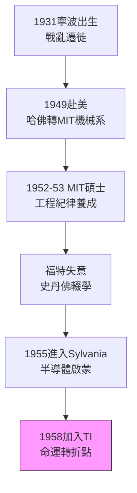

# 1.1 亂世少年與麻省理工(1931-1955)

## 寧波少年的大逃難

張忠謀 1931 年 7 月 10 日生於浙江寧波，父親張錫綸是鄞縣財政局長。抗日戰爭爆發後，全家自南京輾轉廣州、香港、重慶、上海，十年間搬家十餘次。這段顛沛流離的童年在他自傳中被反覆提起：火車上躲避轟炸、在重慶南開中學借讀、在上海南洋模範中學插班。動盪讓他養成兩個終身特質——對「穩定秩序」的渴望，以及在陌生環境中快速適應的生存能力。

1949 年，18 歲的張忠謀隨家人赴香港，考入美國哈佛大學，一年後轉入麻省理工學院（MIT）機械系。選擇 MIT 而非哈佛文理，是父親務實的建議：「學工比較容易找事。」這個決定把他推向了戰後美國工程教育的心臟。

## 史丹佛博士與半導體的召喚

1952 年張忠謀自 MIT 取得學士、1953 年取得碩士，隨後進入福特汽車工作，卻發現自己對汽車毫無熱情；又赴史丹佛大學攻讀博士，因經濟壓力中途輟學，先就業、十年後才回頭拿下博士學位。這段「中斷」後來被證明是幸運：1955 年他求職時，正值蕭克利（Shockley）西遷、仙童（Fairchild）醞釀成立前夜，半導體業求才若渴。比起純學術路線，提早進入產業界讓他完整經歷了電晶體邁向積體電路的十年。

他在 1955 年先進入希凡尼亞（Sylvania）半導體部門，月薪比福特高出一美元——這「一美元的差距」把他帶進了半導體史。1958 年，他跳槽到德州儀器（Texas Instruments, TI），師從傑克·基爾比（Jack Kilby）時代的核心團隊。

真正塑造他技術人格的是 MIT 與史丹佛的訓練：嚴謹的固態物理、統計品質觀念，以及美國大企業的工程管理語言。當時半導體仍是「黑藝術」，良率靠老師傅經驗；張忠謀是最早把「良率是統計與紀律問題」帶入生產線的人之一。

## 從機械到半導體的躍遷

以今日眼光看，張忠謀的學路並非天才型直線，而是一次次務實修正：機械→半導體、博士→就業、東岸→德州。每一次轉向都遠離舒適圈，卻更靠近產業爆發點。當他在 1958 年走進 TI 大門時，積體電路尚未發明，但一切要素——鍺轉矽、平面製程、軍方訂單——都已就位。他趕上了最好的班車。

$$P(\text{成功}) = P(\text{能力}) \times P(\text{站在風口}) \times P(\text{堅持})$$

張忠謀後來自述：「我一生都是 orangutan（人猿）——別人爬樹，我也爬，只是爬得慢而穩。」亂世少年學會的第一課，就是不抱怨環境，只問自己能在環境中佔據什麼位置。

## 因果鏈

- **前因驅動**：中日戰爭與國共內戰造成的流亡童年 → 塑造適應力與對秩序的信仰；父親務實主義 → 放棄文人路、選擇 MIT 工科 → 進入戰後美國工程體系。
- **本節如何引發後果**：MIT 的統計與製造思維 + 提早進入半導體業 → 使他在 TI 能以「良率管理」嶄露頭角（見 1.2）；史丹佛博士中斷 → 十年後以 TI 副總裁身分回校補博士，恰恰證明「產業成就反哺學術」的路徑，也預示他日後「實業重於學位」的管理哲學。
