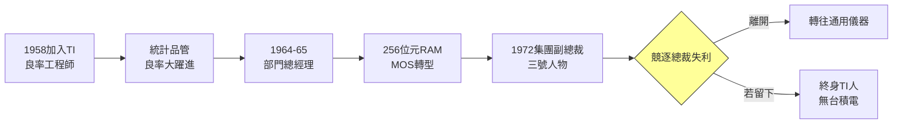

# 1.2 德州儀器的二十五年(1958-1972)

## 從小工程師到三號人物

1958 年張忠謀加入德州儀器時，TI 剛與仙童競逐積體電路發明權，傑克·基爾比在 TI 做出第一塊鍺積體電路。張忠謀的第一份工作是改善鍺電晶體的生產良率。他把 MIT 學到的統計製程管制（SPC）引入生產線，用數據而非經驗找缺陷源，良率在一年內大幅提升，從此被高層注意到。

1961 年，TI 資助他重返史丹佛，一年內拿下電機博士——創下史丹佛罕見的「一年博士」。1964 年他升任鍺電晶體部門經理，1965 年升任積體電路部門總經理，1967 年成為 TI 半導體集團副總裁，1972 年升任集團副總裁，成為 TI 僅次於董事長與總裁的三號人物，也是當時美國大企業中職位最高的華人。

關鍵戰役有二。其一是 **256 位元 RAM 與 MOS 之戰**：1960 年代末，TI 在雙極（bipolar）技術上領先，卻輕視新興的 MOS 技術；張忠謀力主投入 MOS 與記憶體研發，主導開發出早期 256 位元 RAM，並推動 TI 在 MOS 上追趕仙童與英特爾。其二是 **4K DRAM 的抉擇**：他主張 TI 全力投入半導體記憶體，與摩托羅拉、英特爾正面競爭；雖然 TI 後來在 DRAM 上未成霸主，但這段經歷讓他透徹理解「技術路線一旦選錯，規模再大也救不回」。

## 學到的與沒學到的

在 TI，張忠謀學會了三件事：第一，**良率即利潤**——半導體是製造業，製程穩定度決定成本；第二，**大企業的紀律**——預算、目標、績效考核的完整體系；第三，**美國式研發管理**——用專案與里程碑推進技術。

但他也看到了 TI 的病灶：官僚、派系，以及 IDM（整合元件製造）模式下「設計」與「製造」互相掣肘。TI 既做產品又做製程，資源永遠向當紅產品傾斜，製造部門淪為配角。這個觀察在他心中埋下一顆種子：**設計與製造分開，製造專注到極致，會不會更有效率？** 純代工的念頭，萌芽於 TI 的走廊。

1972 年，張忠謀競逐 TI 總裁失利（敗給 G. H. Brock），心灰意冷離開待了 14 年的公司（一說 1958–1972 為 TI 年資，合計德儀生涯約 14 年；加上前後半導體資歷常被概括為「德儀 25 年經驗」的起點）。失利反而把他推向更大的舞台。

## 天花板與出走

張忠謀在 TI 碰到華人當時在美國企業幾乎共同的天花板：技術可以到頂，總裁需要「自己人」。他的離開既是個人挫折，也是產業史的幸運——若他當上 TI 總裁，台灣半導體史可能要重寫。正如他後來說：「TI 教會我一切，除了教我如何當老闆。」

$$良率 = \frac{好晶粒數}{總晶粒數} = f(\text{缺陷密度}, 晶圓面積)$$

這個簡單公式是他在 TI 二十五年（廣義半導體資歷）經驗的結晶：半導體競爭的本質是數學，是缺陷密度的戰爭。日後台積電的一切管理——夜鷹計畫、統計製程管制、機台利用率——都源於此。

## 因果鏈

- **前因驅動**：MIT 統計訓練（1.1）+ TI 的積體電路創業氛圍 → 張忠謀以良率管理快速晉升；TI 的 IDM 內耗 → 萌生「設計製造分離」直覺。
- **本節如何引發後果**：TI 總裁競逐失敗 → 被迫離開舒適圈、接掌通用儀器（見 1.3），從「專業經理人」轉向「企業領導人」；MOS 與記憶體之戰的教訓 → 日後台積電堅持「不與客戶競爭、只做製造」的戒律；良率至上的信念 → 成為台積電技術文化的基因。
