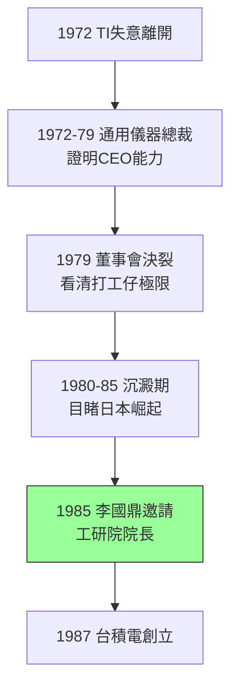

# 1.3 通用儀器與返台前夜(1972-1985)

## 從老三到老闆

1972 年離開 TI 後，張忠謀接任通用儀器（General Instrument, GI）總裁，成為美國大型半導體公司最早的華人總裁之一。GI 當時以電視調諧器、機上盒與半導體起家，張忠謀大刀闊斧整頓：裁撤虧損部門、聚焦半導體、推動消費電子晶片。在他任內（1972–1979），GI 營收與獲利顯著改善，他證明了自己不只能管工廠，也能當 CEO。

但 GI 的董事會文化與 TI 迥異：短視、內鬥、只看季度財報。1979 年張忠謀與董事會決裂，轉任通用儀器營運長一年後離開，短暫赴紐約擔任通用儀器之外的顧問與投資人。這段「一把手初體驗」既是成功也是挫折：成功在於證明領導力，挫折在於讓他看清——**沒有股權與理念認同的總裁，只是高級打工仔**。

1980–1985 年，他進入半導體生涯的沉澱期：擔任創投顧問、觀察日本半導體崛起（NEC、東芝、日立以 DRAM 橫掃美國），並目睹美國 IDM 模式在日本「產官學一體」攻勢下節節敗退。日本通產省主導的 VLSI 計畫讓他深思：**政府之力若用得好，可以是半導體的槓桿，而非包袱。**

## 來自台灣的邀請

1985 年，台灣行政院政務委員李國鼎與工研院院長徐賢修透過關係，邀請 54 歲的張忠謀返台擔任工研院院長。當時台灣半導體幾乎為零：只有工研院電子所從 RCA 引進的 7 微米 CMOS 技術，以及一家虧損的聯華電子（UMC，1980 年成立）。許多人不解：一個美國大公司總裁，為何要去一個年預算不及 TI 零頭的研究機構？

張忠謀的算計有三層：其一，在美國的天花板已現，GI 經驗讓他渴望「自己開創」；其二，台灣政府（李國鼎、孫運璿）展現出日本通產省式的決心，願意出錢、出政策；其三，他心中「設計製造分離」的構想，在美國大公司體制內無人理睬——台灣這張白紙，反而是最佳試驗場。

1985 年秋天，他舉家遷台，接下工研院院長聘書。兩年後，台積電誕生。

## 命運的伏筆

通用儀器的七年，是張忠謀從「將」到「帥」的成人禮。他學會了取捨（砍部門）、用人（找對的副手）、以及與政府打交道。而 1980 年代初日本半導體對美國的碾壓，給了他最關鍵的歷史教材：**後進者可以用新商業模式彎道超車**——日本用的是國家隊與製造紀律，他將用的，是純代工。

$$後進優勢 = 模仿成本 < 創新成本 + 體制包袱^{-1}$$

## 因果鏈

- **前因驅動**：TI 的管理紀律（1.2）→ 在 GI 得以施展 CEO 手腕；GI 董事會短視 → 激發「必須自己創業、掌握股權與理念」的決心；日本 VLSI 的刺激 → 相信政府 + 新模式可以顛覆既有霸主。
- **本節如何引發後果**：GI 的一把手資歷 → 讓李國鼎敢把工研院與半導體大業託付給他；對 IDM 弊病與日本模式的雙重理解 → 直接導出下一章「工研院出技術、飛利浦出品牌、台積電只做代工」的合資設計（見 2.1）。
