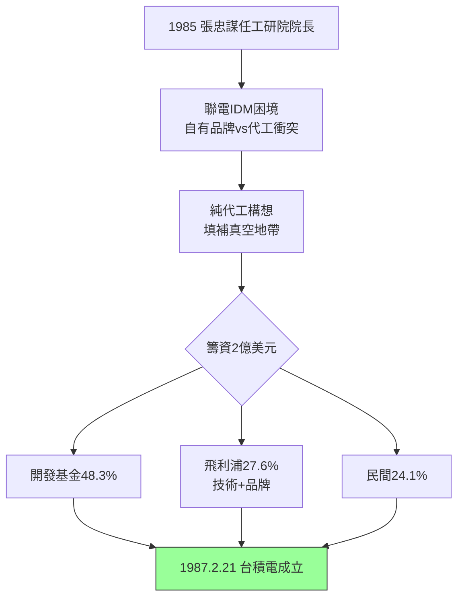

# 2.1 工研院與飛利浦合資(1985-1987)

## 兩億美元的賭局

1985 年張忠謀接任工研院院長，兼任聯電董事長，很快發現聯電（UMC）同時做設計與製造、自有品牌與代工混雜，正是他反對的 IDM 老路。他提出分拆另立新公司的構想：**一家不做產品、只做代工的公司**。當時幾乎所有人反對——工研院官員問：「不做產品要賣給誰？」台灣商人問：「幫別人代工能賺什麼錢？」

張忠謀的說帖直指產業結構：設計公司（fabless）正在美國萌芽，但建一座晶圓廠要上億美元，小設計公司建不起；大 IDM 又不願真心代工（怕養大競爭對手、產能先供自家）。中間有一個真空地帶——**中立、可信、只做製造的代工廠**。他估算籌資需約 2 億美元（當時約新台幣 80 億元），行政院開發基金出資 48.3%、荷蘭飛利浦（Philips）以技術授權與現金換 27.6%、民間企業認購其餘 24.1%。

飛利浦的加入是關鍵一筆：它帶來 0.5–2 微米 CMOS 製程技術授權、品牌背書與歐洲客戶，更重要的是讓「台灣代工」在國際上有了信用狀。1987 年 2 月 21 日，台灣積體電路製造公司（TSMC）在新竹科學園區正式成立，資本額 22.8 億新台幣，張忠謀兼任董事長，工研院電子所約 100 多位工程師整批轉入，第一座廠（一廠）以工研院既有廠房改建。

## 為什麼是飛利浦？

飛利浦當時是歐洲 IDM 巨頭，為何願意扶持未來的競爭者？原因有三：一是飛利浦想降低製造成本、把部分產能外包；二是荷蘭政府鼓勵對亞洲技術合作；三是張忠謀在 TI、GI 的人脈與信譽。飛利浦副總裁范德維爾（F. Barlow）與張忠謀一拍即合。這個合資結構日後證明是神來之筆：官方資金扛住重資本風險、外資技術墊高起點、民間資本保持市場紀律。

## 白手起家的第一廠

創業之初的台積電寒酸至極：廠房是工研院舊廠、設備是二手與拼湊、技術落後英特爾至少兩個世代（當時主流已進 1 微米，台積電從 2 微米起步）。但它有兩項無形資產：張忠謀的紀律（夜鷹計畫、SOP、良率文化），以及「不與客戶競爭」的信用承諾。這兩項資產，在未來三十年複利增長為護城河。

$$代工價值 = 客戶節省的建廠成本 - 代工毛利 > 0 \Rightarrow 雙贏$$

這個不等式成立，是整個台積電故事的數學基礎。

## 因果鏈

- **前因驅動**：TI 的 IDM 內耗教訓（1.2）+ GI 的 CEO 經驗與政府打交道能力（1.3）+ 台灣官方資金與飛利浦技術供給 → 三方合資成為可能；美國 fabless 萌芽 → 提供需求面的真空。
- **本節如何引發後果**：合資成立 → 解決「錢與技術」的初始約束，但留下「客戶在哪裡」的問題 → 必須發明純代工的商業話術與信任機制（見 2.2）；飛利浦技術起點 → 決定早期只能做成熟製程、靠良率與服務取勝的路徑。
