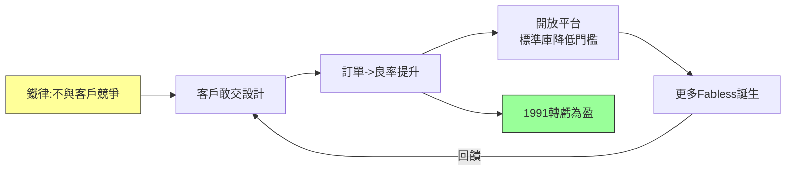

# 2.2 純晶圓代工的理念革命(1987-1991)

## 不與客戶競爭

台積電成立時，張忠謀立下一條鐵律：**永不設計、永不賣自有品牌產品，永遠不與客戶競爭**。在 1987 年，這句話近乎異端——當時所有半導體公司都以自有產品為榮，代工是 IDM 產能過剩時的施捨。但張忠謀看到的是分工的必然：隨著摩爾定律推進，建廠成本指數上升（$C_{fab} \propto 2^{n}$），設計成本也在上升，單一公司同時負擔兩端將不堪重負。分工才能讓各自專注，整體創新加速。

為落實信用，台積電發明一整套制度：客戶的設計資料嚴格隔離（不同客戶團隊物理隔離）、業務人員不得洩露產能資訊、產能分配透明化。張忠謀親自拜訪美國潛在客戶，保證「你的競爭對手也是我的客戶，我對誰都一樣」。這種「瑞士中立」定位，讓彼此廝殺的設計公司敢把命根子（GDSII）交出來。

## Fabless 生態的助產士

純代工模式與無廠半導體（fabless）互為因果、互相驅動：沒有可信代工，fabless 不敢創業；沒有 fabless，代工沒有訂單。1987–1991 年，台積電的早期客戶包括英特爾（小量外包）、Altera（可程式邏輯）、以及後來的 Broadcom 前身、Nvidia 前身概念團隊。真正關鍵的是與 **Altera、Xilinx、Adaptec** 等公司的合作：它們把最先進的產品交給台積電，台積電用超預期的良率與交期回報。

張忠謀還推動「開放創新平台」（後成 Open Innovation Platform 前身）：提供標準元件庫（standard cell library）與設計手冊，讓小公司不必懂製造也能投片。這等於把晶圓廠的圍牆拆掉，把製造能力「API 化」。IDM 把製程視為機密，台積電卻把製程文件化、模組化——開放反而帶來更多訂單。

## 虧損前四年

理念雖美，現實殘酷：1987–1990 年台積電連年虧損，產能利用率不足，飛利浦一度想撤資，民間股東抱怨連連。轉機在 1991 年：全球半導體回暖 + fabless 浪潮 + 台積電良率追上國際水準，當年開始獲利。張忠謀用四年證明：信任是最貴的固定資產，攤提前很長，攤提後極厚。

## 因果鏈

- **前因驅動**：TI 內耗（1.2）提供反面教材 → 萃取出「中立代工」正解；合資解決錢與技術（2.1）→ 剩下信任問題必須用制度回答。
- **本節如何引發後果**：「不競爭」信用 + 開放平台 → 孵化 fabless 生態 → 帶來 1990 年代訂單洪流（見 2.3）；1991 年獲利 → 證明模式可行 → 吸引資本市場支持後續三廠、四廠擴建，也為聯電被迫跟進轉型埋下伏線（見 3.2）。
