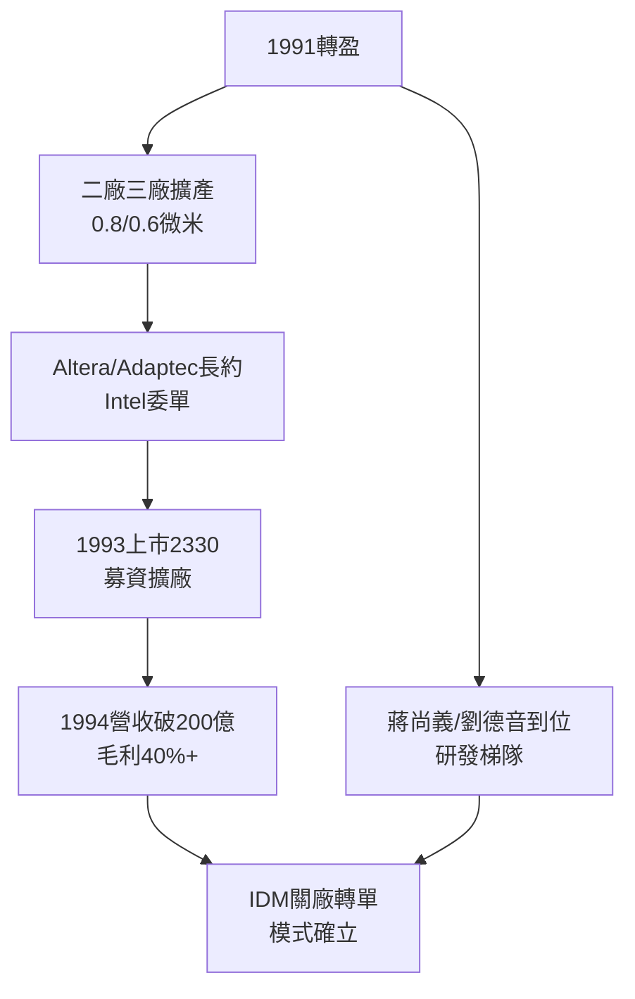

# 2.3 早期客戶與上市之路(1991-1994)

## 從虧損到上市

1991 年轉盈後，台積電進入高速擴張：二廠（1990 投產）、三廠（1992 動工）相繼上線，製程從 1.0 微米推進到 0.8、0.6 微米。客戶結構質變：從零星外包變成長約大單，Altera、Adaptec、Cirrus Logic 把主力產品線移入，英特爾也在特定晶片組上委單——連 IDM 龍頭都承認台積電的成本與良率優勢。

1993 年 9 月，台積電股票在台灣證券交易所掛牌上市（2330），成為當時台灣最大的民營科技 IPO 之一。上市募集的資金投入四廠與 Fab 5（第一座 8 吋廠的前期規劃），產能利用率長期維持 90% 以上。1994 年營收突破新台幣 200 億元，毛利率超過 40%——證明代工不是微利，而是在高利用率下接近軟體業的高槓桿生意：

$$毛利率 = 1 - \frac{固定折舊 + 變動成本}{單價 \times 利用率 \times 良率}$$

利用率與良率雙高時，折舊被攤薄，利潤爆發。

## 蔣尚義的到來

1994 年前後的另一條暗線是人才。1990 年代初，張忠謀延攬在 TI、惠普任職的 **蔣尚義**（後任研發副總、共同營運長）返台。蔣尚義帶來美國最前沿的 CMOS 與記憶體研發管理經驗，主導 0.5 微米以下研發，為下一章的銅製程與 300mm 埋下人才種子。同時，孫元成、劉德音（1993 加入）、魏哲家（1998 加入）等幹才陸續到位，「台積電大聯盟」的人才梯隊成形。

## IDM 時代的黃昏

1994 年，台積電與聯電合計已佔全球代工市場大半，fabless 公司數量從 1980 年代的十餘家暴增至上百家。IDM 巨頭（TI、摩托羅拉、飛利浦）紛紛關閉老舊小廠、轉單台積電——它們親手餵大了顛覆者。張忠謀在 1994 年法說會上預言：「未來全世界只需要幾家最先進的晶圓廠，其餘都將外包。」當時被視為狂言，十年後成為現實。

## 因果鏈

- **前因驅動**：「不競爭」信用（2.2）→ 換來大客戶長約 → 利用率拉滿 → 高毛利 → 上市成功；人才引進 → 研發能力從「跟隨飛利浦」轉向「自主研發」。
- **本節如何引發後果**：上市資金 + 高利用率現金流 → 支撐下一章動輒數十億美元的銅製程、300mm 與浸潤式豪賭（見 3.1、3.2）；IDM 外包潮 → 代工市場規模膨脹 → 引來聯電轉型對決與三星覬覦，為技術爬坡期的競爭埋下戰線。
