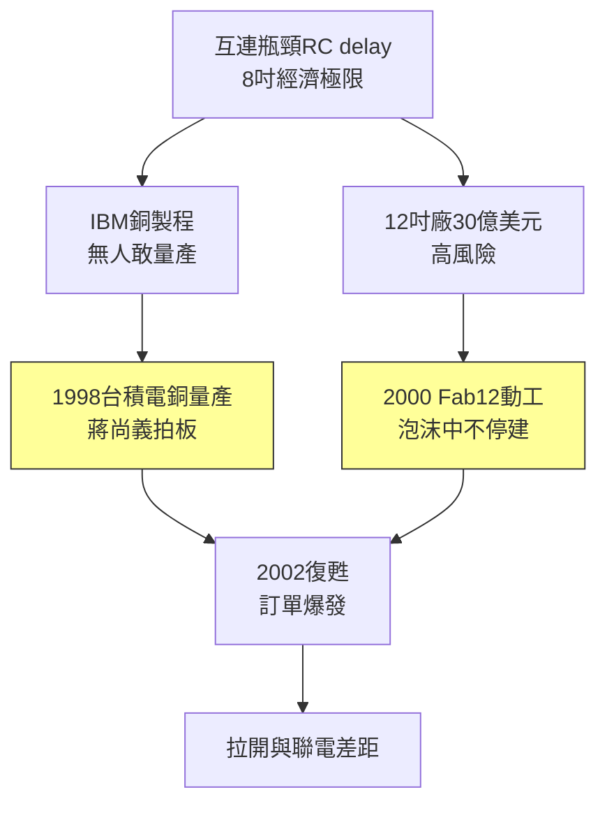

# 3.1 銅製程與三百毫米晶圓(1997-2003)

## 兩場豪賭

1990 年代末，半導體撞上兩道牆。第一道是互連延遲：隨著線寬縮小，傳統鋁導線電阻與電容延遲超過電晶體本身， $RC$ delay 成為瓶頸；IBM 率先研發出銅鑲嵌（copper damascene）製程，但良率極低、污染風險大，無人敢量產。第二道是晶圓尺寸：8 吋（200mm）晶圓逼近經濟極限，12 吋（300mm）可讓每片晶粒數增加約 2.25 倍，但一座 12 吋廠投資超過 30 億美元，失敗即滅頂。

1997–1998 年，在蔣尚義與孫元成主導下，台積電決定兩場仗一起打：1998 年宣布銅製程量產（0.25/0.18 微米世代），與 IBM、摩托羅拉幾乎同步，甚至在量產良率上反超；2000–2001 年 Fab 12（竹科第一座 12 吋廠）動工，2001 年試產，正逢網路泡沫破裂、半導體史上最慘衰退。張忠謀力排眾議不停建，反而加碼——因為他算過：衰退時建廠成本最低，復甦時產能就是定價權。

結果：2002–2003 年復甦來臨時，台積電手握業界最成熟的銅製程 + 最先投產的 12 吋產能，Nvidia、ATI、Broadcom 的高階訂單蜂擁而至，市占一舉拉開與聯電的差距。

## 夜鷹計畫與研發紀律

技術豪賭敢贏，靠的是研發紀律。蔣尚義建立的「夜鷹計畫」（Nighthawk）、技術委員會與階段關卡（stage-gate）制度，把研發從天才靈感變成可管理的工程：每代製程定義明確的良率、缺陷密度（ $D_0$ ）與可靠性目標，不達標不轉量產。這套源自 TI 的統計文化，在台積電被發揮到極致——工程師笑稱「在台積電，數據會說話，官大也沒用」。

## 規模的複利

銅製程與 12 吋的勝利，確立了台積電此後二十年的公式：**用資本開支換技術領先，用技術領先換訂單，用訂單現金再投入更大的資本開支**。競爭對手一次豪賭失敗就掉隊，台積電則把豪賭變成常態——因為它的良率體系讓豪賭的勝率遠高於同業。

## 因果鏈

- **前因驅動**：上市資金與高利用率現金流（2.3）→ 供得起 30 億美元賭注；TI/惠普研發人才（蔣尚義、孫元成）→ 具備消化 IBM 銅技術並量產的能力；網路泡沫的低建廠成本 → 反週期投資回報最大化。
- **本節如何引發後果**：銅 + 12 吋領先 → 產能與成本優勢 → 在下一輪浸潤式微影競賽中有本錢再賭（見 3.2）；與聯電的技術差距從半年拉大到一年以上 → 直接導致 2000 年代聯電轉型掉隊、人才倒戈，為「雙雄變一強」定調。
