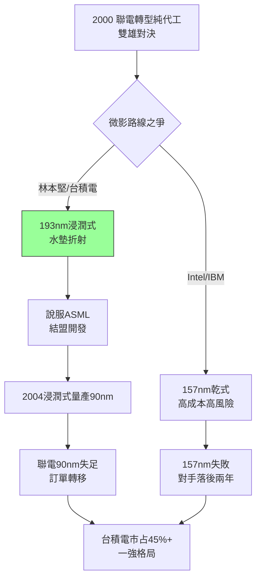

# 3.2 與聯電之爭與浸潤式微影(2000-2007)

## 雙雄對決的終結

2000 年前後，聯電在曹興誠帶領下宣布放棄自有品牌、全力轉型純代工，與台積電正面對決，一度在 0.18 微米世代緊咬。但台積電以三招拉開差距：第一，銅製程與 12 吋的先發產能（見 3.1）；第二，專利與人才磁吸——聯電 2005 年和艦案、何建廷案等爭議重創士氣，部分戰將轉投台積電；第三，也是最致命的，是對下一代微影的路線抉擇。

## 157nm 乾式 vs 193nm 浸潤式

2002–2003 年，全行業為下一代微影路線爭吵：英特爾、IBM 主張跳往 157nm F2 乾式微影；台積電微影處長林本堅（Burn Lin）逆勢主張 **193nm 浸潤式微影（immersion lithography）**——在鏡頭與晶圓之間墊一層水，靠折射率（$n \approx 1.44$）把等效波長縮短，延續 193nm 機台壽命。當時被譏為「洗澡式曝光」，英特爾甚至拒絕評估。

張忠謀與蔣尚義拍板力挺林本堅，並說服關鍵夥伴 ASML 全力開發浸潤式機台（TWINSCAN XT:1900i 系列）。2004 年台積電率先以浸潤式量產 90nm，2005–2007 年推進至 65/45nm，良率與成本雙勝。堅持 157nm 的陣營血本無歸，英特爾被迫回頭跟進時，已落後兩年。ASML 自此與台積電結為生死同盟——台積電給方向、給訂單、給製程回饋，ASML 給最優先的機台與工程師。

2005 年聯電在 90nm 良率上失足、大客戶（Xilinx、Broadcom 部分訂單）轉單台積電，雙雄格局就此終結：台積電市占突破 45%，聯電跌破 15% 且再未追近。

$$NA_{eff} = n \cdot \sin\theta, \quad CD \propto \frac{\lambda}{NA_{eff}}$$

一層水把 $n$ 從 1 提高到 1.44，摩爾定律續命至少三個世代——這是物理光學送給製造紀律的禮物。

## 因果鏈

- **前因驅動**：銅 + 12 吋的現金與信心（3.1）→ 敢在微影上再賭一把；林本堅的光學洞見 + 蔣尚義的研發紀律 → 把異想變成量產；ASML 當時居於尼康、佳能之後、急需差異化 → 願意與台積電共押冷門。
- **本節如何引發後果**：浸潤式勝利 → 台積電–ASML 同盟固化 → 為 EUV 世代的優先供貨與共同研發鋪路（見 4.2）；聯電掉隊 → 2009 年後退出先進製程競賽 → 台積電在 FinFET 世代只需對決三星與英特爾，戰線簡化。
