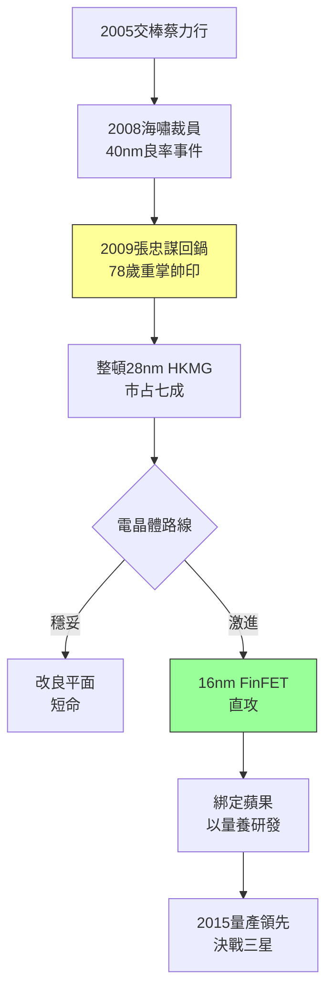

# 3.3 FinFET豪賭與重掌帥印(2005-2011)

## 交棒危機

2005 年，74 歲的張忠謀交棒給蔡力行，轉任董事長。然而 2008 年金融海嘯重創半導體，蔡力行以裁員、凍薪應對，重創台積電「不裁員」的文化與士氣；同時在 40nm 世代良率出包，Nvidia 執行長黃仁勳公開抱怨，訂單一度轉向聯電與三星。2009 年 6 月，張忠謀以 78 歲高齡重掌 CEO，發動「新台積電運動」：恢復雇用、加薪、重建紀律，並親自督軍下一代電晶體。

## 平面 vs 鰭式

背景是物理極限：28nm 之後，平面（planar）電晶體漏電失控，$I_{off}$ 指數上升，功耗牆擋住微縮。三星與英特爾押注 **FinFET（鰭式場效電晶體）**——把通道立起來、三面包覆閘極，大幅抑制短通道效應；台積電內部一度爭論是否先推改良平面（HKMG + planar）求穩。梁孟松（時任先進技術負責人之一）等人主張直攻 FinFET。

2011 年，台積電宣布 16nm FinFET 路線圖（後以 16FF/16FF+ 量產），與三星 14nm、英特爾 14nm（Tri-Gate）正面對決。為了 FinFET，台積電投入空前研發資源，並與蘋果深度綁定（見 4.1）——沒有大客戶的量保證，不敢開這麼大的製程賭局。2009–2011 年的重整（恢復士氣、整頓 40nm、確立 28nm HKMG 量產領先）為 FinFET 攒足了本錢：28nm 台積電市占超過七成，賺來的現金全數投入 16/20nm 研發。

梁孟松於 2009 年前後因升遷爭議離職、輾轉赴三星（引發著名的競業訴訟與洩密爭議），一度被視為人才流失；但劉德音、魏哲家接掌研發與業務，蔣尚義回鍋顧問，梯隊無縫接軌，反而證明了台積電體系重於個人。

## 老帥的最後一戰

張忠謀回鍋的兩年，是台積電史上最驚險的轉折：若 28nm 守不住，蘋果不會把 A 系列交出來；若 FinFET 選錯，高通、蘋果將倒向三星。兩關都過，台積電才從「代工一哥」變成「技術盟主」。

## 因果鏈

- **前因驅動**：40nm 教訓 + 海嘯士氣危機 → 觸發回鍋；28nm HKMG 的現金流 → 供得起 FinFET 豪賭；浸潤式同盟（3.2）→ ASML 機台保障 FinFET 所需的多重曝光產能。
- **本節如何引發後果**：16nm FinFET 路線確立 + 蘋果訂單（見 4.1）→ 在 2015–2016 年與三星的 A9 代工對決（雙採購、台積電版續航勝出）中獲勝 → 奠定 7nm 獨拿蘋果的基礎（見 4.2）；梁孟松事件 → 強化營業秘密與競業管理，也讓三星短期獲益、長期仍敗給體系戰。
