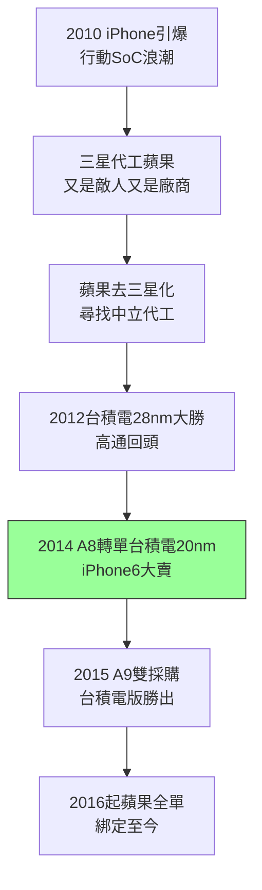

# 4.1 行動裝置浪潮與蘋果訂單(2010-2014)

## iPhone 重新定義晶片

2010 年 iPhone 4 引爆智慧型手機浪潮，行動 SoC 成為半導體成長最快的市場：要求極致效能功耗比（ $Performance/Watt$ ）、一年一世代的節奏、千萬級出貨量。傳統 PC 晶片（英特爾）節奏太慢、功耗太高；高通、蘋果（A 系列）、Nvidia Tegra 等 ARM 陣營需要一個能跟上手機節奏的製造夥伴。三星當時既是蘋果代工廠、又是手機競爭者（Galaxy 告 iPhone），蘋果如芒在背——「把命脈交給敵人」不可忍。

2013–2014 年，蘋果決定將 A8 處理器（iPhone 6）由三星轉單台積電 20nm。這是台積電史上最重要的訂單：蘋果要求產能（包下數座廠）、良率（高於三星）、保密（獨立產線、獨立團隊）。魏哲家（業務與營運）親自督軍，劉德音（研發）保證 20nm SoC 製程準時量產。2014 年 A8 準時交貨，iPhone 6 狂賣，台積電 20nm 營收佔比一季之內衝上兩成。

## 三星的陰影

拿下蘋果之前，台積電先嚐過失去的滋味：2011–2013 年 A5/A6/A7 皆由三星代工，高通 28nm 也曾分單三星。轉折點是 28nm（2012）：台積電良率與產能大勝，三星 28nm 良率不穩、高通回頭加單；加上 2012–2013 年蘋果三星專利大戰，蘋果去三星化決心已定。台積電的「不做手機」中立性，在此成為決定性優勢——蘋果寧可與不做產品的台積電分享藍圖，也不願再讓三星看到 A 系列的架構。

2015 年 A9（iPhone 6s）蘋果採雙採購（三星 14nm + 台積電 16nm），實測台積電版續航與發熱更優，輿論譁然（「晶片門」Chipgate）；2016 年 A10 起蘋果全數回歸台積電，此後再未離開。

## 一個客戶，半壁江山

蘋果訂單佔台積電營收一度超過兩成，帶來甜蜜的煩惱：議價壓力、產能排擠（聯發科、高通抱怨拿不到產能）、技術路線被單一客戶牽引。但正面效應更大：蘋果的量與利潤資助了 16nm、10nm、7nm 的研發（每年資本開支破百億美元），蘋果的嚴苛要求（PPA、良率爬坡速度）逼出台積電的極限。這是「以大客戶養大研發」的正循環。

## 因果鏈

- **前因驅動**：28nm 大勝與中立信用（3.3）+ 蘋果三星專利戰 → 蘋果轉單的動機與信心；20nm 準時量產能力 → 接得住 A8 的量與時程。
- **本節如何引發後果**：蘋果的量與錢 → 資助 FinFET 世代決戰（見 4.2），讓台積電敢在 10/7nm 上全速衝刺；A9 雙採購的勝利 → 三星在行動 SoC 代工上信用破產 → 高通、輝達後續跟進轉單，台積電在 7nm 時代獨大。
