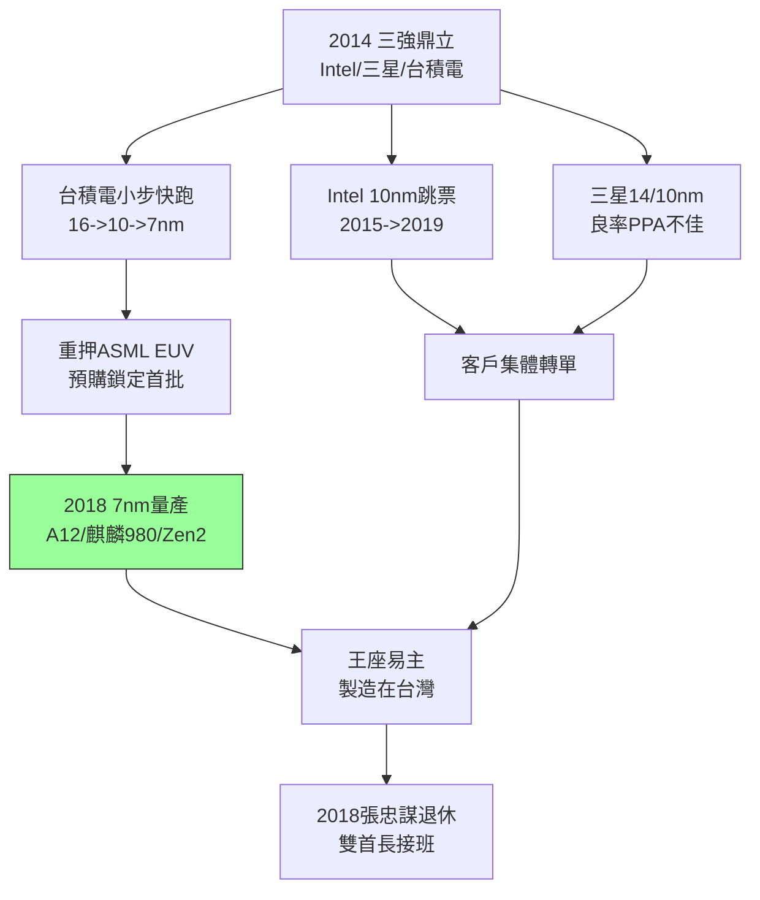

# 4.2 七奈米超越三星英特爾(2014-2018)

## 三強鼎立的結局

2014–2018 年是先進製程的決戰期。英特爾在 14nm  MULTIPATTERNING 上延宕、10nm 連年跳票（2015→2017→2019），摩爾定律在 Santa Clara 熄火；三星 14/10nm 雖早量產，但良率與 PPA（功耗效能面積）遜色，高通驍龍 810 的發熱門重創其口碑。台積電採取「小步快跑」：20nm（平面最後一代）→ 16FF/16FF+（FinFET）→ 10nm（短命過渡）→ 7nm（決勝），每一代都準時、每一代都滿載。

關鍵是 EUV 的抉擇。ASML 的極紫外光（EUV， $\lambda = 13.5nm$ ）機台研發十餘年，一台要價逾億美元，英特爾、三星態度猶豫；台積電與 ASML 對賭：以巨額預購鎖定首批 EUV（NXE:3350/3400），並投入浸潤式多重曝光作為過渡，確保 7nm（DUV 多重曝光版）2017 年風險量產、2018 年以 7nm+（EUV）領先全行。高通、蘋果、海思、AMD、Nvidia 全數押注台積電 7nm——客戶用訂單投票，英特爾第一次在製造上被代工廠超越。

2018 年：台積電 7nm 量產（蘋果 A12、華為麒麟 980、AMD Zen 2）；三星 7nm EUV 落後半年以上且無大客戶；英特爾 10nm 跳票、被迫承認「製程領先不再」。半導體王座易主——**設計在美國、製造在台灣**的新分工確立。

## 張忠謀退休

2018 年 6 月，87 歲的張忠謀正式退休，交棒給劉德音（董事長）與魏哲家（總裁）雙首長制。他留下的台積電：市值逾 2000 億美元、全球市占逾五成、先進製程市占近九成。退休演說只強調一句：「誠信正直、承諾、創新、客戶信任。」——與 1987 年創業時同一套詞。

## 技術為王的證明

7nm 的勝利，本質是三場勝利的疊加：浸潤式同盟（3.2）保證過渡產能、FinFET 豪賭（3.3）保證電晶體架構、蘋果訂單（4.1）保證研發經費。三者缺一不可。這也解釋為何三星、英特爾單點突破卻全局落敗——它們缺的不是技術，而是「可信中立 + 大客戶量 + 製造紀律」的體系。

$$PPA_{7nm} = f(\text{FinFET} + \text{EUV/多重曝光} + D_0) \quad 台積電三項全優$$

## 因果鏈

- **前因驅動**：ASML 同盟（3.2）→ EUV 優先供貨；蘋果資金（4.1）→ 撐起百億美元資本開支；對手失誤（Intel 跳票、三星良率）→ 客戶集中轉單形成雪球。
- **本節如何引發後果**：7nm 獨大 → 囊括蘋果、AMD（Zen 逆襲英特爾）、輝達 AI 晶片 → 為 5/3nm 的絕對領先與高毛利（>50%）奠基；王座易主 → 觸發美國「製造回流」的焦慮與華為圍堵（見 4.3、5.2），技術勝利引來地緣政治反噬。
