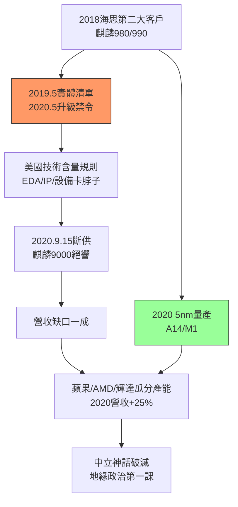

# 4.3 華為海思事件與五奈米(2018-2020)

## 第二大客戶的殞落

2018–2019 年，海思（HiSilicon）已是台積電第二大客戶（僅次於蘋果，佔比近一成），麒麟 980/990（7nm）與昇騰 AI 晶片、5G 基地台晶片（天罡）皆由台積電代工，華為手機全球市占逼近三星。2019 年 5 月，美國商務部以國家安全為由將華為列入實體清單；2020 年 5 月升級禁令——**凡使用美國技術代工給華為者須申請許可**，精準掐住台積電（美系 EDA、IP、設備佔比極高）。

台積電在 120 天緩衝期內為海思趕工出貨（2020 年 9 月 15 日斷供前），麒麟 9000（5nm）成為絕響。此後華為手機市占崩盤，海思營收蒸發九成。台積電短期痛失近一成營收，長期卻因禍得福：空出的 7/5nm 產能瞬間被蘋果、AMD、輝達、高通、聯發科瓜分，2020 年營收反而逆勢成長 25%，毛利率突破 53%。

## 5nm 的加冕

與此同時，2020 年台積電 5nm（N5）量產（蘋果 A14/M1、史上第一代 5nm 手機 SoC），電晶體密度達每平方毫米約 1.7 億顆，功耗效能雙壓三星 5nm。蘋果 M1（Mac 轉 ARM）全線採用台積電 5nm，標誌 PC 處理器亦倒向台灣製造。2018–2020 年，張忠謀退休後的雙首長制經受住「斷供海思 + 疫情 + 中美脫鉤」三重考驗，證明體系已可無創辦人運轉。

這場事件給台積電上了地緣政治第一課：**技術中立在國家安全邏輯前不堪一擊**。過去「誰都是客戶」的瑞士模式，第一次被出口管制打破。台積電被迫選邊——而它的設備、EDA、IP 與最大客戶都在美國，選擇並不困難，但代價是從此成為大國博弈的棋子與籌碼。

## 因果鏈

- **前因驅動**：7nm 獨大（4.2）→ 海思重度依賴台積電 → 美國發現「掐台積電即掐華為」的最短路徑；5nm 研發（蘋果資金鏈）→ 斷供陣痛可被新製程紅利對沖。
- **本節如何引發後果**：斷供海思 → 示範了出口管制的威力 → 美國順勢推動晶片法案、要求在地設廠（見 5.2）；5nm 成功 + 疫情遠距需求 → 引爆 2020–2021 全球晶片短缺（見 5.1），台積電從「重要供應商」升格為「兵家必爭之地」。
