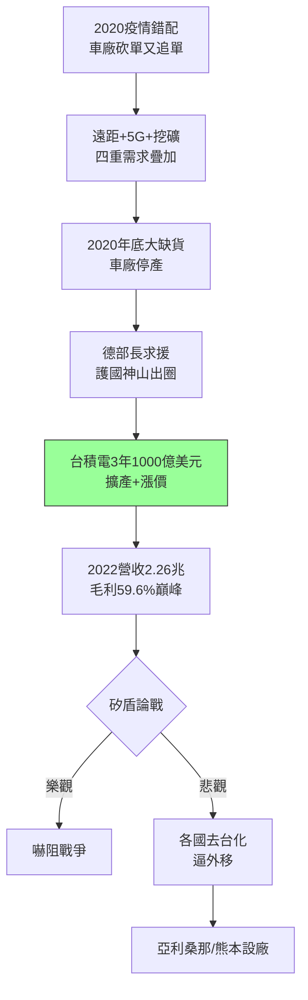

# 5.1 晶片短缺與護國神山(2020-2022)

## 一顆晶片停一輛車

2020 年底至 2021 年，新冠疫情造成詭異的供需錯配：車廠年初砍單、年中需求報復性反彈，疊加遠距辦公（筆電、伺服器）、5G、顯卡挖礦四重需求，全球晶圓代工產能（尤其是 28nm 以上成熟製程與 5/7nm 先進製程）全面爆滿。車用 MCU 缺貨導致通用、福特、豐田減產，德國經濟部長寫信向台灣求援——「護國神山」（Silicon Shield）一詞從台灣輿論走向《經濟學人》封面。

台積電的回應是 2021 年宣布三年 1000 億美元資本開支：在竹科（Fab 20 超大晶圓廠 GigaFab）、中科、南科擴建 5/3nm，並調漲成熟製程代工價、優先保障車用客戶。2021–2022 年營收連創新高（2022 年營收 2.26 兆新台幣、毛利率 59.6% 歷史峰值），市值一度超越騰訊與三星，成為亞洲市值王。台灣社會對台積電的情感也達頂點：工程師是婚戀市場頂配，缺水缺電時全民為它讓路（2021 年大旱水車馳援南科）。

## 矽盾的兩面

「護國神山」論述認為：台灣掌握全球九成先進製程產能，美國與中國都不敢讓兩岸開戰——晶片即嚇阻。但批評者指出：矽盾也可能是「人質」——正因太重要，各國才加速扶植本土產能、逼台積電外移，最終掏空台灣。2021–2022 年的短缺，既證明了台積電不可或缺，也種下了各國「去台化」的動機。繁榮與脆弱，同一枚硬幣。

$$利用率 \to 100\% \Rightarrow 議價權 \to 供應商 \Rightarrow 漲價 + 預付款擴廠$$

短缺把三十年積累的信任一次性變現為定價權——客戶從「要求降價」變成「付預付款搶產能」。

## 因果鏈

- **前因驅動**：5nm 領先 + 海思空出的產能被秒殺（4.3）→ 產能本就緊繃；疫情錯配 → 引爆點；車用缺貨的外溢政治效應 → 把商業問題升級為外交問題。
- **本節如何引發後果**：短缺的暴利（千億美元擴產底氣）→ 支撐美日德三地設廠的巨額開支（見 5.2）；「太重要所以必須分散」的邏輯 → 各國晶片法案補貼競賽 → 台積電從台灣公司變成跨國產能網絡，開啟下一節的全球化陣痛。
