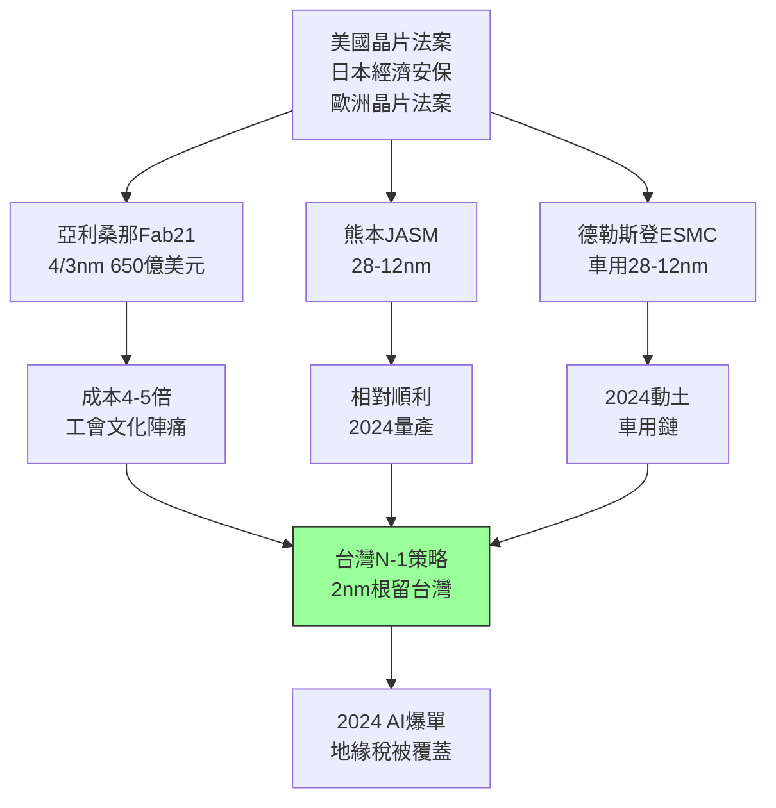

# 5.2 美國日本德國擴廠(2020-2025)

## 三座海外新城

地緣壓力下，台積電被迫走出「根留台灣」：**亞利桑那（美國）** 2020 年宣布设 Fab 21（5/4/3nm，總投資 650 億美元，美國史上最大外商直接投資），2024 年量產 4nm，蘋果、輝達、AMD 包產能，獲美國晶片法案 66 億美元補助；**熊本（日本）** 2021 年與 Sony、Denso 合資 JASM（22/28nm 與 12/16nm 成熟特殊製程），2024 年開幕量產，2025 年宣布二廠（6nm），主攻車用與影像感測；**德勒斯登（德國）** 2023 年宣布與 Bosch、Infineon、NXP 合資 ESMC（28/22nm、16/12nm FinFET），2024 年動土，主攻歐洲車用。

三地邏輯各異：美國要的是「最先進製程在美生產」（國安）；日本要的是「成熟製程不斷鏈」（經濟安保 + 九州半導體復興）；德國要的是「車用晶片自主」（歐洲晶片法案）。台積電的應對是差異化：最先進（2nm 以下）研發與量產初期永遠在台灣（竹科 Fab 20、新竹寶山），海外廠落後 N-1 世代——既滿足盟友，又守住「台灣最優先」的底線（劉德音所謂「根留台灣」）。

## 全球化的代價

海外擴廠的陣痛真實而昂貴：亞利桑那建廠成本是台灣的 4–5 倍（人力、法規、工會、文化衝突），量產時程兩度延後，2023–2024 年一度傳出與工會、 Austin 承包商摩擦，以及台灣工程師外派的家庭與工時爭議；熊本相對順利（日本營建效率與九州水電優勢），德國則面臨歐洲人力成本與環評。2022–2023 年半導體下行週期中，龐大資本開支（每年 300–400 億美元）壓縮自由現金流，毛利率從 59.6% 回落至 50% 出頭——華爾街開始質疑「地緣稅」（geopolitical tax）。

但 2024 年 AI 浪潮（輝達 H100/B200、蘋果 M3/M4、AMD MI300 全數台積電 5/3nm）讓產能再度滿載，證明：**只要技術領先兩個世代，成本劣勢可被轉嫁**。海外廠的虧損，被台灣廠的超額利潤覆蓋——全球化是稅，也是保險費。

## 因果鏈

- **前因驅動**：晶片短缺的政治化（5.1）+ 海思斷供示範（4.3）→ 美日歐以補貼 + 市場准入為槓桿要求在地生產；AI 訂單的利潤 → 付得起海外虧損。
- **本節如何引發後果**：海外產能網絡 → 台積電從「台灣之光」變成「全球基礎設施」→ 必須以更強的技術代差（2nm/A16）維持議價權（見 5.3）；雙首長制在跨國管理上的負荷 → 促成 2024 年交棒魏哲家單一領導，開啟新治理時代。
