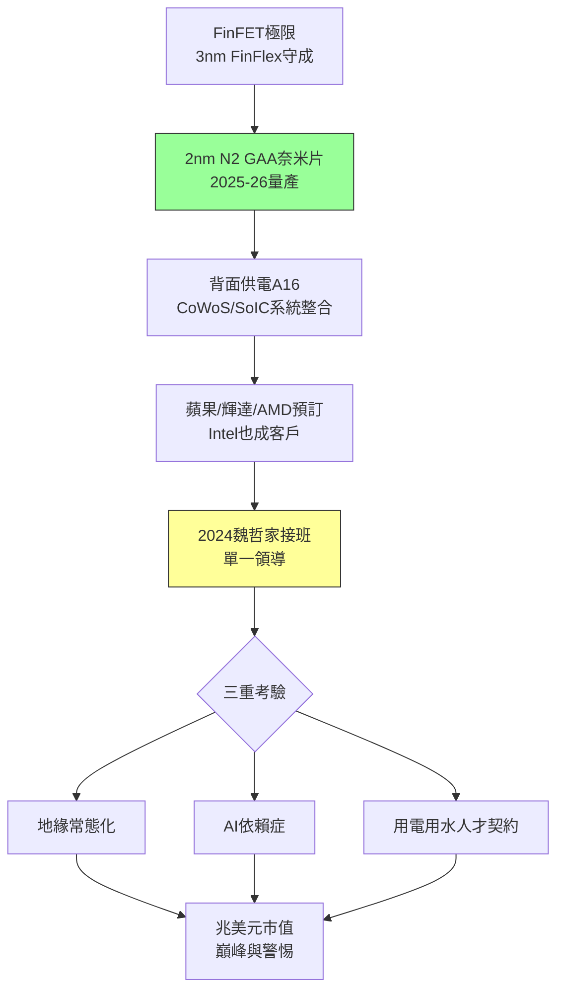

# 5.3 二奈米與魏哲家時代(2020-2026)

## 從 FinFET 到 GAA

2020 年代的技術主線是電晶體結構再革命：FinFET 在 3nm 逼近極限，台積電 3nm（N3，2022 量產，蘋果 A17/M3 首發）仍以改良 FinFET（FinFlex）守住 PPA 領先（三星搶先上 GAA 卻良率慘淡）；真正的換代是 **2nm（N2，2025 風險量產、2026 量產）**——首採奈米片（nanosheet）環繞式閘極（GAA），疊加背面供電（backside power delivery，A16 製程），號稱同功耗效能提升 10–15%、功耗降低 25–30%。

為 N2，台積電在新竹寶山（Fab 20）與高雄建超大 GigaFab，EUV 機台（NXE:3600/3800，高數值孔徑 High-NA 評估中）全數優先到貨；蘋果、輝達、AMD、博通、聯發科已預訂首批產能，英特爾亦將部分 Nova Lake 委外——**連昔日霸主都成了客戶**，完成了 1987 年「IDM 終將外包」預言的最後一塊拼圖。A16（1.6nm，2026–2027）與系統級晶圓（CoWoS、SoIC、3D Fabric）則把競爭從電晶體推向封裝與系統整合——台積電的敵人不再是某家公司，而是物理本身。

## 魏哲家時代與護國神山爭論

2024 年 6 月，劉德音退休，魏哲家接任董事長兼總裁，結束雙首長制。魏哲家（1998 年加入，業務與營運出身，客戶口中的「小張忠謀」）風格更貼近客戶與一線：親自主持蘋果、輝達產能協調，以幽默直率著稱。他面對的三重考驗：其一，**地緣政治常態化**——美國大選、兩岸局勢、關稅與出口管制年年加碼，台積電需在合規與商機間走鋼索；其二，**AI 依賴症**——2024–2025 年輝達佔營收比重飆升，AI 伺服器 CoWoS 產能決定獲利天花板，若 AI 資本開支退潮何以為繼；其三，**台灣社會契約**——用電（2025 年用電佔全台逾 8%）、用水、人才磁吸與房價（竹科、中科、南科高雄），「護國神山」是否也是「吸血神山」的爭論不息。

張忠謀 2024 年公開示警「全球化已死」，魏哲家則務實回應「台灣最優先、全球有佈局」。2025–2026 年台積電市值突破一兆美元（全球前十），毛利率重返 55% 以上——數字證明體系仍在巔峰，但歷史從不承諾巔峰永駐：正如仙童、英特爾的前車之鑑，**領先者的敵人永遠是下一場典範轉移**（量子？矽光子？Chiplet 架構？）。

$$領導力交棒 = 制度成熟度 \times 文化連續性 - 創辦人依賴$$

台積電用 2018（張忠謀退）、2024（劉德音退）兩次交棒證明等式為正——這是它與仙童、英特爾最大的不同。

## 因果鏈

- **前因驅動**：7/5nm 的體系勝利（4.2、4.3）→ 攢足研發與 EUV 資源 → 敢在 GAA 上後發先至；海外擴廠的 N-1 策略（5.2）→ 2nm 根留台灣 → 守住技術與議價中樞；AI 爆發 → 為 2nm 提供確定的首發大客戶。
- **本節如何引發（未來）後果**：2nm/A16 若再勝 → 先進製程代差拉大到三代以上 → 海外「地緣稅」可持續轉嫁，台灣議價權延續；反之，若 GAA 良率失手或 AI 退潮、或地緣斷鏈加劇 → 三十年的正循環（大客戶→大研發→大領先）可能逆轉——這正是全書因果鏈留給讀者的開放結局：**台積電的歷史，就是一部把偶然變成必然、又時刻警惕必然變回偶然的歷史。**
