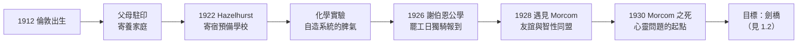

# 1.1 倫敦童年與寄宿學校（1912–1926）

1912 年 6 月 23 日，艾倫·麥席森·圖靈（Alan Mathison Turing）出生於倫敦帕丁頓的梅達維爾（Maida Vale）。父親 Julius 是任職於印度公務系統的文官，長年駐守印度；母親 Ethel 隨夫往返殖民地。這個家庭最大的特徵是**缺席**：父母常不在身邊，艾倫與哥哥 John 交給坎伯蘭郡一位退伍軍人上校夫婦照顧，在倫敦與印度之間像包裹一樣被送往迎來。

## 分離的童年

- 父母 1907 年結婚後即返回印度，將幼子留在英國由 Warren 夫婦寄養；
- 1915 年母親返英短暫陪伴，這段時光成為圖靈畢生珍視的少數溫暖記憶；
- 1922 年父母再度赴印度，艾倫被送進圖恩（Tunbridge）附近的寄宿預備學校 Hazelhurst——他一開學就哭了，此後也未曾真正喜歡上那裡；
- 母子之間的書信往返，成為他與世界的主要情感通道。

## 頭一個做出來的孩子

圖靈不是傳統意義的神童，而是一個**執拗的實驗者**：

- 他很晚才學會說話、很晚才學會閱讀，卻在學會之前就自己弄懂了長除法；
- 在 Hazelhurst 他種菜、參加划船，但最著迷的是化學——他相信「用化學能把廢料變成有用的東西」；
- 母親後來回憶：艾倫曾提議「用海水提取碘」補貼家用，認真得令人發笑又心驚；
- 他痴迷於「發明東西」：墨水、無痛針頭、對打字的改進，樣樣都要親手驗證。

這種「自己發明系統、拒絕接受現成解釋」的脾氣，貫穿他一生——從自己重造相對論，到自己定義「可計算」。

### 大自然的孩子

圖靈的另一面是對**生命現象**的著迷：

- 他喜歡觀察雛菊的花瓣數、松果的螺旋排列——數十年後成為他形態發生（morphogenesis）理論的種子（見 4.1）；
- 他和朋友討論過「心靈是什麼」——在一個連「智能」都還沒被科學化的年代。

## 謝伯恩與 Christopher Morcom

1926 年，十四歲的圖靈通過考試進入英國著名公學謝伯恩（Sherborne School）。報到當天適逢全國大罷工，鐵路停駛，他竟然獨自騎自行車從南安普頓騎了六十英里到校——地方報紙還為此登了一則報導。這則軼事預示了他的風格：**規則停下來時，自己把事情做完。**

在謝伯恩，命運給了他一生中最重要的一份禮物，也給了最沉重的一擊：

- **Christopher Morcom**（克里斯多福·默康），高他一屆的學長，是第一個真正「看見」圖靈的人；
- 兩人一起做天文觀測、討論愛因斯坦相對論——圖靈為了讀懂愛因斯坦，硬啃了德文原著；
- 圖靈在給母親的信中寫道：與 Christopher 在一起時，「每一個想法都可以變成笑聲」；
- 他把 Christopher 當作標準：「他的數學比我的紮實，我要追上他。」

### 崩塌

1930 年 2 月 13 日，Morcom 猝死於牛結核病。十七歲的圖靈的世界塌了：

- 他給母親寫信：「我覺得我還會再見到 Christopher，而他會照舊與我一起工作，我這樣想才做得下去。」
- 他陷入對**心靈與肉體之關係**的追問：Morcom 的思想去了哪裡？精神能否脫離身體存在？
- 這個哀悼中的形而上問題，是圖靈日後一切思考的暗流——「機器能否思考」這一問題（見 4.2），在 1930 年的謝伯恩就以「人如何思考、精神是什麼」的形態存在了；
- 母親 E. S. Turing 後來寫道：兒子的科學動機，有一半來自「想證明 Christopher 的靈魂以某種方式存在」。

## 為劍橋而戰

Morcom 死後，圖靈有一個具體的理由繼續奮鬥：Christopher 的目標是劍橋三一學院，圖靈決定**替他完成這條路**。數學教師 Donald Eperson 支持他，校方卻嫌他「偏科」——古典學老師抱怨他「答卷只寫滿數學草稿」。

- 1928 年起，圖靈開始在「科學研究獎學金」考試中闖關，屢敗屢戰；
- 1930 年 12 月，他在謝伯恩的一次報告中提出「相對於觀察者的時間測量」——證明他早已自主讀透了愛因斯坦；
- 1931 年，他終於獲得劍橋國王學院（King's College）獎學金——放棄了父親希望的「安全文官路線」。

## 事件關聯與前因後果

| 年份 | 事件 | 後續影響 |
|------|------|----------|
| 1912 | 出生於倫敦梅達維爾 | 文官家庭的殖民地缺席背景 |
| 1922 | 入寄宿預備學校 Hazelhurst | 孤獨中養成自造系統與化學實驗癖 |
| 1926 | 罷工日獨騎六十英里入謝伯恩 | 「自己完成事情」的人格標記 |
| 1928 | 與 Morcom 結為摯友 | 智性同盟，劍橋目標的確立 |
| 1930 | Morcom 猝死 | 「心靈—身體」問題成為終身暗流 |
| 1931 | 入劍橋國王學院 | 邏輯與量子的啟蒙（見 1.2） |

**因果**：如果說羅素的童年被死亡與哲學塑造（→ 詳見《羅素傳記》第 1 章），圖靈的少年則被**缺席與哀悼**塑造。寄宿學校的孤獨教會他不需要他人的理解也能工作；Morcom 之死則在他心底留下「精神能否獨立於肉體」的問題——這個問題二十年後化成「機器能否思考」，五十年後化成整個人工智慧學科的哲學基礎。悲劇在這裡不是修辭，而是論證的起點。

### 與同時代的對照

| 人物 | 生年 | 少年主題 | 成年的核心問題 |
|------|------|----------|----------------|
| 圖靈 | 1912 | 寄宿學校、Morcom | 什麼是可計算、什麼是思考 |
| 香農 | 1916 | 小鎮電報玩具 | 什麼是資訊（→ 詳見《香農傳記》第 1 章） |
| 麥卡錫 | 1927 | 少年自學數學 | 什麼是智能的形式語言（→ 詳見《麥卡錫傳記》第 1 章） |
| 霍金（日後對照） | 1942 | 同樣生於 6 月 8 日的倫敦 | 什麼是宇宙的極限 |

三人日後在資訊與智能的交界處交會（見 4.2、5.3），但圖靈的獨特起點是：他的問題不是工程問題，而是**哀悼問題**——這使他成為最不工程、卻最有哲學後勁的計算機先驅。

## 小結

- 圖靈的童年三件關鍵物事：**缺席的父母、孤獨的寄宿學校、Morcom 的友誼與死亡**；
- 他不是被老師教出來的，而是被「自己發明系統」的衝動與「追上 Christopher」的誓約推進的；
- 謝伯恩時期已同時埋下三條線：化學（日後的形態發生與氰化物悲劇）、數學（可計算性）、心靈之問（圖靈測試）；
- 1931 年秋，他帶著這三條線進入劍橋國王學院——下一段，劍橋將用量子力學與數理邏輯，把少年形而上的追問鍛造成嚴格的數學（見 1.2）。
