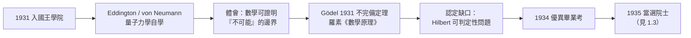

# 1.2 劍橋國王學院與量子、數理邏輯啟蒙（1931–1934）

1931 年 10 月，圖靈入學劍橋國王學院（King's College）。這裡與謝伯恩是兩個世界：公學強調紀律與古典傳統，國王學院則以知識分子的自由風氣著稱——布爾什維克同情者、同性戀者、無神論者在這裡都不必躲藏。圖靈終於找到一個不必表演的環境。

## 開放的學風與第一個榮譽

- 1932 年，圖靈便以一篇關於**誤差理論**的論文贏得國王學院開放給大學生的計算獎章（Raleigh Prize 系脈絡下的數學獎勵）；
- 1934 年，他大學畢業考（Mathematical Tripos）成績優異，獲得 B 星級 Wrangler 之列；
- 1935 年，年僅二十二歲的他被選為**國王學院院士**（Fellow）——一個通常屬於三十歲以上學者的榮銜（見 1.3）。

## 量子力學的洗禮

劍橋正是量子革命的火線之一，圖靈在這裡讀懂了新物理：

- 他閱讀了 Arthur Eddington 的《物理世界的本質》（The Nature of the Physical World, 1928）與 John von Neumann 的《量子力學數學基礎》（1932）（→ 詳見《馮紐曼傳記》）；
- von Neumann 證明「隱變量不可能再現量子力學的統計規律」，這件事讓圖靈震動：**一個「物理上不可完成」的過程，可以被數學嚴格地證明不可完成**；
- 這種「用數學劃出不可能的邊界」的思路，正是他日後處理希爾伯特問題的方法論雛形（見 1.3、2.1）；
- 他還為自己和母親寫了關於「測量誤差與不確定性」的手稿，把理論物理的隨機性化作自己的問題。

## 維根斯坦的陰影與數理邏輯的啟蒙

劍橋的另一重思想氛圍來自**路德維希·維根斯坦**（Ludwig Wittgenstein）與邏輯實證主義圈子（→ 詳見《維根斯坦傳記》）。圖靈雖然要到 1939 年才正式參加維根斯坦的數學基礎講課（見 2.3），但劍橋時期他已經浸在「數學是什麼」的爭論裡：

- 羅素與懷海德的《數學原理》（→ 詳見《羅素傳記》）主張數學可還原為邏輯；
- Hilbert 學派的形式主義主張數學是符號遊戲、需證明其一致性（→ 詳見《希爾伯特傳記》）；
- 1931 年，Gödel 的不完備定理傳開：任何足夠強的形式系統都有不可證明的真命題；
- 這三股力量構成了圖靈自學的核心書單——他在本科高年級幾乎讀完了《數學原理》的邏輯部分。

### von Neumann 著作的轉折

圖靈最終放棄「跟隨 von Neumann 做物理」的想法。傳記作者 Andrew Hodges 指出轉折點：圖靈發現量子測量的問題**無法靠他一人之力**在物理上推進，而數理邏輯的基礎問題卻有一個**定義清晰、無人解決**的缺口——那就是 Hilbert 的可判定性問題（Entscheidungsproblem）。他選了缺口。

## 黎曼猜想與概率論：劍橋年的另一面

圖靈並非只做基礎問題，他的劍橋歲月也顯示了驚人的廣度：

- 他研究過**誤差估計**與矩陣方法的數值穩定性——日後造電腦時立刻派上用場（見 3.3）；
- 1936 年前夕，他一度試圖攻擊**黎曼猜想**，發展出一套概率論證法（雖未成功，但其中想法與 1938 年論文〈可計算函數的一些結果〉相通）；
- 這種「理論與數值計算並行」的風格，與香農「理論與工程並行」如出一轍（→ 詳見《香農傳記》第 2 章）。

## 國王學院與「不必偽裝」

國王學院對圖靈的意義超出了學術：

- 學院的同性戀文化在當時劍橋相對寬容，圖靈在這裡首次不必為性向恐懼（儘管法律仍屬犯罪——這一法律最終成為悲劇根源，見 4.3）；
- 他與同輩David Champernowne、Kenneth Harrison 等人組成小圈子，討論邏輯與電腦的假想；
- 他終身保留國王學院院士資格，即使戰時與曼徹斯特時期也把學院當作家。

## 事件關聯與前因後果

| 年份 | 事件 | 後續影響 |
|------|------|----------|
| 1931 | 入國王學院 | 自由學風，智性與人格的雙重安放 |
| 1932 | 獲大學生數學獎 | 誤差理論與數值計算的早期訓練 |
| 1932–33 | 讀 von Neumann《量子力學數學基礎》 | 「用數學證明不可能」的方法論 |
| 1933 | 接觸 Gödel 不完備定理與《數學原理》 | 邏輯基礎問題成為主攻方向 |
| 1934 | 畢業考優異 | 為院士選舉鋪路 |
| 1935 | 當選國王學院院士（見 1.3） | 展開可判定性問題的總攻 |

**因果**：若沒有 von Neumann 那本書教會圖靈「數學可以劃出物理的禁區」，他很難想到去劃「機械程序的禁區」。劍橋三年的真正產物不是論文，而是一個**問題的選擇**：在 Gödel 已經轟塌 Hilbert 計畫的 1930 年代中期，還剩下一座無人攻下的堡壘——Entscheidungsproblem（可判定性問題）。圖靈認定：攻克它需要先回答「什麼是機械的計算」。

### 與同時代的對照

| 人物 | 同期動作 | 與圖靈的關係 |
|------|----------|--------------|
| Gödel | 1931 不完備定理 | 劃出「證明」的邊界，留下「判定」的缺口 |
| von Neumann | 1932 量子力學數學化 | 圖靈的啟蒙書作者，日後的賞識者（見 2.2） |
| 丘奇 | 普林斯頓發展 λ 演算 | 同一問題的競爭者（見 2.2） |
| 香農 | MIT 研究布林代數 | 「開關的邏輯」與「邏輯的機器」互為鏡像（→ 詳見《香農傳記》第 2 章） |

## 小結

- 劍橋國王學院給了圖靈兩樣謝伯恩給不了的東西：**自由**與**真正的問題**；
- 量子力學教會他「數學可以證明不可能」，Gödel 教會他「公理系統有邊界」，兩者合流成一個研究方向：機械程序的邊界；
- 他自學《數學原理》不是為了追隨羅素，而是為了拆解 Hilbert 的最後堡壘；
- 1935 年當選院士後，他放棄了物理，鎖定了 Entscheidungsproblem——下一段，這個「決定性的問題」將把他帶到普林斯頓，並催生二十世紀最重要的單篇論文之一（見 1.3）。
