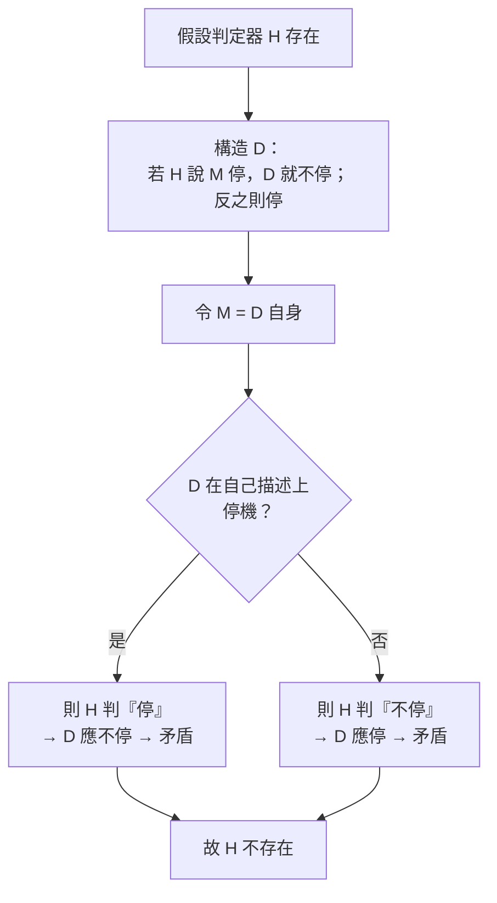

# 2.1 論可計算數（1936）

1936 年 11 月與 12 月，倫敦數學會會刊分兩期刊出圖靈的〈論可計算數及其在判定問題上的應用〉（*On Computable Numbers, with an Application to the Entscheidungsproblem*）。這篇論文同時完成了三件大事：定義了「機械可計算」、證明了判定問題無解、發明了通用機。本節拆解其技術核心。

## 第一擊：圖靈機——計算的原子化

圖靈從「人類計算員」出發做**現象學式的抽象**，得到一臺只會做五件事的機器：

1. 在無限紙帶的**格子**上讀一個符號；
2. 寫下一個符號（或擦除）；
3. **左移或右移**一格；
4. 根據（所讀符號 × 內部狀態）查表決定動作，並**切換狀態**；
5. 或者在適當時機**停機**。

這臺機器的驚人之處在於其**完備性聲明**（即後人所稱**圖靈–丘奇論題**的一半）：任何「可由明確規則一步步執行」的計算，都可由某臺圖靈機完成。圖靈為此辯護的方式不是證明（無法證明，因為「機械程序」是直觀概念），而是**論證**：人類計算員可被限制到上述五個動作而不損失任何能力。

### 與 Gödel、Church 的關係

- Gödel 用 **primitive recursive 函數**與 general recursive 函數刻劃「可計算」（經 Herbrand–Gödel）；
- Church 用 **λ 演算**的 λ 可定義函數（→ 詳見《丘奇傳記》）；
- 圖靈證明：三種定義**外延等價**——不同進路匯流於同一條邊界，這正是「論題」可信的力量來源；
- Gödel 起初不信任 Church 的定義，讀到圖靈的版本後接受：「圖靈的定義是正確的。」（1938 年在普林斯頓）

## 第二擊：對角線與不可計算數

圖靈問：是否所有實數都可計算？答案是**否**，而且證明是康托式對角線的計算版：

- 把所有「可計算數列」逐一編號（每臺機器有一個描述數，descriptive number）；
- 構造第 $n$ 個可計算數的第 $n$ 位加以翻轉，得到一個不在表上的新數；
- 陷阱在於：逐臺模擬機器產生數字時，**無法事先知道某臺機器會不會永遠算下去不輸出**——即無法避開不停機的機器；
- 因此這個對角程序**不可計算**：可計算數是可數的，但**沒有有效列舉**。

$$\text{可計算數} \subsetneq \text{實數}，\ \text{且可計算數不可有效列舉}$$

## 第三擊：停機問題

上述陷阱本身被提煉為獨立的定理——後世稱**停機問題**（Halting Problem）：

> 不存在一臺圖靈機 $H$，能對任意機器 $M$ 與輸入 $I$，判定 $M$ 是否在 $I$ 上停機。

證明用自我指涉的反證：若 $H$ 存在，則可構造一臺「讀到自己的描述後反其道而行」的機器 $D$——$D$ 停機若且唯若 $D$ 不停機，矛盾。

## 第四擊：終結 Entscheidungsproblem

有了停機問題，判定問題的崩塌只需一步歸約：

- 對任意一階邏輯語句 $S$，可**有效地**構造一臺圖靈機 $M_S$，使 $M_S$ 停機當且唯當 $S$ 可證明；
- 若有判定程序可判 $S$ 的可證性，即可判 $M_S$ 是否停機——違反停機問題；
- 故 **Entscheidungsproblem 無解**：任何機械程序都無法判定所有邏輯語句的可證性。

Hilbert 計畫的最後堡壘至此陷落（→ 詳見《希爾伯特傳記》）：Gödel 摧毀了「完備性」，圖靈摧毀了「可判定性」，兩者共同宣告——數學沒有萬能機器。

## 第五擊：通用機——被埋沒的正遺產

論文第 6、7 節（篇幅最長）展示了**通用圖靈機** $U$：

- $U$ 讀入「機器 $M$ 的描述碼＋輸入」，逐步模擬 $M$ 的運行；
- 於是**描述（程式）與資料同構**——紙帶上的一切都是符號；
- 這意味著：不必為每個任務造專用機器，造一臺 $U$，換描述即可。

當時讀者關心的是否定結果；日後歷史關心的是這一節——**儲存程式電腦的數學原型**。圖靈本人 1945 年設計 ACE 時就直接引用自己這篇論文（見 3.3）。

## 事件關聯與前因後果

| 年份 | 事件 | 後續影響 |
|------|------|----------|
| 1936.4 | 完成初稿，Church 消息傳來 | 競爭加速（見 1.3） |
| 1936.5 | 補寫「可修正性」附錄 | 回應 Church 的架構批評 |
| 1936.11–12 | 論文分兩部分刊出 | 計算理論的建基文獻 |
| 1936 | 停機問題、判定問題無解 | 數學基礎的世紀定讞 |
| 1936 | 通用機登場 | 程式＝資料；1945 年後化為實體電腦 |

**因果**：這篇論文的內部邏輯環環相扣——「機械程序的精確定義」（圖靈機）→「不可判定數」（對角線）→「停機不可判」（自指反證）→「邏輯不可判定」（歸約）。四步之中，前兩步供給後兩步的武器。外部因果同樣清晰：Gödel 的不完備定理是**前因**（證明的邊界已現），Church 的搶先是**催化劑**，而 1945 年後的電腦是**後果**——通用機從紙帶走進了電路。

### 邊界的兩面

| 成果 | 性質 | 日後化為 |
|------|------|----------|
| 圖靈機／通用機 | 正面：計算的能力 | 電腦架構、程式語言、複雜性理論 |
| 停機問題／判定問題無解 | 負面：計算的極限 | 不可判定性、Rice 定理、安全與驗證的理論天花板 |

## 小結

- 〈論可計算數〉一舉完成：**定義計算、劃定極限、發明通用機**；
- 停機問題的證明結構（自指＋對角線）成為整個計算機科學不可判定性證明的母版；
- 判定問題的終結是 Hilbert 計畫的墓誌銘，也是數學自由的反證明——機器不能窮盡數學；
- 論文的即時反響冷清，但它的每一節都在戰後被兌現：通用機化為電腦，停機問題化為理論計算機科學的基石；
- 1936 年秋，帶著這篇論文的圖靈抵達普林斯頓——下一段，他將在 Church 門下拿到博士學位，並面對 von Neumann 留他的一臂之力（見 2.2）。
