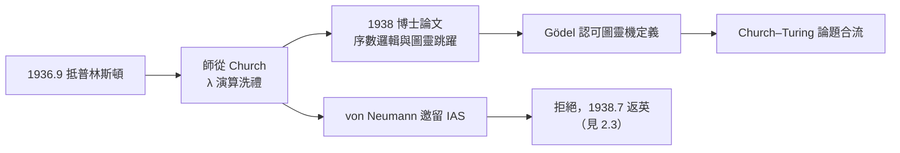

# 2.2 普林斯頓師從丘奇（1936–1938）

1936 年 9 月 28 日，圖靈抵達紐約，轉赴普林斯頓大學。他將在 Alonzo Church（→ 詳見《丘奇傳記》）門下度過兩年，取得 Ph.D.。這段時期把兩條平行的研究線（λ 演算與圖靈機）合流成一個今日所稱的**Church–Turing 論題**，也讓圖靈進入了 von Neumann（→ 詳見《馮紐曼傳記》）與 Gödel 的視野。

## Fine Hall：世界邏輯的中心

普林斯頓數學系當時聚集了最強的邏輯陣容：

- **Church**：導師，λ 演算的創立者，以「一絲不苟」聞名——他的學生必須寫出無懈可擊的細節；
- **Gödel**：1933–34 年已在 IAS 講課不完備定理，圖靈到時他往返維也納，1938 年後常駐；
- **von Neumann**：邏輯出身、正轉向其他領域的天才；
- 同期還有 Church 的學生**Kleene**與**Rosser**（兩人已證明 λ 演算的不一致性漏洞，即 Kleene–Rosser 悖論，促成 Church 轉向 λI 演算）。

圖靈在 1936 年 10 月 3 日的家書中寫道：「這裡的數學系簡直完美……Church 當然也來過。」但同時他抱怨美國的一切：食物、咖啡、以及社交的膚淺。

## 1938 年博士論文：序數邏輯

圖靈的博士論文《基於序數的邏輯系統》（*Systems of Logic Based on Ordinals*, 1938）是〈論可計算數〉的自然延伸：

- 核心想法：不完備定理說任何形式系統都有不可證的真命題，那麼能否**沿序數層級不斷添加公理**，逐層擴張系統？
- 圖靈證明：對**非機械的**（由人直觀啟發的）公理添加，可建立嚴格的序數邏輯層級；
- 但他同時證明：若添加公理的程序本身機械化，則整個層級仍可被單一圖靈機掌握，不完備性照舊歸來；
- 這篇論文引入的**圖靈跳躍**（Turing jump／Turing degree 之雛形）成為日後**可計算性理論**（recursion theory）的核心概念。

### Gödel 的裁判

1938 年春，Gödel 給論文一個歷史性的評語：他正式接受圖靈對「機械程序」的定義為**正確且充分的**。此事在邏輯史上的意義：

- Church 的 λ 定義曾被 Gödel 拒絕為「不令人信服」；
- 圖靈用「計算員的直觀分析」贏得了最挑剔裁判的認可；
- 自此「可計算」的標準定義落定——Church–Turing 論題成為定理背後共享的公理。

## von Neumann 的邀留

圖靈在普林斯頓的兩年還收到一份重量級的邀約：**von Neumann 提供他在 IAS 的助理職位**，年薪1500美元，請他留美做邏輯與數學研究。圖靈拒絕了。

- 拒絕的原因是歸屬感：劍橋、國王學院、母親，以及一個他終其一生不願在信中明言的事實——美國的文化讓他孤獨；
- 歷史的弔詭：von Neumann 數年後在曼哈頓計畫中急需「可計算」的幫手，想起了當年的圖靈機；他後來成為電腦架構的推手（→ 詳見《馮紐曼傳記》），而圖靈則回到英國造出了自己的路線（見 3.3）；
- 兩人於 1938 年分道，1946 年又在儲存程式電腦的專利與優先權問題上隱性對峙（見 3.3）。

## 普林斯頓的陰影面

這兩年並非全然光明：

- 1937 年 2 月，父親 Julius 病重；圖靈多次折返英國探視（父親於 1937 年夏去世前的病榻歲月，圖靈屢次往返大西洋）；
- 他母親 Sarah（Ethel 於 1936 年底去世，父親 Julius 的病由圖靈照顧）——實際上 1936 年底母親病逝、1937 年父親去世，圖靈在兩年間失去雙親；
- 學術上他也經歷挫折：一篇關於群論的論文（與 Reinhold Baer 的 Lie 群逼近問題）顯示他試圖「正常化」自己的研究方向，未獲大迴響；
- 孤獨、思鄉與身份（同性戀在美國校園更無處容身）使他的書信充滿對劍橋的渴望。

1938 年 7 月，圖靈取得 Ph.D.，立刻返英——拒絕 von Neumann，回到國王學院。

## 事件關聯與前因後果

| 年份 | 事件 | 後續影響 |
|------|------|----------|
| 1936.9 | 抵普林斯頓，入 Church 門下 | 兩大計算模型開始合流 |
| 1936–37 | 修改〈論可計算數〉附錄、與 Church 通信互動 | 論題的正式確立 |
| 1937 | 發表 〈可計算函數與 λ 可定義性〉 | 證明圖靈機＝λ 可定義 |
| 1936–37 | 雙親相繼病逝 | 情感支柱轉向劍橋與母親書信傳統 |
| 1938 | 博士論文（序數邏輯、圖靈跳躍） | 可計算性理論的深度工具 |
| 1938 | 拒絕 von Neumann 的 IAS 邀約 | 返英→GHC 招募（見 2.3） |

**因果**：普林斯頓兩年是「匯流」的兩年。**前因**：Church 的搶先（見 1.3）把圖靈推過大西洋。**過程**：Gödel 的認可把兩個模型焊接成一個論題——沒有這個焊接，「可計算」就沒有公認標準，日後的電腦科學將失去理論地基。**後果**：von Neumann 的邀留被拒，使圖靈回到英國的密碼戰場——若圖靈留美，布萊切利園的故事將完全改寫，二戰大西洋戰役的走向也難以想像（見 3.1）。

### 同期的世界（1936–1938）

| 年份 | 事件 | 與圖靈的關聯 |
|------|------|--------------|
| 1936 | 香農完成布林代數碩士論文（→ 詳見《香農傳記》第 2 章） | 邏輯的電路化，與圖靈機互為表裡 |
| 1937 | Zuse 的 Z1 在柏林動工 | 機械計算的德國路線，戰時對手 |
| 1937 | Turing 改寫論文回應批評 | 理論的精緻化 |
| 1938 | 香農入普林斯頓高等研究院（IAS） | 與圖靈錯身而過，1943 倫敦補上（見 3.1；→ 詳見《香農傳記》第 3 章） |

## 小結

- 普林斯頓完成三件事：**博士學位（序數邏輯）、Church–Turing 論題的合流、Gödel 的終審認可**；
- 圖靈跳躍的誕生，使「不可計算」不再是單一的黑洞，而是一個有層級的宇宙——可計算性理論自此成為獨立學科；
- 拒絕 von Neumann 是這段時期最重要的「負決定」：它把圖靈送回英國，送進了戰爭；
- 1938 年夏，二十八歲的雙博士回到劍橋——他不知道，政府代碼與密碼學校（GCCS）的招募信已在等他（見 2.3）。
