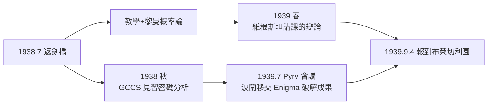

# 2.3 返劍橋與 GHC 招募（1938–1939）

1938 年夏，圖靈帶著普林斯頓的 Ph.D. 返回劍橋國王學院。隨後的一年半是暴風雨前的平靜：白天教書與研究，一條看不見的線已把他與戰爭繫在一起——**政府代碼與密碼學校**（Government Code and Cypher School, GCCS／GCHQ 前身）。

## 返英後的雙軌生活

- 圖靈恢復國王學院院士身分，開了邏輯課，並在 John Boardman 的年輕人圈子中短暫交往；
- 學術上，他把博士論文改寫成論文〈序數邏輯系統〉發表，並投入**黎曼猜想**的概率論進攻——1939 年發表的〈概率論在數論中的一個應用〉即其副產品；
- 他還完成了關於**矩陣方法解線性方程組**（誤差分析）的手稿，以及一臺用齒輪做二進位乘法的機器設計——後者幾乎是 Bombe 的暖身（見 3.1）。

### 維根斯坦的數學基礎講課（1939）

1939 年春夏，圖靈參加了維根斯坦在劍橋的「數學基礎」講課（→ 詳見《維根斯坦傳記》第 4 章）。這是兩位天才的直接對撞：

- 維根斯坦立場：矛盾並不可怕，形式系統裡的矛盾是「無害的」——「你不能用矛盾砸到腳」；
- 圖靈反駁：**矛盾的實踐後果**是會讓橋樑塌掉、讓計算失效——若系統容許矛盾，我們就不知道該信任哪條推論；
- 維根斯坦的記錄顯示他最終不接受圖靈的論證，但承認圖靈是唯一「指出形式主義實際後果」的聽者；
- 圖靈上完幾講後因戰時工作離席——哲學與數學的這場對話，以圖靈的「去造有用的機器」告終。

這場講課的意義：維根斯坦質疑「形式」能否窮盡數學實踐，圖靈則用工程師的直覺捍衛形式系統的**可依賴性**。日後的計算機科學站隊圖靈：程式的正確性不是哲學姿態，而是生死問題。

## GCCS 的招募線

戰雲密布之際，一條精巧的人才管道啟動了：

- GCCS 自 1930 年代末就與劍橋、牛津的數學圈子建立「休假式」聯繫，挑選能做密碼分析的年輕學者；
- 1938 年春，**Gordon Welchman**（劍橋同路人，日後 Bombe 改良者）與圖靈相繼被點名；
- 1938 年夏秋，圖靈被帶往倫敦 GCCS 本部見習密碼分析課程——講授者包括古典密碼學家 Dillwyn Knox；
- 1939 年，圖靈以「休假研究員」身分定期前往倫敦，學習 Enigma 的分析現況。

### 1938 年波蘭的禮物

圖靈受訓的背景中，最大的變數來自波蘭：

- 波蘭密碼局（Biuro Szyfrów）自 1932 年起由 **Rejewski** 等三人用純數學方法**破解了 Enigma**，並造出「炸彈機」（bomba）；
- 1938 年 12 月德軍 Enigma 加裝兩個轉子（由 3 選 3 變 5 選 3，組合數暴增 60 倍），波蘭的 bomba 失效；
- 1939 年 7 月 24–26 日，波蘭在華沙附近的 Pyry 會議上**把全部成果移交英法**：Rejewski 的循環指標法、Zygalski 穿孔片，以及一台複製 Enigma；
- 這份禮物使英國的破解工作**站在巨人的肩膀上起步**——圖靈在戰前已仔細研究過波蘭方法與其失效原因。

## 1939 年 9 月 4 日：報到 Bletchley Park

1939 年 9 月 3 日英國對德宣戰；次日，圖靈到白金漢郡的布萊切利園（Bletchley Park, BP）報到。這座鄉村莊園在戰時將容納近萬人，破譯德國三軍的密碼。圖靈是最早入住的少數數學家之一：

- 他的直屬任務：接手 GCCS 中**最難的德國海軍 Enigma**——其他單位幾乎都放棄了它；
- 同期入住的還有 Welchman、Gordon Welchman、John Jeffreys、Tony Kendrick 等劍橋人；
- 這個「教授雜燴」最初被軍方輕視，日後卻證明是戰爭史上最划算的人才投資。

## 事件關聯與前因後果

| 年份 | 事件 | 後續影響 |
|------|------|----------|
| 1938.7 | 返劍橋，恢復院士生活 | 學術與戰備的雙軌 |
| 1938 | GCCS 接觸、倫敦見習 | 密碼分析入門，遇 Knox |
| 1939 春 | 維根斯坦講課，圖靈反駁 | 形式主義的實踐辯護（→ 詳見《維根斯坦傳記》第 4 章） |
| 1939.7 | Pyry 會議，波蘭移交成果 | 英國破解工作的起點躍升 |
| 1939.9.4 | 報到布萊切利園 | 接手海軍 Enigma（見 3.1） |

**因果**：這一年半的關鍵因果是**國家機器對純數學的收割**。GCCS 之所以點名圖靈，正是因為〈論可計算數〉與普林斯頓經歷使他在「邏輯＋機器」的光譜上無人能替；而圖靈之所以能在 BP 幾週內做出突破，靠的是戰前波蘭人留下的方法地圖——**純數學（可計算性）、機器直覺（齒輪乘法器）、波蘭遺產（循環指標）**三者在 1939 年匯流於一個鄉村莊園。維根斯坦講課的插曲則是一面鏡子：當哲學還在爭論形式系統的意義時，圖靈已把形式系統變成戰爭武器。

### 同期的世界（1938–1939）

| 年份 | 事件 | 與圖靈的關聯 |
|------|------|--------------|
| 1938 | 香農貝爾實驗室發表開關電路論文（→ 詳見《香農傳記》第 2 章） | 邏輯機器的美國路線 |
| 1938.12 | 德國 Enigma 增轉子，波蘭 bomba 失效 | 迫使英國另起爐灶 |
| 1939.4 | 圖靈齒輪乘法機設計 | Bombe 的機械直覺預演 |
| 1939.9 | 二戰爆發 | BP 時代開啟 |

## 小結

- 1938–39 年，圖靈完成從**純邏輯學家到戰爭數學家**的轉身，轉身的中介是 GCCS 的精準招募；
- 維根斯坦講課留下了他「為形式系統辯護」的最清晰哲學立場，也預告了他「機器可靠而人不可靠」的世界觀；
- 波蘭的移交是技術前因：沒有 Rejewski 的數學與 Pyry 的禮物，英國的起點將落後數年；
- 1939 年 9 月，圖靈走進布萊切利園，接下最硬的骨頭——海軍 Enigma。下一段，Bombe 與大西洋上的生死算術（見 3.1）。
