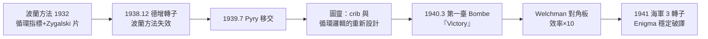

# 3.1 布萊切利園與 Enigma（1939–1941）

1939 年 9 月至 1941 年，圖靈在布萊切利園（Bletchley Park, BP）完成了他一生最緊急、也最具工程色彩的工作：**破解德國海軍 Enigma**。這段戰績長期保密，戰後數十年無人知曉——歷史學家估計它縮短戰爭兩年以上，拯救數百萬生命。

## Enigma 與海軍的難題

Enigma 是一臺轉子密碼機：三個（後為四個）轉子＋插接板，每日（後每 24 小時）更換設定，組合數達 $1.5 \times 10^{20}$ 量級。海軍版本最難：

- 插接板（stecker）最多接 10 對字母交換，徹底摧毀頻率分析；
- 海軍報文用**指示程序**隱藏每日鑰匙，且用於 U 潛艇作戰的報文最關鍵也最難得手；
- 1940 年英國護航船隊被 U 潛艇重創，**大西洋之戰**的勝負繫於能否讀懂狼群通訊。

## 圖靈的兩大突破（1940）

### 突破一：指示程序與「 crib 」分析

圖靈從波蘭方法失效處重新出發。他發現海軍指示程序（基於氣象站短碼與德軍的規程化用語）暴露了**已知明文 crib** 的機會——例如德軍幾乎每天在同一時間發的氣象報告，開頭必是 `WETTERVORHERSAGE`（天氣預報）。他進一步分析了插接板的統計性質，證明 crib 方法在 stecker 面前依然可用——這是波蘭人未曾走通的路。

### 突破二：Bombe 的邏輯

1939 年底至 1940 年初，圖靈設計出** Bombe **——不是波蘭 bomba 的升級，而是全新邏輯：

- **核心思想**：不逐個試鑰匙（組合數天文數字），而是利用 crib 導出的**字母自反循環**（因為 Enigma 加解密同一程序，插接板不改變循環結構）；
- 對每個候選轉子設定，Bombe 沿 crib 的字母鏈做**邏輯傳播**（現稱 constraint propagation）：矛盾者瞬間淘汰，僅極少數「停機」（stop）需人工驗證；
- 這是把〈論可計算數〉的「矛盾即淘汰」思維做成機電機器——**一臺專用圖靈機**；
- 1940 年 3 月 18 日，第一臺 Bombe「Victory」開始運轉；Gordon Welchman 隨即發明**對角板**（diagonal board）利用插接板的自反性，效率暴增十倍（→ Welchman 日後在 BP 內部管理 Hut 6）。

## Hut 8 與組織戰

1940 年圖靈受命主持 **Hut 8**——海軍密碼分析小屋，成為 BP 最年輕的部門主管之一：

- 團隊包含 Joan Clarke（後與圖靈短暫訂婚）、Peter Twinn、Tony Kendrick、Hugh Alexander（日後英國象棋冠軍，戰後接掌 Hut 8）；
- 圖靈的工作不止破譯：他發明 **Banburismus**（用貝葉斯式證據加權猜轉子順序的統計法，大幅縮小 Bombe 的搜索空間）、設計了名為 **Turingery** 的分析技巧（用於 Tunny／Lorenz 密碼，見 3.2 前身）；
- 他以「Prof」聞名於 BP：不修邊幅、杯子用鐵鏈鎖在暖氣管上、跑步去倫敦開會——BP 的傳說半數與他有關；
- 1941 年，Hut 8 已能穩定破譯海軍 Enigma，U 潛艇的「狼群」部署圖開始在盟軍海圖上透明化。

### 1941 年的成效與直接後果

- 護航船隊得以避開狼群集結區，損失曲線在 1941 年中明顯改善；
- 1941 年 10 月，圖靈等人直接致信丘吉爾請求增援人力與資源——丘吉爾批示「即刻辦理」；
- BP 由數百人擴張至近萬人，成為史上最大的密碼分析工廠。

## 1943 年與香農的華盛頓會面

1942 年 11 月至 1943 年 2 月，圖靈奉派赴美，考察美國密碼分析並擔任聯絡。行程的高光是與**克勞德·香農**（→ 詳見《香農傳記》第 3 章）在貝爾實驗室的多次晚餐：

- 兩人談的卻是**機器能否思考**：圖靈描述了可計算性與「思維機器」的想法，香農回應以布爾邏輯與機器智能；
- 這次對話是 1950 年〈計算機器與智能〉的史前史（見 4.2），也是 1956 年達特茅斯會議「機器智能」議題的遠因（→ 詳見《麥卡錫傳記》；→ 詳見《香農傳記》第 4 章）；
- 兩人還討論了語音加密：美國正在開發 X System（SIGSALY），圖靈受此啟發，回英後展開 Delilah 語音密碼機的設計（見 3.2）；
- 諜報制度使兩人無法交流各自的核心機密——兩位資訊時代之父聊的是哲學，不是密碼。

## 事件關聯與前因後果

| 年份 | 事件 | 後續影響 |
|------|------|----------|
| 1939.9 | 報到 BP，接手海軍 Enigma | Hut 8 成立（1940） |
| 1939 底 | 圖靈設計 Bombe 邏輯 | 「矛盾即淘汰」的機械化 |
| 1940.3 | Bombe「Victory」運轉 | 破解速度的量級躍升 |
| 1940 | Welchman 對角板；Banburismus | 搜索空間壓縮，海軍密文可破 |
| 1941 | 海軍 Enigma 穩定破譯；致信丘吉爾 | 大西洋之戰轉折，BP 擴編 |
| 1942–43 | 赴美；與香農會面 | AI 對話的史前史；Delilah 之緣起（見 3.2） |

**因果**：BP 時期的因果鏈極其清晰——**波蘭遺產**（見 2.3）供給起點，**可計算性理論**供給方法（把破譯化為邏輯約束的機器化），**戰爭壓力**供給資源，而**圖靈的個人天賦**（統計學＋機器直覺＋邏輯）供給臨門一腳。反方向的因果同樣驚人：Bombe 的「程式化的矛盾淘汰」經驗，直接餵養了戰後 ACE 的設計（見 3.3）；與香農的深夜對話，則把「機器能否思考」從普林斯頓的私語變成二十年後一門學科的第一問。

### 同期的世界（1939–1943）

| 年份 | 事件 | 與圖靈的關聯 |
|------|------|--------------|
| 1940 | 香農在貝爾實驗室研究差分分析儀（→ 詳見《香農傳記》第 3 章） | 戰時數學的兩岸分工 |
| 1941 | von Neumann 投入曼哈頓計畫（→ 詳見《馮紐曼傳記》） | 「計算」成為戰略資源 |
| 1942 | Zuse 的 Z3 在柏林運轉 | 敵方也有通用機的萌芽 |
| 1943 | 與香農貝爾實驗室會面 | AI 思想的合流點 |

## 小結

- 1939–41 年，圖靈把**邏輯學家的腦袋**變成**戰爭機器**：Bombe、Banburismus、Turingery；
- 破解海軍 Enigma 的直接軍事後果是**大西洋之戰的轉折**，間接後果是 BP 制度化——「數學家工廠」成為現代情報機構的原型；
- Welchman 的對角板、Joan Clarke 的統計工作、波蘭人的遺產，共同構成圖靈成就的地基——BP 是團隊戰，圖靈是**概念上的總設計師**；
- 1943 年與香農的會面，把戰爭的緊迫轉化為戰後的遠見：機器智能的問題已經被兩人共同點燃；
- 下一段，戰火尾聲中的圖靈將轉向語音加密與戰後規劃——Delilah 與一臺還不存在於地球上的「電腦」（見 3.2）。
