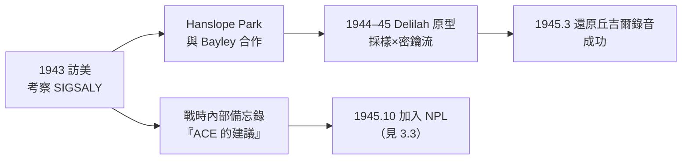

# 3.2 Delilah 語音加密與戰後（1943–1945）

1943 年至 1945 年，圖靈的工作從破解轉向**加密**：他在英國秘密電報偵查處（SCU）的 Hanslope Park 研製出**Delilah** 語音密碼機。同時，他開始在內部備忘錄中規劃戰後的「自動計算機器」——戰爭還沒結束，電腦的藍圖已經在他腦中成形。

## 背景：語音是戰時最脆弱的通道

- 無線電話（如丘吉爾與羅斯福的越洋通話）經過簡單的「倒頻」處理，可被德國人截聽還原；
- 美國的對策是貝爾實驗室的 **X System（SIGSALY）**：把語音採樣、量化，用一次性密鑰加密——體積佔滿一個房間，重達數十噸；
- 圖靈 1943 年訪美時在貝爾實驗室考察了 SIGSALY（與香農共事的單位，→ 詳見《香農傳記》第 3 章），並與香農討論了語音信號的數學本質；
- 英國需要一個**能裝進行李箱**的同類系統——這是 Delilah 的任務。

## Delilah：圖靈的工程首演

1943 年秋，圖靈調往 Hanslope Park 的無線電部門（SCU3），與工程師 Donald Bayley 合作研製 Delilah：

- **原理**：對語音信號**採樣並乘以一次性密鑰**（key-multiplication），密鑰來自偽隨機產生器；接收端做同樣運算即可還原——數學上 $E = S \times K$，$D = E \times K^{-1}$，其嚴格性可比擬一次一密；
- **採樣率與量化**：圖靈用電子管電路實現了音頻採樣與 30 級量化——實質上是一臺小型**數位信號處理器**；
- **密鑰產生器**：基於多級移位暫存器的偽隨機序列——這幾乎是**線性回饋移位暫存器（LFSR）**加密的先聲；
- 1944 年完成原型，1945 年春成功還原了丘吉爾的演講錄音，音質清晰可辨；
- 裝置小得可以放進兩個箱子——達成了「行動語音加密」的目標。

Delilah 的意義常被低估：它是圖靈**第一次把數學想法做成完整工作的電子機器**——設計、繞線、除錯、測試一手包辦。Bayley 回憶：圖靈「是我遇過最好的電子學夥伴」。這段實作經驗直接支撐他戰後設計電腦的底氣（見 3.3）。

### 香農的平行線

同年（1943–45）香農在貝爾實驗室完成**密碼學數學理論**的內部報告（1945 年機密報告，1949 年公開為《保密系統的通信理論》），證明一次一密的不可破解性。圖靈的 Delilah 採用的正是「密鑰流相乘」的同一數學族——兩人在 1943 年晚餐上無法談的秘密，戰後各自以論文與機器的形式公開交會（→ 詳見《香農傳記》第 3 章）。

## 戰後規劃：1945 年的「提案」明證

戰爭尾聲，圖靈的注意力飛快地轉向和平時期的機器：

- 1945 年，他向國家物理實驗室（NPL）提交任職申請，明言目標是「研製電子計算機器」；
- 他事後向 NPL 主任 Charles Darwin 呈交的機密備忘錄《自動計算引擎的建議》（1945–46）直接引用自己 1936 年的論文：**通用機**將以電子管實現；
- 他曾在 BP 內部（與 Donald Michie、Jack Good 等人）討論「Chess machine」「thinking machine」——戰時小屋裡的閒談，是 AI 的第一批口頭文獻（見 4.2）；
- 1945 年 10 月，圖靈正式加入 NPL，展開 ACE 設計（見 3.3）。

## 事件關聯與前因後果

| 年份 | 事件 | 後續影響 |
|------|------|----------|
| 1943 | 訪美考察，與香農深談 | 語音加密的靈感＋AI 議題的遠因 |
| 1943 秋 | 調 Hanslope Park | 離開破譯前線，轉入工程實作 |
| 1944 | Delilah 採樣／量化／密鑰流電路 | 數位信號處理的早期實踐 |
| 1945 春 | 成功還原丘吉爾錄音 | 機電工程能力的完整證明 |
| 1945 | 提交 ACE 建議；加入 NPL | 通用機走向硬體（見 3.3） |

**因果**：Delilah 的因果鏈是「**破譯者成為加密者**」——圖靈攻破 Enigma 的統計與邏輯，反過來化為自建系統的設計原則（一次性密鑰的嚴格性、偽隨機序列的生成）。而訪美之行是雙重催化：向香農與 SIGSALY 學到的，不只是語音加密的技術，更是「信號＝離散符號流」的世界觀——這正是 1948 年香農資訊理論的核心（→ 詳見《香農傳記》第 3 章），也預埋了圖靈「思維＝符號處理」的 AI 立場。戰後一切的伏筆都在這兩年寫下：數學（1936）＋工程（Delilah）＋組織（BP）＝一臺電腦的三個必要條件。

### 同期的世界（1943–1945）

| 年份 | 事件 | 與圖靈的關聯 |
|------|------|--------------|
| 1943 | Colossus 於 BP 運轉（攻擊 Lorenz，非 Enigma） | 圖靈的 Turingery 技巧是其分析源頭 |
| 1944 | von Neumann 加入 ENIAC 計畫（→ 詳見《馮紐曼傳記》） | 美國電腦路線啟動 |
| 1945 | 香農發表密碼學機密報告 | 與 Delilah 同一數學族 |
| 1945.7 | ENIAC 公開 | 「電子計算」時代來臨 |

## 小結

- 1943–45 年，圖靈完成了從**密碼分析者到機器建造者**的轉型，Delilah 是他工程能力的畢業證書；
- Delilah 的採樣—量化—密鑰流架構，在今日眼光下是一臺微縮的數位通訊系統，與香農的理論互為印證；
- 戰爭結束前，圖靈已完成電腦藍圖的思想準備：通用機（1936）＋Bombe 的機電經驗（1940）＋Delilah 的電子經驗（1945）；
- 1945 年 10 月，他帶著這三份遺產走進 NPL——下一段，ACE 的設計與「儲存程式」概念的制度化之爭（見 3.3）。
