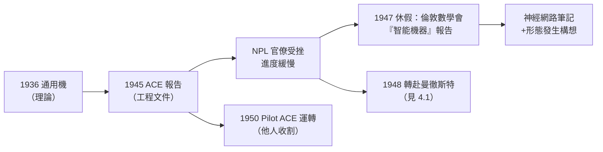

# 3.3 NPL ACE 設計與儲存程式概念（1945–1947）

1945 年 10 月，圖靈加入倫敦郊外的**國家物理實驗室**（National Physical Laboratory, NPL），在數學部展開**自動計算引擎**（Automatic Computing Engine, ACE）的設計。這是「圖靈機」第一次成為工程文件——1936 年的紙帶機，即將變成一臺真實的電子機器。

## 1945 年 11 月：ACE 報告

1945 年 11 月至 1946 年 2 月，圖靈寫成《自動計算引擎的建議》（*Proposals for the Development in the Mathematics Division of an Automatic Computing Engine*）——史上最詳盡的早期電腦設計文件之一：

- **完整架構**：高速**水銀延遲線**記憶體（聲波在汞柱中循環）、磁帶外存、輸入輸出、控制邏輯一應俱全；
- **儲存程式**：程式與資料同樣以數字形式存入記憶體——他直接引用自己 1936 年的通用機論證：「一臺機器可以改變自己的指令表」；
- **速度指標**：要求時脈 1 MHz、延遲線記憶，遠超當時 ENIAC 的水準；
- **簡潔硬體**：圖靈堅持「硬體極簡、功能靠指令實現」——乘法、甚至偽隨機數，都由指令序列完成，控制電路因此極小。

### 儲存程式概念的歸屬問題

「儲存程式」的思想在 1945 年前後多點獨立出現：

| 路線 | 代表 | 特徵 |
|------|------|------|
| 圖靈理論先行 | ACE 報告（1945） | 直接源自通用機（1936），指令＝資料有嚴格論證 |
| EDVAC 報告 | von Neumann（1945，→ 詳見《馮紐曼傳記》） | 對 ENIAC 缺陷的工程修正＋邏輯組織 |
| 實作先行 | Manchester Baby（1948）、EDSAC（1949） | 先造出來再說 |

歷史公允的說法：**von Neumann 的 EDVAC 報告是流傳最廣的文獻**（故稱「馮紐曼架構」），而**圖靈的 ACE 報告在時間與理論深度上並不落後**，且兩人戰時已相互知曉。圖靈本人對「von Neumann 架構」這個命名未置一詞——他一向不愛爭名。

## 理想的挫折

ACE 計畫很快撞上英國的官僚現實：

- NPL 的電子工程能力不足，圖靈的 1 MHz 願景被削減為保守方案；
- 計畫被拆分：圖靈被要求先做「微型」試驗機（Pilot ACE），實際上由 **Jim Wilkinson** 與 Harry Huskey 主持工程細節；
- 1947 年，圖靈對 NPL 的進度徹底失望，申請休假回劍橋一年；
- 1948 年，他正式辭去 NPL 職務，轉赴曼徹斯特（見 4.1）——ACE 與他從此無緣。

### Pilot ACE 的後話

諷刺的是，圖靈離開後的 1950 年，**Pilot ACE 運轉成功**：1950 年 5 月 10 日首次正式運行，是英國最早運轉的電腦之一，商業衍生機 DEUCE 銷售良好。Wilkinson 後來獲圖靈獎（1970，表彰數值線性代數）。歷史再一次：**圖靈播種，他人收割**。

## 劍橋休假（1947）：神經網路與「機器智能」的醞釀

1947 年的休假期間，圖靈做了兩件影響深遠的事：

1. **在倫敦數學會報告「智能機器」**（1947 年 2 月 20 日，倫敦數學會）：提出「機器可以學習」「可能需要進化式的訓練而非硬編程」——〈計算機器與智能〉（1950）的直接前身；
2. **研究電子神經網路**：筆記中設計了模擬神經元連接的 B 型無組織機器（B-type unorganised machines）——**連接主義**的先聲，比 Rosenblatt 的感知機早了十年；
3. 同期他還研究 Programming（ACE 的指令系統設計）與化學：此時他已開始思考「兩種化學物質的反應—擴散如何生成圖案」——形態發生理論的萌芽（見 4.1）。

## 事件關聯與前因後果

| 年份 | 事件 | 後續影響 |
|------|------|----------|
| 1945.10 | 加入 NPL | 電腦設計的正式起點 |
| 1945.11–46.2 | ACE 報告完成 | 儲存程式的最完整早期文獻之一 |
| 1946 | 與 EDVAC 路線並行 | 兩大設計傳統的分岔 |
| 1947 | 休假，倫敦數學會「智能機器」報告 | AI 的先聲（見 4.2） |
| 1948 | 辭 NPL，轉曼徹斯特 | 播種已畢，開花在別處 |
| 1950 | Pilot ACE 運轉 | 英國電腦實業的間接起源 |

**因果**：ACE 時期的因果是「**理論需要機構，機構拖垮理論家**」的經典劇本。**前因**：1936 的通用機使圖靈的設計有哲學根基；BP 與 Delilah 使他有工程直覺。**過程**：NPL 的官僚體系無法消化一個領先時代五年的設計——圖靈的極簡硬體思想對工程師太抽象，1 MHz 的目標對經費太昂貴。**後果**：圖靈離開，Pilot ACE 在他缺席下運轉；而他本人轉赴曼徹斯特，把「智能機器」的火種帶到了新戰場。與此同時，von Neumann 在美國的 EDVAC 路線贏得了命名權——兩位邏輯學家，一個贏了文獻傳播，一個贏了思想原創。

### 同期的世界（1945–1948）

| 年份 | 事件 | 與圖靈的關聯 |
|------|------|--------------|
| 1945 | von Neumann 的 EDVAC 草案（→ 詳見《馮紐曼傳記》） | 儲存程式的另一源頭 |
| 1945 | 香農的密碼學報告成文（→ 詳見《香農傳記》第 3 章） | 戰後資訊理論蓄勢 |
| 1946 | ENIAC 公開；Turing 記錄其缺陷 | ACE 設計的直接對照組 |
| 1948 | Manchester Baby 運轉；香農發表資訊理論 | 圖靈的兩位同代人同年開花 |

## 小結

- ACE 報告（1945）是圖靈機的工程化身：**儲存程式、極簡硬體、指令即資料**，理論脈絡直通 1936 年；
- NPL 的組織失能讓圖靈失去了親手造機的機會——他一生最接近「工程師」的時刻，被官僚主義終結；
- 1947 年休假反而完成了兩份重要遺產：「智能機器」報告與神經網路筆記——AI 的兩條路線（符號與連接）在他 1947 年的筆記裡已同時現身；
- 1948 年，圖靈投奔曼徹斯特大學的實機——下一段，曼徹斯特機、程式設計的誕生，以及比電腦更早成形的生物學之問（見 4.1）。
