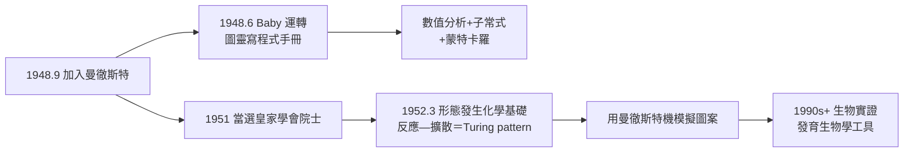

# 4.1 曼徹斯特機與 Morphogenesis（1948–1952）

1948 年 9 月，圖靈接受**曼徹斯特大學**的職位（實際工作場所是皇家學會計算機實驗室），擔任 Newman 手下的副主管。這五年是圖靈生命最後的創造期：白天為世界第一臺儲存程式電腦寫程式，夜裡推演生物的圖案從何而來——兩者在他身上從不衝突。

## 曼徹斯特機：第一臺真正的「程式」

曼徹斯特大學的 **Baby**（Small-Scale Experimental Machine）於 1948 年 6 月 21 日運轉，是世界上第一臺以**威廉斯管**（Williams tube，陰極射線管儲存）為記憶體、執行儲存程式的電子電腦。圖靈 1948 年加入後：

- 為機器撰寫了**程式設計手冊**（Programming Handbook, 1950）與大量實用程式——他是最早思考「如何為機器寫程式」的人之一；
- 發明了**子常式**（subroutine）與「程式庫」的系統性用法，以及用隨機數做數值積分的蒙特卡羅方法實作；
- 做了**數值分析**工作：Routh 行列式、矩陣特徵值的誤差分析（1948 年論文），把劍橋時期的誤差理論（見 1.2）兌現；
- 他對機器的態度務實而幽默：昵稱它「MUC」（Manchester Universal Computer），並寫下「機器的記憶體比我的好」之類的自嘲。

### Newman 的居中作用

Max Newman（紐曼）是這一切的中介：他是把圖靈引向邏輯的人（見 1.3），戰時也在 BP（Hut 8 之外的 Tunnel 部分），戰後在曼徹斯特籌建計算機實驗室並拉來皇家學會資助。沒有紐曼，圖靈可能永遠停留在 NPL 的公文堆裡。

## Morphogenesis：生命的圖案從何而來

1951 年，圖靈當選**皇家學會院士**（F.R.S.）——表彰的不是電腦，而是他 1930 年代以來的數學工作（及戰時勳績的默認）。當選後他立刻把主要精力投向**數理生物學**：

### 反應—擴散理論

1952 年 3 月，圖靈在《哲學會刊》（*Philosophical Transactions of the Royal Society B*）發表〈形態發生的化學基礎〉（*The Chemical Basis of Morphogenesis*）：

- **核心問題**：胚胎細胞在化學上近乎均勻，為何會分化出條紋、斑點、節段？
- **答案**：兩種（或多種）化學物質（他稱 morphogens，形態發生素）以不同擴散速率互動作用，可使**原本均勻的系統自發失穩**，形成週期性圖案——即所謂 **Turing pattern**（圖靈圖案）；
- 數學上：他分析反應—擴散方程 $\partial u/\partial t = f(u,v) + D_u \nabla^2 u$ 的線性穩定性，證明「擴散」（通常被視為均質化力量）在**雙物質反應系統中反而製造不均勻**；
- 他用曼徹斯特機**數值模擬**了圖案的形成——這是電腦模擬生物系統的最早案例之一。

這項工作與他少年時對雛菊花瓣、松果螺旋的著迷（見 1.1）首尾呼應——1930 年謝伯恩的那個孩子，最終用偏微分方程解釋了自己在草地上看到的秩序。

### 後話

- **1952 年**正是理論發表之年，也是圖靈被捕之年（見 4.3）——理論的推廣因他的身故而中斷近二十年；
- 1990 年代起，生物學家在**條紋魚、斑馬紋、海膽、口器形成**等系統中證實圖靈圖案；2012 年起有實驗直接觀測到 morphogen 對（如 Nodal/Lefty）的圖靈動力學；
- 反應—擴散理論今日是**發育生物學、合成生物學**的標準工具，也是複雜系統科學「自組織」概念的經典例證。

## 兩個領域的內在統一

表面看，電腦與生物學毫不相干；在圖靈那裡是同一件事：

- **通用機**（1936）：有限規則產生任意計算；
- **Bombe**（1940）：有限規則淘汰矛盾；
- **圖靈圖案**（1952）：有限規則自發生成複雜秩序；
- 三者共同的信念：**複雜性可以由簡單的、機械的規則湧現**——這正是「機器能否思考」（見 4.2）與「生命如何成形」（本節）共享的形上學。

## 事件關聯與前因後果

| 年份 | 事件 | 後續影響 |
|------|------|----------|
| 1948 | 辭 NPL，入曼徹斯特；Baby 運轉 | 儲存程式電腦時代開始 |
| 1948 | 〈數值分析中的舍入誤差〉 | 程式設計與數值計算的制度化 |
| 1950 | 程式設計手冊；發表〈計算機器與智能〉 | 軟體概念與 AI 藍圖（見 4.2） |
| 1951 | 當選皇家學會院士 | 轉向生物學的正當性資本 |
| 1952.3 | 形態發生論文刊出 | Turing pattern 成為發育生物學基石 |
| 1952.2 | 同年 2 月被捕（見 4.3） | 理論推廣被迫中止 |

**因果**：曼徹斯特時期的因果鏈雙向纏繞。**前因**：紐曼的招募使他脫離 NPL 泥沼；曼徹斯特機使他第一次擁有「可以跑模擬的通用機」——沒有這臺機器，形態發生論文只是分析數學，有了它，才是可檢驗的動力系統。**後果**：反應—擴散理論在他死後三十年成為生物學主流；而「用電腦模擬自然過程」這一做法本身，開創了計算生物學。更深的因果：他 1947 年的「機器學習」筆記（見 3.3）與 1952 年的「生物自組織」論文共享同一個問題——**秩序從規則中湧現**；AI 與發育生物學，是同一個問題的兩個化身。

### 同期的世界（1948–1952）

| 年份 | 事件 | 與圖靈的關聯 |
|------|------|--------------|
| 1948 | 香農發表資訊理論（→ 詳見《香農傳記》第 3 章） | 離散符號流的統一世界觀 |
| 1948 | Wiener 的控制論問世 | 「回饋與湧現」的同源思想 |
| 1949 | EDSAC（劍橋）運轉；Wilkes 引用圖靈的子常式思想 | 英國電腦生態成形 |
| 1951 | UNIVAC 預測選舉結果 | 電腦進入公眾視野 |
| 1952 | 麥卡錫籌劃達特茅斯提議（→ 詳見《麥卡錫傳記》） | AI 學科的臨盆（見 4.2） |

## 小結

- 1948–52 年，圖靈在曼徹斯特完成了**軟體誕生期的關鍵工程**（程式設計、子常式、數值方法）；
- 1952 年的形態發生論文把「計算」的視野從人工物擴展到生命：**Turing pattern** 證明簡單規則可湧現生物圖案；
- 他一生三個身份——邏輯學家、密碼破譯者、生物數學家——共享同一條信念：**機械規則的深不可測**；
- 1952 年 3 月論文刊出時，圖靈正因同性戀被起訴（見 4.3）——創造力與迫害在同一個月交錯；
- 下一段，回到 1950 年那篇把「機器能否思考」變成可操作問題的經典（見 4.2）。
